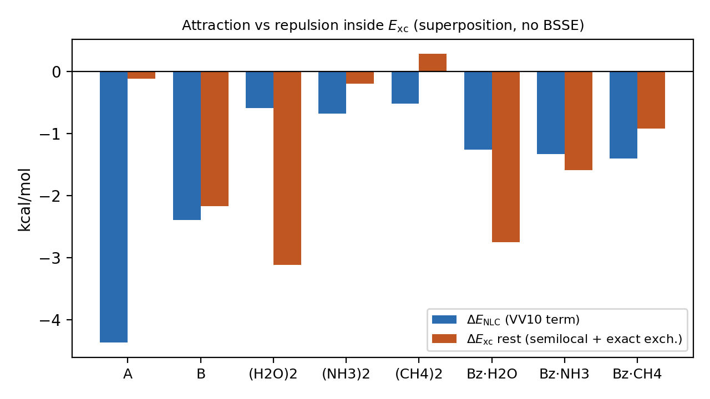
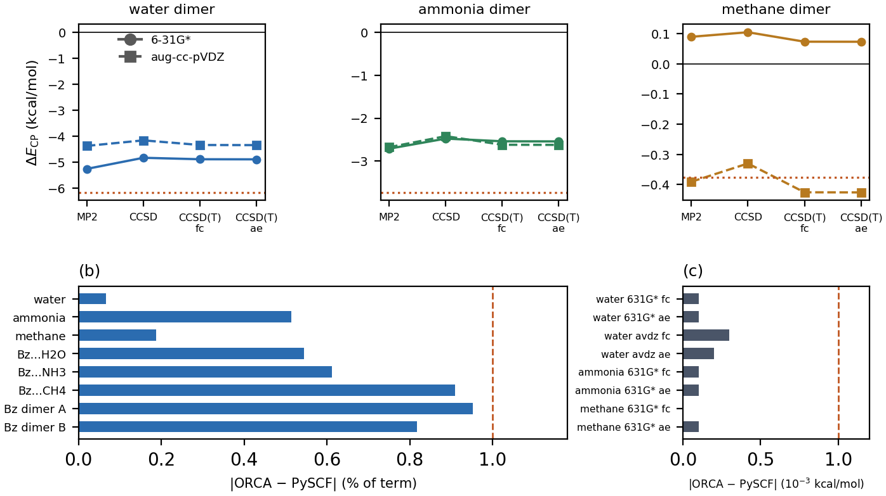
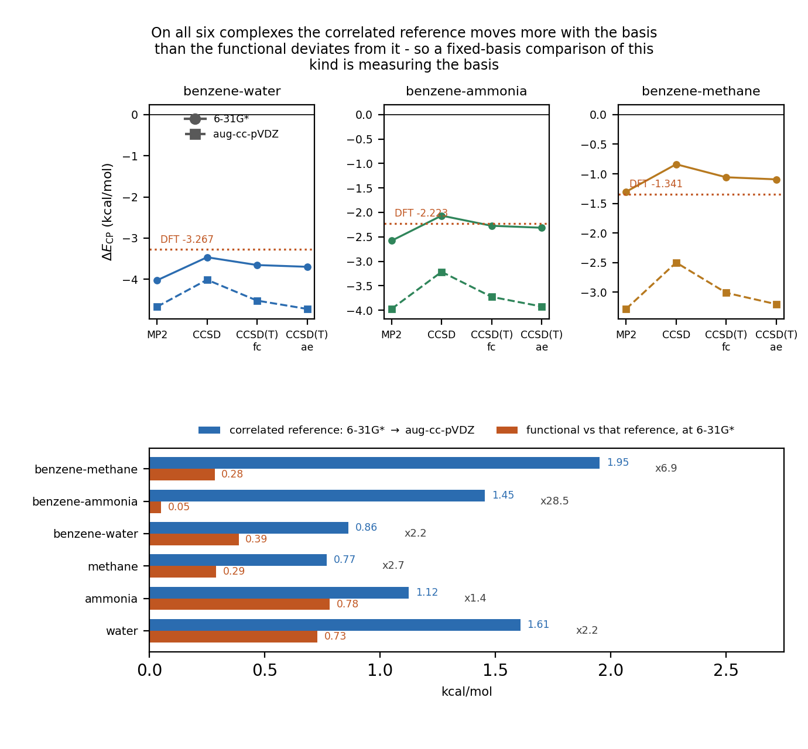
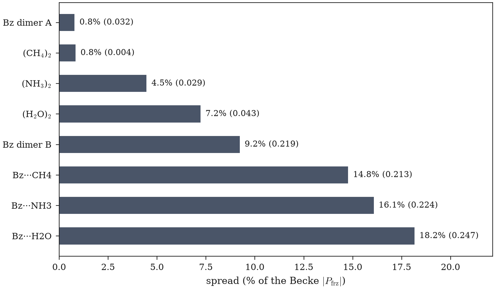
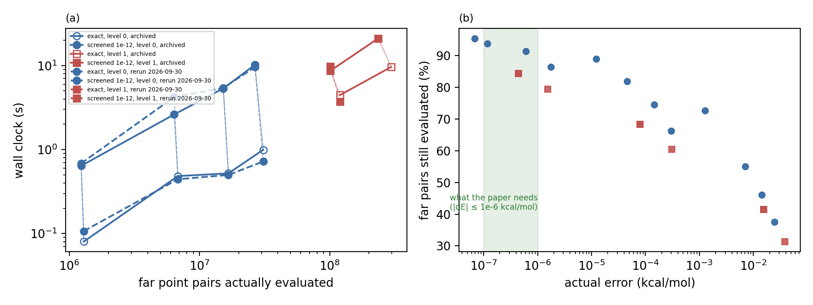

# 外部评审请求书 · 2026-10-14 · v1

**这份文件要你做三件事**：(1) 判六个悬而未决的口径门与两件授权；(2) 审我们这条证据链本身可不可信；(3) 指出我们没想到的失效模式。
它的定位不是"帮我们总结"，而是**接受攻击**。§7 列了我们自己最想让你打的地方。

被评审对象：`E:\Project\GAMESS\nlcsplit\`（方法与包）+ `E:\Project\GAMESS\paper\main.md`（正文，附录 A 逐字节随附）。
本文件是**自包含**的：不需要访问我们的仓库就能判；所有数字旁边都标了原件路径与本档的取证等级（§0.3）。
与本文件配套的前一份是 `E:\Project\GAMESS\TASK-BRIEF-20261014.md`（2026-10-14 21:22 落盘，按验收台账组织）。**本文件不替代它**，区别在：那份按"四条验收"横切，本份按"事情怎么一步步走到今天"纵切，并补了本会话新查出的三条缺口（§7.1、§7.2、§7.4）。

---

## 0. 使用须知

### 0.1 你要判的题面（原文，不作摘要）

作者定的目标原文（四条验收，全部机器可判，缺一不可）：

> 把 nlcsplit 与 paper/main.md 推到"审稿人一条命令能复现正文每一个数"的投稿就绪态。
> 【1 数据面】正文每张表每一格都有可复查的 `.out` 原件（带 `# exit=` 自写行与 `.rc`），且表由脚本从原件现算、零手抄。待做 W4：满 S22 十四格 + 至少一类异质体系。
> 【2 发布链】由 `node tools/make_public_repo.js` **从导出树**出货的 wheel 满足：`certificate.py` 与测试模块随包；装到一次性 `--target` 目录、树外 cwd 跑 pytest 全绿；`evidence/release_qa/` 下 census / member-diff / 树外 pytest 三份归档齐。
> 【3 口径】现在时计数全部由新 census 改口，不手抄。
> 【4 卫生与收口】`claim_gate` 与 `precommit_gate` 均 rc=0；`staleManifests()=0` 且逐目录无条目消失；未提交条目归零（只能 Windows 侧提交，且需作者单独授权）。

**现状：四条一条未齐。** §5 给逐条判决。

### 0.2 你不能假设的事

- 你不能重跑任何计算（PySCF 只装在我们这台机器的 WSL 里；6-31g\* 的复合物 SCF 一次几十秒到几小时）。
- 我们的**所有**数值判据都是我们自己写的。没有任何一个门是外部标准。这是本条链最大的结构性弱点，见 §7.6。
- 归档里的数只印到 **4 位小数**（`%.4f`），所以"逐位复现"在我们这里等于"≤1e-4"，不是字面意义的 bit-for-bit。

### 0.3 取证等级（本文件每个数都带标记）

| 级 | 含义 |
|---|---|
| **A** | 本次评审书写作会话（2026-10-14 晚）**我自己跑命令读到的**，命令与输出附在附录 D |
| **B** | 记在台账/决策件里并指回某份 `.out`，本轮**我没有重跑**那个命令 |
| **C** | **只在散文里**（NOTE 或台账），盘上找不到落档原件 —— 这类我们主动标出来，见 §7.1 |

本文件的诚实性由这个标记保证：**C 类一共 4 处，全部写明了。**

---

## 1. 起因：这项工作为什么存在

主线最初是往 GAMESS 里移植 ωB97X-V。那条线 2026-09-28 已判死：改过的 `rhfuhf.src` 让多中心 RHF 收敛到**错误的解**，那棵树的全能量不可用（`A: 本会话读到项目记忆与 HEAD 提交信息一致；GAMESS 源码未进本仓任何证据链`）。

活下来的问题是另一个，一个方法学问题：

> **ωB97X-V 的非局域关联（VV10）项，能不能在数值网格上拆成"片段 A / 片段 B"的归属？**

它值得问，是因为所有做能量分解的人都会碰到同一个动作：把非局域项当成一个总数挂在复合物上，或者干脆按 `1/n` 摊。而 VV10 是**双中心非局部**的积分，它对区域的依赖不是点态的，所以"这块能量属于哪个片段"这件事**没有唯一定义**。

论文的当前结论形状（数据口径已定，措辞待作者点头）：

> **归属歧义长在标准工具链内部**——它不是我们实现的毛病，是 PySCF 这类通用代码里"换个归属方案会连积分网格一起换"这件事的副产品；**换到家族外构造（Voronoi 硬指派 / Hirshfeld 库存化）既不消除也不放大**这个跨度。

这个形状是六天里被自己的实测一步步改出来的，不是设计出来的。§3 是全过程。

---

## 2. 正文的关键表：Table 1（口径必须先讲清，否则后面全读错）

`paper/main.md:815-824`，**A 级**（本会话原文读取，且 `main.md` 的 sha256 与 `HEAD` 版本逐字节相同：`38e548cdfe574956ce4122bf857291675b6b75f5d3c4376933c09d5f0e00f5c2`，1435 行 / 145328 B）：

```
| System | P_frz (Becke) | span, own grids | relative | attribution only, one grid | quadrature only, totals | attribution / quadrature |
| methane dimer | -0.474 | 0.004 | 0.9% | 0.0034 | 0.0026 | 1.29 |
| benzene dimer (A) | -4.038 | 0.032 | 0.8% | 0.0274 | 0.0082 | 3.32 |
| ammonia dimer | -0.649 | 0.029 | 4.5% | 0.0284 | 0.0016 | 18.22 |
| water dimer | -0.601 | 0.043 | 7.2% | 0.0433 | 0.0001 | 352.14 |
| benzene dimer (B) | -2.371 | 0.219 | 9.2% | 0.2195 | 0.0085 | 25.81 |
| benzene...methane | -1.442 | 0.213 | 14.8% | 0.2143 | 0.0018 | 121.66 |
| benzene...ammonia | -1.393 | 0.224 | 16.1% | 0.2219 | 0.0026 | 84.44 |
| benzene...water | -1.360 | 0.247 | 18.2% | 0.2468 | 0.0002 | 1046.15 |
```

三件必须知道的事：

1. **第 3 列**（span, own grids）是历史发表口径：四个归属方案**各自用自己的网格**。PySCF 里"换 partition scheme"会连网格一起重建，所以这一列**同时装了两个效应**（归属 + 求积）。
2. **第 5 列**（attribution only, one grid）才是纯归属跨度：同一次 SCF、同一个网格、只换权重。**第 6 列**是纯求积（同权重、只换网格）。第 7 列是两者之比。
3. 第 7 列跨**三个数量级**（1.29 到 1046）。这不是 bug，是结论的一部分：甲烷那格两个效应差不多大（1.29），苯-水那格归属效应是求积效应的千倍。

**已知的一处不符**：**B 级**，`AUDIT-acceptance-20261014.md:24`。`check_table1_transcription.py` 的 `check_span_cols()` 用未舍入值重算比值 ⇒ 第 3 列 8/8 逐字命中、第 4 列 **7/8** 一致，唯一不符是甲烷：机读源 `nlcsplit/logs/step_h.json` 给 0.84%（应写 `0.8%`），正文 `main.md:817` 写 **`0.9%`**。这是 G2 的落点之一（§6.2）。

---

## 3. 前因后果主链

每小节统一四段：**起因 → 实测 → 判决 → 后来被推翻或加固的地方**。

### 3.1 家族内八格：把"两个效应"拆开

- **起因**：第 3 列混了两个效应，正文必须能说出各自多大。
- **实测**：同一次 SCF、同一网格下穷举四个家族内归属方案，得第 5 列；固定权重换网格，得第 6 列。八体系。
- **判决**：§2 那张表成立，且由 `step_*.py` 从原件现算。
- **加固**：这一列后来被 `check_table1_transcription.py` 升到"共现级"凭据（同一档里能同时读到一行的所有数）——**A 级**确认第 3/4 列的比对判据存在于 `tools/check_table1_transcription.py`；7/8 与 0.84% 那两处是 **B 级**。

### 3.2 独立裁判线全灭（这是 G1 的由来，也是本工作的天花板）

我们想回答审稿人一定会问的一句："**谁验证了你的 VV10 核？**"。四条外部路全试过，全断：

| 候选裁判 | 结果 | 凭据（**B 级**，整目录在 `evidence/rvv10_referee/`，7.9 MB，未跟踪） |
|---|---|---|
| PySCF 自带核 | W0 判死"PySCF 把 rVV10 做成 VV10 是实现缺陷"这个假设——两档残差同量级，真正的错是**我们自己把 `-rV` 的参数记错**（`WB97M_V` 给 (6.0, 0.01) 是对的） | `probe_nlc_parameter_authority.py` 及其档 |
| libxc | 7.1.2 只导出 `xc_nlc_coef`；`xc_nlc_vxc`/`xc_nld_vxc`/`xc_vdwnl_kernel`/`xc_setup_kernel`/`xc_run` **全不存在** ⇒ 当不了任何一臂的裁判（但 `SCAN-VV10`(584) 与 `SCAN-RVV10`(292) 确实是不同功能号） | 同上 |
| libvdwxc | 档内 `vv10` 字样**零命中** | 同上 |
| Psi4 | 不实现 rVV10 | 同上 |
| CP2K | R4 查明 `&NON_LOCAL TYPE` 枚举里**没有 VV10 核形** ⇒ 能做 A−B 同码对照的前提不成立；按自定停机判据收口，留档可复跑 | `r4_cp2k_form_test.py` |
| ORCA | 唯一真锚点，但只做到**单体**：水单体 matched-spherical 6-31g\*/level-1 差 **2–3e-4 kcal/mol**（旧档的 6e-4 是同锚不同口径，不是矛盾） | `evidence/orca_widen/`，24 份 run，**B 级** |

- **后果**：JCTC 那篇文章的 C3（"独立第三方验证了核"）**两条腿都没了**。要补只能自己实现 rVV10 阻尼核再找裁判——本机没有可用的第三方裁判。这是 G1（主投 JCTC → JCP）的全部依据。

### 3.3 家族外构造第一次测量：**整列作废**（本仓最贵的一次错）

- **起因**：审稿人会说"你只测了 Becke 家族内的四个方案"。要顶住就得给**家族外构造**：Voronoi（最近原子硬指派）与 Hirshfeld（自由原子库存化）。
- **错在哪**：`evidence/common_grid/hirshfeld_crossfamily.py:87` 用 `atom_coord(a, unit="Angstrom")` 拿**Å 坐标去减 Bohr 网格坐标**。真实单位口径错，不显眼、不报错、结果看着合理。
- **代价**：那一版跨构造八格**整列作废**。被撤回的数：**带顶 0.3898、苯-水 +0.1430、甲烷比值 12.17、苯二聚体(A) 8.06**（**B 级**，`FINDING-20261011-hirshfeld-unit-and-determinism.md:18/30/36` + 修正档里故意保留的"旧值(Å)"对照列）。
- **最直接的伤害**：正文曾据 0.3898 说"跨构造带顶在 0.39 附近"，撤回动作落在 git 提交 `c6fb533`（**A 级**，HEAD 前三条之一）。
- **运气好在哪**：假数**从未进过 `main.md`** ⇒ 无需勘误。这一点请你重点审（§7.5）。

### 3.4 修正版八格：家族内带 0.0034–0.2468

- **实测**：单位修正后重测，同一构造函数、同一网格档，并加一条与归属方案无关的总量对照 `E_nl`（这条是本仓规矩：任何"复现已归档读数"的脚本必须带它，否则整列同号同幅的残差会被误读成实现有系统偏差）。
- **结果**（**B 级**，`evidence/common_grid/20261013T141002Z_after_unitfix_summary_table.out` 第 15–17 行，`VERDICT OK` 第 19 行）：家族内带 **0.0034–0.2468**、跨构造带 **0.0088–0.2746**、绝对增量 **≤0.0393**；水那格 Hirshfeld 增量 0.0214 → **0.0000**。
- **意义**：结论从"换家族外构造会放大歧义"改成"**既不消除也不放大**"。定性方向没变，量级变了很多。

### 3.5 Hirshfeld 那一列不可逐位复现：病因走了三步才对

这一步是现在所有卡点的根，请细读。

1. **第一版解释**："两份实现分叉"（包内 `partition.hirshfeld_factors` vs 包外 `free_atom_soft`）。**被否**：互比 1.47e-1 比自比 6.6e-1 **还小** ⇒ 在这个尺度上"谁分叉"无从谈起。
2. **第二版解释**："开壳层自由原子 UHF 近简并、换解了"。**当时看着对，但差点被当成结论**——重复 5 次里 H/C/N 的 ΔE 与 Δ1-RDM 精确为 0、`n_zero` 恒 0。
3. **第三版＝现在的病因：BLAS 线程数**。`A 级`（本会话逐字读了四份档）：

```
T=1  rc=0  包内两次 = 0.000e+00  互比 max|ΔS| = 0.000e+00  VERDICT IDENTICAL
T=2  rc=3  包内两次 = 8.509e-02  互比 max|ΔS| = 6.095e-01  VERDICT NOT_REPRODUCIBLE
T=4  rc=3  包内两次 = 7.103e-01  互比 max|ΔS| = 6.611e-01  VERDICT NOT_REPRODUCIBLE
T=8  rc=3  包内两次 = 7.107e-01  互比 max|ΔS| = 7.020e-01  VERDICT NOT_REPRODUCIBLE
（evidence/common_grid/20261013T181611Z_thread_sweep_summary.out，# exit=0 at 2026-10-13T18:20:35Z）
```

形状是 **1 与 >1 的阶跃**，不是"越多越抖"的连续量。同前缀的四份明细档给出**抖动的点覆盖面**（体系=苯-氨，16 原子，58448 个网格点，**A 级**）：

```
T=1  >1e-3 的组合 0 个      分布在 0      / 58448 个点上（0.0000%）
T=2  >1e-3 的组合 31523 个  分布在 12468  / 58448 个点上（21.3318%）
T=4  >1e-3 的组合 129827 个 分布在 36283  / 58448 个点上（62.0774%）
T=8  >1e-3 的组合 126612 个 分布在 36530  / 58448 个点上（62.5000%）
```

机制链（`NOTE_hirshfeld_two_implementations_20261013.md §十二`）：开壳层 C/N 的近简并 p 壳层 ⇒ 线程数改变 UHF 迭代轨迹 ⇒ 轨道在简并子空间里转到**能量相同但密度不同**的解 ⇒ `w_A = ρ_A/Σρ` 把它放大 ⇒ `E_AB` 动 ~1e-2。关键实测：**能量只差 1e-14 Ha，但 1-RDM 哈希不同**（`A 级`：`20261013T183207Z_free_atom_cross_thread.out` 存在，rc=3；H 全程"同"，C/N 在 T=2/4/8 全"异"）⇒ **只看 `e_tot` 会漏判**。单线程跨三个独立进程逐位相同：`A 级`，`20261013T183432Z_single_thread_repeat_across_processes.out:6` = `VERDICT SINGLE_THREAD_IS_REPRODUCIBLE`。

### 3.6 门的建立与自我作废（这件事你必须知道）

- `HIR_TOL = 1e-3`：**A 级**存在于 `summarize_s22_full.py:28`。它的来历是**按水二聚体一格的成功标定的**，然后外推给全表。
- `TOL = 1e-4`（证书复现门）：同一个错，第二次犯。
- 台账已把这两个门**判为作废**（**B 级**，`TASK-BRIEF-20261014.md §三.3`）。
- **但今天的 STOP 仍然是这两个门做出来的**（§3.8）。这不是疏忽，是个需要你判的哲学问题：**用一个自己宣布没有依据的门去阻断收口，算诚实还是算自证闭环？** 我们的立场是：STOP 的判决力不来自那个数字，而来自**超门幅度是门的 6–13 倍**这个量级分离。请审这个立场（§7.2）。

### 3.7 决定性 A/B：同一格只差线程就翻绿

`A 级`，我把两份档整份读了：

```
20261013T192727Z_certificate_reproduction_l1_methanedimer_th4.out
   hirshfeld  certify -0.4799  归档 -0.4797  差 2.34e-04 OVER
   界 lo -0.4799 (hirshfeld)  hi -0.4709 (voronoi)  span 0.0090  归档跨度 0.0088  差 2.18e-04
   E_nl 跨方案极差 = 3.553e-15    E_nl certify -9.3976 归档 -9.3976 差 0.0000（门 0.005）OK
   VERDICT REFUSED —— [('hirshfeld', 0.00023368...), ('span', 0.00021828...)]
   # 体系=甲烷二聚体  线程=4  门 TOL=1e-4    # exit=1 at 2026-10-13T19:45:14Z

20261013T200051Z_certificate_reproduction_l1_methanedimer_th1.out
   hirshfeld  certify -0.4798  归档 -0.4797  差 5.46e-05 OK
   span 0.0088  归档跨度 0.0088  差 3.92e-05
   VERDICT DONE     # 体系=甲烷二聚体  线程=1   # exit=0 at 2026-10-13T20:21:05Z
```

氨格 `A 级`：`20261013T202326Z_..._ammoniadimer_th1.out` `VERDICT DONE`，跨度差 1.36e-05。水格在 T=1 也 `DONE`，但**水格在 T=4 本来就过 ⇒ 它不能当 A/B 用**（这条我们自己标过）。

代码漂移已排除：**B 级**，对比档 `20261013T053243Z_crossfamily_inpackage_check` 抬头自报 `git HEAD df8ff66`、`partition.py ec6c0c56…`、`nlc.py 2817acd6…` 与工作树逐一相同。

### 3.8 满 S22 批与收口 STOP

- **批**：22 格，本机 20 核，并发 6/5/3/2、线程 3/4/6/10，**没占集群**。**A 级**：23 份 `*s22_full_certificate*.out` 共 92 KB；首份档戳 `20261013T152306Z`；守望档 `20261014T005551Z_watch_batch.out` 自落 `# exit=0 at 2026-10-14T02:56:29Z` ⇒ 我按这两个戳现算 **11 h 33 m 23 s**；台账记 **11 h 32 m 37 s**（差 46 s，因为它取批驱动自己的止戳 02:55:43Z）。
- **一份孤儿档**：**A 级**，`20261013T152010Z_..._S22_03_l1_small.out` 只有抬头没有判语、**没有 `.rc`**（为"先定价再开批"起、出数前主动停）。表脚本只取 `rc=0` ⇒ 自动排除，并在表尾"被排除在外的档"里点名。留档不删。
- **满表读数**（`A 级`，`20261014T030330Z_summarize_s22_full_table.out` 第 34/35/38/39 行，表体 22 行）：

```
家族内带 = 0.0034–0.3030（22 格）
含家族外总跨度带 = 0.0088–0.3586（22 格）
同核：12 格 家族内带 0.0034–0.2342，含家族外总跨度带 0.0088–0.2373，绝对增量 中位 0.0051/最大 0.0781，增量÷家族内跨度 0.00–6.07
异质：10 格 家族内带 0.0381–0.3030，含家族外总跨度带 0.0525–0.3586，绝对增量 中位 0.0216/最大 0.1079，增量÷家族内跨度 0.00–2.83
未分类：0 格
```

- **逐列交叉认证 8 行**（`A 级`，同档第 47–55 行）：

```
S22_02 水二聚体   六列 → OK×5, OK +0.0001
S22_01 氨二聚体   六列 → OK×6（全 +0.0000）
S22_08 甲烷二聚体 六列 → OK×6（全 +0.0000）
S22_17 苯-水     六列 → OK×5, OK +0.0001      ← 历史上被 0.3898 拖累的那格，现在干净
S22_11 苯二聚体(A) 六列 → OK×5, OVER +0.0064
S22_20 苯二聚体(B) 六列 → OK×5, OVER +0.0079
S22_18 苯-氨     六列 → OK×5, OVER +0.0130
S22_10 苯-甲烷    六列 → OK×5, OVER +0.0093
!! 有列新旧不符：[('S22_11','hirshfeld',0.0064,0.001), ('S22_20',0.0079), ('S22_18',0.0130), ('S22_10',0.0093)]
# exit=1 at 2026-10-14T03:03:32Z
```

⇒ **八格里 4 格六列全过、4 格只错 Hirshfeld 一列。** 超门四格（24/24/17/16 原子）都比过格的苯-水（15 原子）大——我们**故意不**把它写成标度律（样本只有八格）。
- **收口 STOP**（`A 级`，`20261014T025620Z_w4_closeout.out` 全文 450 B）：

```
# W4 满表收口  起始 2026-10-14T02:56:20Z  host=Haangyeon
# git HEAD df8ff6680556d74f88454148245f361294fdfed8
## 步 1：summarize_s22_full.py 出满表
wrote 20261014T025620Z_summarize_s22_full_table_closeout.out rc=1 bytes=7023
STOP —— 满表还出得来不了（上面列了缺哪些格）。
   清单**没动**：这正是本脚本存在的理由，别让'先把清单跑绿'插到表前面。
# exit=1 at 2026-10-14T02:56:25Z
```

### 3.9 一个我们自己的静默漏（值得单独一节）

交叉认证的旧档键原先取**文件名**。苯-水那格的档名是拉丁 `benzwater`、其余七格是中文 ⇒ **那一格被静默丢掉**，我们上一轮说的"八格认证"其实只有 7 格，而且不报错。
修法：键改成取**档内自报的体系名**（抬头 `== <体系名> … 片间min …` 那行），档名与档内名不一致就打一条留痕、档内名读不出就打 `!!` 报警而不是退回档名硬撑。**A 级**：这条留痕现在就在表档里：

```
# 旧档档名与档内自报体系名不一致：benzwater → 取档内自报的 苯-水（该档自报原子数 15，与哪一格对应由 `cell_names()` 反查决定，不在此硬编）
```

改的过程中还把正则写成 `^##`（真实分隔符是 `==`），**被脚本自己的报警分支当场抓到**。
为什么单独写一节：这类"覆盖面静默缩面"是这几天反复出事的同一个病根，而它**还有三条没堵**（§7.1）。

### 3.10 定名与"同式不同几何"：体系名这一栏的引用纪律

- **A 级**：满表 22 行里 **14 行体系名仍是"（待核）"**（`grep -c "（待核）" = 14`），而 `20261013T220452Z_verify_s22_official_names.out`（rc=0）已把 22/22 定完名 ⇒ **定名结果没有回流到表**。是否有意为之，仓里没记录（列为未决，见 §6.9）。
- 定名的三条判据（**B 级**，`NOTE_s22_official_names_20261013.md`）：取回 GMTKN55 官方 `S22/.res`（sha256 `a43c93f5…c888bd7`）、化学式 22/22 逐格一致、官方 `##` 的 7/8/7 分块边界与几何氢键指纹边界**一格不差**。
- **四对"同式不同几何"**（**B 级**，`20261013T193551Z_verify_s22_folder_identity.out`）：`05/13`(dmin 1.77/2.71)、`11/20`(3.37/2.80)、`14/21`(3.20/2.59)、`07/15`(1.82/2.68 Å)。⇒ 光靠片段式或体系名**区分不开**，表必须带 `(片段式, dmin)` 这个键。四对现在全部成对落档。
- 标签陷阱：`uracil` 在 05/13 **重复**、`indolebz` 与 `indolbz` 只差字母顺序 ⇒ 正文必须带文件夹号。

### 3.11 卫生机制史：这套东西为什么长成这样

`A 级`（本会话亲跑）：`node tools/claim_gate.js` → **rc=0**；`node tools/hooks/precommit_gate.js` → **rc=0**；`staleManifests(process.cwd())` → **180**。

三条硬规矩（都由本仓真实事故沉淀，不是通用建议）：

1. **认文件不认通知**：后台任务通知说"exit code 0"，它自己落的文件写 `# exit=2`（= 守望到 `LIMIT` 主动 TIMEOUT，按设计不是失败）。**A 级**实例：`20261013T194907Z_watch_batch.out` = `# exit=2 at 2026-10-14T00:49:26Z`，`20261014T005551Z_watch_batch.out` = `# exit=0 at 2026-10-14T02:56:29Z`。
2. **MANIFEST 在所有证据编辑定稿之后最后重生成**——顺序反了自家闸门会抓到你自己。这就是收口第 1 步 STOP 时**清单未被触碰**的原因。
3. **集群原始日志必须 `cat` 原文 + 比 sha256 才算入库**，禁止用终端回显拼档案。

另一条方法学告警（**B 级**）：同一份代码 `main()` 返回 1，经 `wsl bash -lc` 回到 Windows 侧显示 **0** ⇒ 这套双层 shell 里 `$?` 不可信，只认脚本自落的 `.rc` 或 `VERDICT` 行。

### 3.12 会话与交接（为什么本文件存在）

国际版会话 `3ebf621a-…` 在 2026-10-14T06:19:24Z 之后只剩通道故障（转录内 9 条 API 错误，文本是 "Unable to connect to the service, or the connection was interrupted"）。那台机器上 Qoder 国际版与 Qoder CN 并存、**两套记忆树零同步**。本文件由新会话在把两侧记忆与盘上现状交叉复核后写出。

---

## 4. 现在手里到底有什么

### 4.1 数据资产（**A 级**体积实测）

| 路径 | 内容 | 体积 |
|---|---|---|
| `evidence/common_grid/` | 满表 23 份批档（92 KB）+ 八格 + 线程四档 + 证书复现四档 + 定名档 | 1 007 KB |
| `evidence/rvv10_referee/` | 裁判线全档（W0/ORCA/CP2K/libxc/libvdwxc/Psi4） | 7.9 MB |
| `evidence/release_qa/` | census / member-diff / 树外 pytest | 439 KB |
| `evidence/claims_audit/` | A–F 六份主张审计 | 105 KB |
| `evidence/` 合计 | 22 个子目录，**每个都有 `MANIFEST.sha256`**（含 `claims_audit` 526 B、`rvv10_referee` 3926 B） | 13 MB |

### 4.2 版本控制现状（**A 级**，本会话亲测）

- `HEAD = df8ff6680556d74f88454148245f361294fdfed8`（2026-10-10），分支 `master`，**222 个提交**。
- **`git remote -v` 为空 ⇒ 没有远端。** 这一条是本文件里我认为最该被看见的事实。
- 未提交 **297 条**（14 个 `M` + 283 个 `??`），覆盖 2026-10-11 → 10-14 四个工作日。
- 只存在于工作树、**从未进过版本控制**的关键件：`nlcsplit/certificate.py`（整模块 162 行）、`nlcsplit/tests/test_certificate.py`(10 条) 与 `test_crossfamily_schemes.py`(5 条)、`nlcsplit/partition.py` 的 +118/−2、`tools/` 的 **11 个新脚本**、22 格 S22 原件、`paper/notes/` 的 11 份决策件、`evidence/rvv10_referee/` 与 `evidence/claims_audit/` 两个整目录。
- **`paper/main.md` 与 HEAD 逐字节相同**（sha256 双向核过）⇒ 正文一字未动，无勘误负担。
- 本机（Windows 侧）`core.autocrlf=true`（来自 `D:/Program Files/Git/etc/gitconfig`）⇒ 仓里"提交必须 Windows 侧"这个约束，**在当前这台机器上已经满足**，不需要额外动作。
- 两个新目录的 MANIFEST **在盘上存在但未跟踪** ⇒ 相对 HEAD 没有基线可比（`check_manifest_regression.sh` 会如实报出）。这条在 TASK-BRIEF 里被写成"缺 MANIFEST"，**不准确**：缺的是 HEAD 里的版本，不是文件本身。

### 4.3 发布链现状（**B 级**）

- 三个"随包测试模块数"分属三件不同工件，引用不能混：旧 `dist/` 规范名 wheel = **8**（收 59 条）；工作树直建对照件 = **11**（**禁用路径**，会装 6 个 `INTERNAL_ONLY_MODULES` 且自家泄漏闸门 rc=1）；导出树预飞 = **10**。
- 测试全量 **94 = 非慢 71 + 慢 23**。
- `tools/run_ship_qa.sh` 不带参数**只打印计划、什么都不执行**（实测 `dist` 条目 6→6 无变化）；`--yes` 才代表授权"出货"。

---

## 5. 四条验收：逐条判决（本会话复核过的标 A）

| 条 | 判决 | 依据 |
|---|---|---|
| 1 数据面 | **NOT MET**，三个理由 | (i) 收口第 1 步 rc=1（A）；(ii)"包内路径能复现跨构造列"这行被甲烷 `th4` 的 `REFUSED` 否掉，现记 NOT MET（B），三小格单线程已翻绿但**苯系大格未单线程重取**，而正文带顶正落在苯系格上；(iii)**外部异质体系一格没有**（B，且本会话确认盘上除 `scratch/lit/s22/` 的 22 份官方 xyz 外无一手几何文件） |
| 2 发布链 | **BLOCKED（作者授权）** | `make_public_repo.js` 属"只有他能做"那栏；前置已备齐（预飞=10，阴性对照跑过：删一条 ⇒ rc=1 点名） |
| 3 口径 | **BLOCKED（作者 G2）** | 八处落点已给到可照抄文本；**A 级**确认 `main.md` 与 HEAD 逐字节同 ⇒ 正文一字未动 |
| 4 卫生 | **部分 MET** | **A**：`claim_gate` rc=0、`precommit_gate` rc=0、逐目录核对 rc=0；**A**：`staleManifests = 180`（NOT MET，故意——收口第 2 步在第 1 步 STOP 之下不执行）；未提交 297 条 = BLOCKED（作者） |

---

## 6. 请你判的八件（每件给：选项 / 代价 / 不决定的后果 / 我们的推荐 / **要你回答的具体问题**）

### 6.1 G1 主投期刊：JCTC → JCP？

- **选项**：改主投 JCP；或继续赌 JCTC；或 JCTC 留作拒稿后升级路线。
- **代价**：继续 JCTC ⇒ 必须补"独立第三方裁判"，而 §3.2 已把四条外部路全试死；自建 rVV10 阻尼核 + 找不到裁判 = 纯增量风险。走 JCP 不丢任何已做出来的东西。
- **要你判**：一项"没有独立数值裁判、但有跨方案跨度定量 + 22 体系 + 全链可复现"的工作，在 JCP 的定位是否成立？还是这个缺口在任何刊都会被同一句话打死？

### 6.2 G2 八处现在时计数改口

落点：`main.md:1232-1233`（"the four attribution schemes" 包内实为**六个**；"every table" 要等 §6.8 出货才成立）、`software.md:154`（模块地图整行缺 `certificate.py`）、`software.md:330-331`、`software.md:507`（讲历史事故却用现在时形）、`README.md:30`、`README.md:33-38`、`README.md:148/151`、以及 §4b 甲烷 `0.9% → 0.8%`。
- **要你判**：**只改正文还是连 README 一起改**？我们倾向一起——只改正文会让 README 成为全仓唯一还错着的文件，而它比正文先被读者打开。`README.md:33` 那句 "not typed here from memory" 现在等于"靠一份过期档案"，这句是否必须删。

### 6.3 G3 退出码覆盖面：改措辞还是补跑

- **事实**（**B 级**，`DECISION-G3-exitcode-coverage-20261013.md:11/25/36/65`）：被引用 **44 份**档里 **23 份**既无 `# exit=` 也无 `.rc`（分布 `centos` 5、`recompute` 4、`population` 3、`l2cp` 3、`release_qa` 3…）；Table 1 所引 3 份实测 `# exit=` **0/3**。**A 级**确认这三份档名与位置见 AUDIT:19。
- **定价**：23 份里只有 1 份该补（`test_count_census`，秒级，正是 `README:36` 的凭据）；**16 份是测量档 ⇒ 重跑可能给出略不同的数，制造"两份档互相矛盾、正文引哪份"的新问题**（比缺一个退出码行严重一个量级）。判据：这份档的用途是"某个数"还是"某个过程发生过"。
- **要你判**：以改措辞为主（"自 2026-10-13 起用 `# exit=`+`.rc`；更早的档由同名 `.rc`（两代写法）或档内 `EXIT=` 记录"）——这话在审稿人眼里算坦白还是算找借口？

### 6.4 G4 Table 1 第 2 列 `P_frz` 纳不纳入逐字核

出处已查明在 `MAIN-skeleton.md` 表 4b，检查器就位只差这一列的键。不纳入 ⇒ 第 2 列是全稿唯一没被"零手抄"覆盖的正文数。**要你判**：纳入。（我们无异议，主要想请你确认"引自另一份未随包发布的骨架文档"这个凭据形态可接受。）

### 6.5 G5 Hirshfeld 那一列怎么处置

三选一：(a) 只把超门 4 格在 `OMP=1` 下重取，**≈16 核·小时**（**A 级**价签锚点：`S22_18` 的 `.out` 末行自报 `# 用时 3714.6 s` @ 4 线程）；(b) 保留现读数 + 每格抬头与表注记线程配置（几乎零代价，但诚实度依赖"线程记录"——而那份记录 `20261014T025718Z_cell_thread_config.out` 是**派生自批日志、不是原件自报**，**A 级**存在性）；(c) 整列降级进 SI。
- **要你判**：一列"随 BLAS 线程数在 62% 的网格点上变动 >1e-3、从而让 `E_AB` 动 ~1e-2"的归属方案，**能不能留在正文主表**？如果留，读者需要什么条件才能用它？

### 6.6 G6 含 Hirshfeld 的**带顶数字**怎么落地（我认为是全局最关键的一件）

**为什么它和 G5 是两件**：`summarize_s22_full.py:123` 的 `all_span` 对 **usable 全六列**取 max−min ⇒ 正文那句"含家族外总跨度带 0.0088–**0.3586**"（A 级，表档第 35 行）**顶值本身由哪一列撑起是数据决定的**，不是我们写死的。
- **(c) 推荐**：带顶只用确定性 Voronoi，Hirshfeld 移进 SI 作敏感性对照。它同时让收口链第 1 步能通过（因为不再对 Hirshfeld 列做逐位认证），**代价 0 算力**。要改四处：`summarize_s22_full.py` 的列集合与 `all_span` 定义、表注、`main.md` §3.4 那句带顶、相关图。
- **(a)**：16 核·小时（G5）+ 苯系大格仍不覆盖 ⇒ 第 1 条那一行仍 NOT MET。
- **(b)**：不消除抖动，只是把它说清楚。
- **要你判三件事**：(i) 主表跨度该不该把 Hirshfeld 计入；(ii) 如果移出，"换家族外构造既不消除也不放大"这个**定性**主张是否仍然成立——我们的账是"定性不受影响：放大 ~11% 对 ~4% 的抖动，方向不改"，请验算这句话；(iii) **实现 (c) 需要改判据脚本的列集合，这在我们仓里等同于"改门"，尽管它是收窄不是放宽——该由谁点头。**

### 6.7 A1 提交授权（我们把它排到 G6 同级，理由如下）

**无 remote + 297 条未提交 + 4 个工作日的全部新工件只存在于一块磁盘**。任何一次误 `checkout`/`clean` 就没了，包括 `certificate.py` 整模块。
- 已排除的顾虑：**A 级**，本机 `core.autocrlf=true`，Windows 侧提交安全；出货工具**没有**"工作树必须干净"的前置 ⇒ **提交与出货互相独立**（"先提交再出货"是我们自己加的假依赖，已撤）。
- 顺序上唯一真实的约束：**证据定稿 → 重生成清单 → 提交**（硬规矩二）。而"证据定稿"正卡在 G6。
- **要你判**：在 G6 未拍之前，**先提交一次"半成品但带日期的备份"**（提交不会锁死任何读数，回滚容易），还是坚持"必须等收口绿了再提交"？我们前一轮押了后者，代价是风险已经挂了四天。

### 6.8 A2 出货授权

`bash tools/run_ship_qa.sh --yes`：从导出树建 wheel → census/member-diff → `pip install --no-deps --target 临时目录` → 树外 cwd `pytest -m "not slow"` → 三份归档，并当场核对装的 `test_*.py` == 预飞说的 10。30–60 分钟，不触网、不用 token。
- **要你判**：出货是否可以在 G2（口径）之前做？我们的判断是**可以且应该**——因为 §6.2 里两处计数**只能由出货后的 census 填**，在此之前正文只能留占位符，这是个死锁。

### 6.9 一件我们没写完的题：W4 后半"至少一类异质体系"到底满足了没有

目标原文写"满 S22 十四格 + 至少一类异质体系（候选 X40 或 ion-pair / H-bond 主导子集）"；台账 `AUDIT:27` 写"改道 MET（不等 X40）"，依据是 S22 内部按片段元素式分层（**A 级**：现在同核 12 / 异质 10）。**这是两处措辞不一致，我们没找到任何记录说明它们算不算同一判据。**
- 相关的代码事实（**A 级**，`summarize_s22_full.py:128-138`）：分类**从原件里的片段元素式推**（两片元素式相同=同核），**不从体系名推**，因为名字那栏还有"（待核）"。
- 外部那一半还有一道**硬代码缺口**：`s22_full_certificate.py` 建 `gto.M(...)` 时**没有 `charge` 参数** ⇒ 电离对/离子液体那类会被按中性算电子数，静默错。走 ion-pair 必须先补这个入口并重新认证。
- **要你判**：10 格异质对（含苯-水、苯-氨、苯-甲烷、尿嘧啶-水等）在"覆盖不同元素与不同相互作用类型"这个意义上，**是否已足以顶住"你只测了一类"这一刀**？还是必须有一类**结构上不同的第二数据集**（X40 子集、或 alane/borane 类中性异质）？如果要，请给价签可接受的形式：X40 子集在本机的外推（按原子数^2.19 的已拟合标度，**B 级**）是**天**量级，不是小时。

---

## 7. 请你重点打的部位（含本会话新查出的三条）

### 7.1 【新发现，A 级】交叉认证有**三条静默缩面路径**，而且它能以零认证通过

`summarize_s22_full.py` 的认证块（我读了 `:262-300`）：

| # | 位置 | 缩面方式 | 后果 |
|---|---|---|---|
| (a) | `:263` `if old:` |  glob `2026*_hirshfeld_crossfamily_l1_*_after_unitfix.out` 一份都找不到 ⇒ **整块跳过** | 表照出，末行 `VERDICT OK —— 22 格齐`（`:300`） |
| (b) | `:157-158` `if len(vals) < 6: continue` | 某旧档缺六列中任一列（比如改了打印格式、或列名变体） ⇒ **该格无声丢弃** | 覆盖面从 8 降到 7 而无人报错——**§3.9 那次事故就是这个类的实例**，但这条路径本身还没堵 |
| (c) | `:272-273` `if name not in old: continue` | `geomlib.S22` 的中文名与旧档自报名不再相交 ⇒ **每格都 continue** | `mismatch` 保持空 ⇒ 落到 `:300` 判 OK |

**要害**：这个判据**没有一条"认证行数必须等于预期重叠格数（8）"的断言**，所以它可以认证零格而打印 VERDICT OK。对照同一个仓里的另一个判据 `check_cell_key_uniqueness.py:10/48-49`，它**有**这个防御：`退出码 0 唯一 / 1 撞键 / 2 一格的原件都没读到（那不算通过，算没测）`。⇒ 同一个病，一处堵了一处没堵。
**这条特别要紧，因为它和 §6.9 那件待办（把 22 个官方标签接进体系名列）直接冲突**：那张表的**显示名**与**认证键** currently 都来自 `_load_folder_map()`（`:46-53`）。谁为了"把名字补全"去改这个函数，就会通过路径 (c) **把交叉认证清空**，然后收口第 1 步**变绿**——绿的原因正好是判据没执行。
**建议补丁**（不放宽任何东西，是收窄）：认证块结尾断言 `n_certified == len(set(fmap.values()) & set(old.keys()))` 且该值 > 0，否则 `return 2`。**要你判**：这个补丁该在 G6 之前落，还是作为 (c) 实现的一部分一起落？

### 7.2 【新发现，A 级】STOP 的失败文案与真实失败原因不符

`tools/run_w4_closeout.sh:33` 在任何 `rc≠0` 时打印 `STOP —— 满表还出得来不了（上面列了缺哪些格）`。而 §3.8 那次 STOP 的**真实原因是逐列认证不符，缺格数 = 0**（A 级：表档里 22 行齐、`!!` 那行是 mismatch 而非 missing）。⇒ 下一个读这份 STOP 的人会去找"缺哪一格"，而答案是零格。**要你判**：这类"失败文案预设了失败形状"的守卫，算不算你审的"闸门不可证伪"的一种？

### 7.3 【新发现，C 级 ⇒ 这是缺口】被用来**否掉一条出路**的那两个数，没有落档原件

`NOTE_hirshfeld_two_implementations_20261013.md:204` 与 `:210`：

```
58448 个点里 38119 个（65%）权重差 >1e-3 ⇒ E_AB 动 ~1e-2
远尾实验（probe_tail_underflow_hypothesis.py，T=1 vs T=8）显示抖的点不集中在远尾
（抖点 p10 距离 0.61 Å vs 全体 0.12 Å，但抖点占 65%，不是"少数尾部点"的故事）
```

**A 级实测**：`probe_tail_underflow_hypothesis.py` 存在（5792 B），但 `find` 全仓（含 `scratch/`、`nlcsplit/logs/`）**没有任何对应 `.out`、`.npy` 或 `.meta.json`**；`grep -rl "38119"` 只命中 NOTE 与 TASK-BRIEF；`grep -rl "0.61"` 在 `evidence/common_grid/*.out` 里**零命中**。
⇒ **"分母下溢阈值"这条出路的否证，目前是 NOTE 自述级（C），不是原件级（A/B）**。同一句里那个 65% 还被 `STATE-20261013-night.md:144` 搬进"病因=线程数"的论证里，**而 65% 与线程扫描档自报的 62.08% / 62.50% 是两个不同配对对象**（前者 T=1 vs T=8 跨跑，后者同线程自比），台账没有区分。
- **要不要重跑**：按 §6.3 自己的判据，这份产物是"**某个过程发生过**"型（它输出的不是正文引用的数，而是一个方向判别）⇒ **允许重跑**，且它**不跑复合物 SCF**（脚本只做自由原子 + 权重），代价是**分钟级**。
- **要你判**：如果重跑给出 60% 或 70%，NOTE 的结论（"不是少数尾部点"）会不会翻？我认为不会——但这条应该由原件而不是由我这个推断来定。

### 7.4 全部裁判都是同源实现

我们的"复现"是 PySCF 产数、PySCF 复现 PySCF（`certify` vs 归档 dispatcher 是**同一套几何、同一套基组、同一套权重代码的两条调用路径**）。唯一真正外部的锚是 ORCA，而它只做到**单体**、且差在 2–3e-4 kcal。**要你判**：本工作的核心主张是"歧义长在工具链内部"，这个主张**在逻辑上是否需要**跨程序复现？我们的立场是"需要但代价不可接受，所以改用 `E_nl` 闭包判据（跨方案极差 3.5e-15，A 级）来代替跨程序判据"——请攻击这个替代。

### 7.5 "零手抄"判据的覆盖边界（我们不主动说，审稿人会发现）

判据要求**每行 ≥3 个带小数的值**才算覆盖，整数按设计当噪声丢。⇒ `p2.md:242` 那两行有真数字（`53,983`、`18.0%`、`0`）但**不在共现级覆盖内**。当前全稿 50 可比对行里 NONE = **0**（B 级）。**要你判**：这个"零手抄"的宣称，措辞上要不要**自带边界**（"每行至少三个带小数值者"），还是它现在的说法就已经误导了。
另外：这个数从 51/35 变成 50/34 是因为**修解析器**（千分位逗号把 `53,983` 拆碎、扫描正则不吃指数），两者都曾造出**假案与假覆盖**（B 级）。

### 7.6 所有门都是我们自己定的

`PRINT_TOL=1e-4` = 旧档打印分辨率；`HIR_TOL=1e-3` = 按水一格标定后外推（已判作废）；`E_NL` 门 0.005 = 我们选的。**没有任何一个数字有外部出处。**（A 级：前两个在 `summarize_s22_full.py:27-28` 是源码常量。）
**要你判**：把门的选取写成"门的选取本身也是被复现的对象"（即随包一份 `gates.json` 让审稿人能看到每个门的来历与当前是否作废），是否值得做？代价约 1 小时，不花算力。

### 7.7 基线档的线程数**永久未知**

`20261013T053243Z_crossfamily_inpackage_check` 抬头记了 python/pyscf/numpy 版本、`git HEAD` 和 5 个 sha256，但**没有线程记录**（`omp/thread/线程` 命中 0，B 级）。⇒ §3.7 那组 A/B 的严格表述是"**同一个（线程未知的）基线**下，我的 `OMP=1` 跑到 3.9e-05、`OMP=4` 跑到 2.3e-4"。因为基线在两次比较里相同会抵消，归因仍成立，但**不能写成"新跑 vs 归档"**。我们已经这样收紧了。**要你判**：这个收紧够不够。

### 7.8 ETA 与代价数字的可推翻性（我们已经有两次被打脸）

- "整批 7–8 h" 偏低（从 3–6 原子小格外推，没料到 24–30 原子的二次增长）。
- 末次外推剩余 2 格 [2.3, 4.3] h，实测 **2 h 14 m 32 s**，**比下沿还低 208 s** ⇒ 区间没盖住实测（B 级）。教训已入仓：拟合残差 ±38% 是**单格**散布，两格并发跑同一 barrier 组时误差**相消而非相加** ⇒ 剩余格数少时区间该**按组**给。
- §4.2 里"24 原子格 CPU 8 h 17 m"这个价签锚点（B 级，只出现在 `AUDIT:12` 与 `DECISION-BRIEF`，**我没在批档里找到它的载体**）⇒ 请把它当 **C 级偏 B** 看待。

### 7.9 我们已抓到并留档的自身错误（分类汇总在下，完整 17 条逐字列在其后——本文件自带，你不需要再要别的附件）

| 类 | 条数 | 代表 |
|---|---|---|
| 单位/口径 | 1 | Å 减 Bohr ⇒ 整列作废（§3.3） |
| 判据构造 | 4 | 按一格定门（两次）；`in "HO"` 把 H···H 当氢键（**那是 rc=0 的假绿**）；预登记用比值定档被极小分母带越档 |
| 解析器/工具 | 8 | 固定宽度 `"%.4f"` 当键；千分位逗号造**假覆盖**；`except: return 0` 掩盖 `No module named`；naive 正则数模块产出乱码名；`ROOT` 浅一层 glob 匹配 0 文件；WSL 缺 `pgrep` 给假的 0；内联 shell 吃空变量使"三种线程"其实同一设置；`[\\s\\S]*?` 在注释里截断造假警报 |
| 外部归因 | 2 | "PySCF 实现缺陷"被 W0 否；"机器/版本不行"类归因在单变量对照前全部撤回 |
| 覆盖面 | 2 | 文件名当键漏一格（§3.9）；"两张表本来无数可比"对 `p2.md:242` 是错的 |

完整 17 条（原  →  现，逐字照录自 `TASK-BRIEF-20261014.md §三`，此处内联是为了单文件自包含）：

1. 作废：**带顶 0.3898 / 苯-水 +0.1430 / 甲烷比值 12.17 / 苯二聚体(A) 8.06**。现说：跨构造带 **0.0088–0.2746**、苯-水 **0.2746**、甲烷比值 **2.60**、苯二聚体(A) **2.43**。原因：`hirshfeld_crossfamily.py:87` 拿 `atom_coord(a, unit="Angstrom")` 的 Å 坐标去减 Bohr 网格坐标；水那格 Hirshfeld 增量 0.0214 → **0.0000**。
2. 作废："**包内路径已复现跨构造列**"由 MET（范围有限）降为 **NOT MET**——它原先只建立在水二聚体一格上，被甲烷 `th4` 的 `REFUSED`（2.3e-4 > 门 1e-4）当场否掉外推；没有靠放宽门让它变绿。
3. 作废：**`HIR_TOL=1e-3` 与 `TOL=1e-4` 两个门都作废**——同一个错犯两次：按单格成功标定容差再外推全表。
4. 作废（机制解释两次被否）：Hirshfeld 列不可复现的原因，① "两份实现分叉"——互比 1.47e-1 比自比 6.6e-1 **还小**，该问题在此尺度上无意义；② "自由原子基态 UHF 近简并换解"——重复 5 次，H/C/N 的 ΔE 与 Δ1-RDM **精确为 0**、`n_zero` 恒 0、兜底也没参与。现说：**病因 = BLAS 线程数**（T=1 `0.000e+00`、T=2 `8.509e-02`、T=4 `7.103e-01`、T=8 `7.107e-01` ⇒ 是"1 与 >1"的阶跃而非连续量）；能量只动 1e-14 而 **1-RDM 哈希会变**，只看 `e_tot` 会漏判。
5. 作废："**给分母加下溢阈值就能让权重与线程无关**"不成立（§7.3 那两个覆盖面读数）——抖的不是尾部少数点。该出路已删。
6. 作废："**全部单线程出货**"从推荐里撤掉——实测 `S22_18`（16 原子）4 线程 = 3714 s ⇒ 单线程每格数小时、22 格几天；24 原子格已耗 CPU 8 h 17 m。
7. 更正："**八格重叠给出一次新旧交叉认证**"是过头话，实际只有 **7** 格——键取文件名而苯-水那格档名是拉丁 `benzwater` ⇒ 被静默丢掉。改成取档内自报名后 8/8；过程中把正则写成 `^##`（真实是 `==`），被脚本自己的报警分支当场抓到。
8. 更正："同式不同几何**三对**" → **四对**（漏了 `11/20`，正文本就用 (A)/(B) 标着）：`05/13`(1.77/2.71)、`11/20`(3.37/2.80)、`14/21`(3.20/2.59)、`07/15`(1.82/2.68 Å)。
9. 作废："**PySCF 把 rVV10 做成 VV10 是实现缺陷**"被 W0 证伪（两档残差同量级；真实错是把 `-rV` 的参数记错，`WB97M_V` 给 (6.0, 0.01) 是对的）；R4 又查明 CP2K 的 `&NON_LOCAL TYPE` 枚举里没有 VV10 核形 ⇒ JCTC 的 C3 两条腿都没了。另两条判死：libxc 7.1.2 只导出 `xc_nlc_coef`（`SCAN-VV10`(584) 与 `SCAN-RVV10`(292) 确是不同功能号）；libvdwxc 里 `vv10` 零命中。
10. 更正：甲烷"相对%"正文 **`0.9%`** 复现不出来——机读源 `nlcsplit/logs/step_h.json` 给 **0.84% → 0.8%**，`main.md:817` 写 0.9%。已从"两文档互相打架"升级为有判据指哪边对。
11. 作废："published wheel ships **eight** test modules / those **79** / 树外 20 条全是 `test_fastpair_ide.py`" 这组现在时计数失效：census 实测 **94 = 非慢 71 + 慢 23**，树外是 **3 模块 / 35 条**（证书 10 + 家族外 5 + ide 20）；随包 8 模块收 59 条对**当前规范名 wheel** 仍成立。`README.md:29-30` 同步过期。
12. 更正：ETA 两处——① "整批 7–8 h" 偏低（从小格外推，没料到 24–30 原子的二次增长）；② 末次外推剩余 2 格 [2.3, 4.3] h，实测 2 h 14 m 32 s = 8072 s，**比下沿 8280 s 还低 208 s** ⇒ 区间没盖住实测。教训：拟合残差 ±38% 是单格散布，两格并发跑同一 barrier 组时误差**相消而非相加** ⇒ 剩余格数少时区间该**按组**给。
13. 作废："**先提交再出货**"是我自己加的假依赖——`make_public_repo.js` 全文无 uncommitted 检查，出货不触网不用 token。真有先后的只有"证据定稿→重生成清单→提交"与"计数只能在出货后改口"。
14. 作废："Table 1 第 2 列 `P_frz` **找不到出处**"是错的（只 grep 了两个目录），已查明在 `MAIN-skeleton.md` 表 4b。
15. 作废："**两张零机器验证的表本来无数可比**" 对 `paper/p2.md:242` 是错的：那两行有真数字 `53,983`、`18.0%`、`0`，正确说法是"不在共现级覆盖内"。同一份审计把"空载机"收口为"方向成立、措辞过强"（24/24 样本外部 R=0 但同工件 `load1` 记到 0.99–4.24），比值端点从 1.08–10.28× 收到纳入被丢弃复现后的 **1.03–12.8×**。
16. 工具层自我更正 10 条（见上表"解析器/工具"类）：全部已落档，因为**它们会让下一个读数的人踩同一个坑**。
17. 流程结论：**四次表格行被覆盖**（anchor 打在已有行标签上）与**一次 `$?` 穿过 WSL 不可信**（同一 `main()` 返回 1，回 Windows 侧显示 0）⇒ 这套双层 shell 里别拿 `$?` 当判据，只认脚本自落的 `.rc` 或 `VERDICT` 行。

**这一节是给你的弹药，不是给我们的功劳**：一个能自己抓出 17 条的系统，也可能有第 18 条抓不到。请优先找"同类但不同载体"的漏——例如 §7.1 那三条路径就是我们**抓到过一次、但没有回扫其余实例**的那种。

---

## 8. 如果你判"还缺一件"，这是我们已经定价、随时能做的候选（都不花集群、不动正文）

| 候选 | 代价 | 触发条件 |
|---|---|---|
| 补 §7.1 的认证行数断言 | 30 分钟 + 一次收口试跑 | 你判它必须堵 |
| 重跑远尾判别并落档（§7.3） | 分钟级，本机，不跑复合物 SCF | 你要求把 C 级升到 A 级 |
| 把每个门的来历/是否作废导出成随包件（§7.6） | 1 小时 | 你认为"门也是我们定的"这件事必须显式交付 |
| 给新起的每格 `.out` 抬头打印 `OMP/OPENBLAS/MKL`（收口 1b 的反面，原件自报） | 生产端 1 行 + 需重取才生效 | 你判表注方案 (b) 不够 |
| 中性异质小体系（GMTKN55 alane/borane 类）几何获取 + 批跑 | 约 1 天，不改代码 | 你判 §6.9 那一半必须补，且不选 ion-pair |
| ion-pair 子集 | 1 天 + 若干核·小时，**需先补 `charge` 入口** | 你判必须补且选这条 |

---

## 9. 红线：请不要建议我们做这几件事（我们会拒绝，且理由已落档）

1. **放宽 `HIR_TOL` / `TOL` 让苯系格变绿**——已明确拒绝过一次（`DECISION-BRIEF-20261014.md §2.1`）。
2. **从档内已有的 `EXIT=0` 反推 `.rc`** 来补 G3 的 23 份——那等于事后制造证据（§2.2 已拒）。
3. **重跑 16 份测量档**只为补一行退出码自报。
4. **从工作树直建 wheel**——会装进 6 个 `INTERNAL_ONLY_MODULES` 且过不了自家泄漏闸门。
5. **动集群上别人的作业**，或配额不足时不提替代方案就提交。
6. **中途改生产脚本**（会让同一批的不同格混用两版生产者）。

---

## 10. 版本与勘误

- v1，2026-10-14（本文件）。写作时 `HEAD = df8ff66`，工作树 297 条未提交，`staleManifests = 180`。
- 本文件承诺 append-only：如被推翻，加带日期的更正节，不删原文。
- 与它冲突时，**以盘上原件为准**，不要以本文件为准。附录 D 列了我这一轮跑过的每条命令，你可以自己重跑。

---

# 附录 A：paper/main.md 全文（逐字节内嵌，未改写）

内嵌源：`paper/main.md`（工作树）**与 `HEAD:paper/main.md` 逐字节相同**，sha256 = `38e548cdfe574956ce4122bf857291675b6b75f5d3c4376933c09d5f0e00f5c2`。
下列标记之间的每一行都是原文。标记行本身不属于原文；本档末尾附了反抽 + `cmp` 的双向校验记录（附录 D20）。

<<<APPENDIX_A_BEGIN_20261014>>>
# Pair Attribution of the VV10 Nonlocal-Correlation Term, and the Grid-Partition Dependence It Inherits

Angran Xia\* and Changwei Wang

School of Chemistry & Chemical Engineering, Shaanxi Normal University, Chang'an Campus,
Xi'an 710119, Shaanxi, China

\* Corresponding author. E-mail: `haangyeon@snnu.edu.cn`; ORCID 0009-0006-3366-6054. The
second author's ORCID and e-mail are still to be supplied by him and are not guessed here.
Both names, the institution and the campus postcode were supplied by the authors on
2026-09-30; the school's English wording is taken from the school's own English site rather
than translated by us. The Chinese forms of both names are recorded in `CITATION.cff` and in
`paper/software.md` and are deliberately not typeset here: this file goes through a pdflatex
with no CJK font, and `tools/md2tex.js` refuses characters it cannot map rather than dropping
them silently.

Number provenance is tagged `[S#]`; the tag-to-artefact table is the appendix at the end of
this file, mirrored in `paper/tex_audit.md`. The literature search behind the no-precedent
claim is described where its own limits are stated (§1 and §6).

---

## Abstract

The VV10 nonlocal-correlation term [[vydrov2009vv10]] of range-separated hybrid
functionals is a double sum over pairs of grid points, and the kernel we audited
folds that sum into per-point values before returning it, which destroys the pair
index. We evaluate the double sum explicitly, keep the (i, j) index, and attribute each
grid point to atoms and fragments through a real-space partition, so the term resolves
into intra-fragment and inter-fragment pair blocks. The split loses nothing in the
continuum: the term's local part is beta times the electron number, which cancels in
any superposition difference. On a grid that cancellation is a measured residual rather
than an identity: -0.0013 to +0.0011 kcal/mol over the eight cells checked at grid level 1
on one common grid. On a fixed density the explicit sum reproduces PySCF's own kernel to
5.7e-06 kcal/mol, and its superposition differences agree with ORCA 6.0.1's independently
computed `NL Energy, E(C,NL)` to under 1% of the term for all eight complexes examined. Applied at omegaB97X-V/6-31G* to the eight S22 complexes,
association-time nonlocal correlation is carried almost entirely by point pairs straddling
the fragments: the inter-fragment block is 0.92-1.08 of the frozen-density superposition
difference in the six systems checked against a counterpoise reference. The nonlocal and
semi-local parts of the exchange-correlation change are not locked in a fixed ratio.
The attribution choice does not collapse either: 0.004-0.247
kcal/mol absolute at grid level 1, with no pattern by interaction type, so a fragment-resolved nonlocal
energy needs a per-system error bar. We found no published
implementation that resolves this term into fragment pairs, and the index is not free: of
33 timed screened/exact pairs on a contention-gated node none beat the exact sum, because the
tightest provable block bound found in a real dimer is loose by a factor of 2.4e5
[S25].

## 1. Introduction

Range-separated hybrid functionals with the VV10 nonlocal-correlation
functional — ωB97X-V [[mardirossian2014wb97xv]] and ωB97M-V
[[mardirossian2016wb97mv]] in particular [[calbo2015vv10review]] — have become a default choice
for non-covalent interactions. The nonlocal term is a two-electron-density
double integral over all pairs of grid points,

E_NL = ½ ∫∫ ρ(r) ρ(r′) Φ(r, r′) d³r d³r′,

and every production quantum-chemistry package we have examined evaluates it in a
way that destroys the pair index: PySCF's `nr_nlc_vxc` calls its own C kernel
`libdft.VXC_vv10nlc`, which bins the kernel and returns only point-folded values.
We have not audited the equivalent paths inside libxc [[lehtola2018libxc]], ORCA, Psi4 or Gaussian -
libxc is not one of them and cannot be made into a numerical referee: the two
libxc shared objects on this machine (conda-forge 5.2.3 and the 7.0.0 bundled with
PySCF) export `xc_nlc_coef` and nothing else among thirteen probed nonlocal entry
points - no `xc_nlc_vxc`, no `xc_run` - which matches libxc's own statement that this
class of van der Waals term "cannot be evaluated with the local density information
provided to Libxc, and must be handled by the calling program". libxc therefore
supplies the parameters (b, C) keyed by functional name, not an independent value of
the integral, so an agreement claim against it would be a category error (see §4,
`RESEARCH-20260929-lit.md` §8.3, and `evidence/recompute/20260929T110830Z_libxc_referee.out`
for the symbol audit). PySCF's nonlocal term comes from its own `nr_nlc_vxc`
implementation, not from libxc. The consequence we do demonstrate is
structural rather than numerical: once the double sum has been folded into a
per-point energy density, as ours does not, the question "how much of this
nonlocal correlation belongs to the interaction between fragment A and fragment
B?" has no answer inside that evaluation.

We provide that answer. `nlcsplit` evaluates the same double sum explicitly,
keeping the (i, j) pair index, and attributes each grid point to a fragment
through a real-space partition, so that E_NL decomposes into intra-fragment
blocks E_AA and inter-fragment pair blocks E_AB. Evaluating the sum explicitly is
not itself new: JuNoLo post-processed a converged density from another code with
the nonlocal term, at the same N² cost, in order to obtain an improved *total*
energy on massively parallel hardware [S14]. What is absent from that work - and
from the production kernels - is the attribution. JuNoLo in fact recommends
against fragment-style treatments for the weakly-bound cases where fragments are
distinguishable, reserving itself for chemisorption "where one cannot tell apart
fragments of the bonded system" [S14]; the present paper works precisely in the
regime where they are. The decomposition is exact by
construction — the sum of the blocks reproduces the total to machine precision
— but exactness is not the point and we do not sell it as such: grouping the
summation indices is trivially additive. Two things are not trivial, and they
are the content of this paper.

The first is **attribution**. The non-uniqueness lives in which fragment owns
each grid point (and, in the same spirit, how the local term β∫ρ is assigned),
not in how the sum is grouped. We therefore quantify the spread over four
published real-space partitions — Becke, Becke with the radius adjustment,
Becke–Treutler, and Stratmann's — on eight S22 complexes, and report it as a
per-system uncertainty rather than asserting one scheme as correct. The spread
is 0.004–0.247 kcal/mol in absolute terms at grid level 1 and 0.8–18.2% relative to |E_AB|,
and it shows no systematic ordering by interaction type: the parallel-displaced benzene dimer
sits at 0.8% while benzene–water sits at 18.2% [S2]. Nor does a better
one-electron basis remove it: on the official water-dimer geometry the spread
stays 0.041-0.044 kcal/mol across the four basis sets beyond STO-3G (0.030 in STO-3G
itself, where the quantity is smaller too) while the quantity itself
drifts by 0.18 kcal/mol along the same ladder (section 3.4, [S12]). A single
blanket uncertainty figure would misrepresent the data; we
report it system by system.

The second, and chemically the more consequential, is **what the term actually
is**. Within a hybrid functional the exchange-correlation contribution to an
interaction energy splits as ΔE_xc = ΔE_xc^rest + ΔE_NLC, where "rest" collects
the semi-local exchange-correlation and the fraction of exact exchange, and the
local piece β∫ρ drops out of any superposition difference identically — β is a
constant and ∫ρ equals the electron count, so Δβ∫ρ vanishes to 3.7×10⁻⁵
kcal/mol in our level-1 test [S3]. That leaves the double sum as the only part
of the nonlocal term that can carry inter-fragment structure, and measuring it
shows that treating it as "the dispersion" is unsafe. For the water dimer it
supplies 16% of ΔE_xc. For the two benzene dimer configurations of S22 the
same quantity ranges from 52% to 97% [S4] — and those two structures differ
only in the relative orientation of the same pair of molecules, so the failure
of the identification is visible within one chemical system, without any
cross-system comparison. In the methane dimer the nonlocal term exceeds the
whole of ΔE_xc (ΔE_NLC = −0.517 against ΔE_xc = −0.232), i.e. the rest of the
exchange-correlation is net repulsive there.

Our positioning relative to the closest prior work is specific, and the title is
written to be specific rather than to sound broader: this is one already-parameterised VV10
double sum, in one implementation, asked where its own grid says the pieces belong.
Dasgupta and Paesani [[dasgupta2023]] decompose interaction
energies of dispersion-corrected functionals with second-generation ALMO-EDA
(E_Int = E_Pol + E_Frz + E_CT + E_Disp) and obtain E_Disp as a difference against a
dispersion-free reference: they treat the VV10 correction as one undivided block and ask
whether that block is accurate. We work inside that block. Heßelmann
[[hesselmann2013nldft]] partitions his own nonlocal scheme's correlation energy into
atom-atom contributions - the abstract of that paper says so in as many words - so
attributing a nonlocal correlation term to atoms is not ours and is not claimed here.
JuNoLo [[lazic2010junolo]] [S14] evaluates the nonlocal double sum explicitly, at the same
N² cost, but post-processes a converged density into an improved *total* energy, and
recommends itself for bonded systems "where one cannot tell apart fragments", directing
separable cases elsewhere. Hyldgaard, Berland and Schröder [[hyldgaard2014interp]] read the
same quantity as a coupling of zero-point energies of semilocal exchange-correlation holes.
That is a real-space *interpretation*, and it is the strongest available objection to calling
the term unanalyzable, so we keep the distinction explicit. They interpret the kernel and the
holes; we take an already-evaluated E_NLC and *bookkeep* it against named fragments and atom
pairs, then report how much the bookkeeping itself moves the answer.

What survives that comparison is specific: taking an existing, already-parameterised VV10
double sum on a numerical integration grid, resolving it into named fragment and atom pairs
without changing the total, and measuring how much the attribution itself - not the energy -
moves when the partition scheme is changed. A formal Web of Science search over the Core
Collection (58,664,816 records, 2026-09-29) found no precedent for that [S16]: the two
strings written closest to our own claim both return zero records, and the non-zero strings
were enumerated in full through the database's own record endpoint, so every returned record
was read rather than the top one. The nearest neighbours are each attributable in one
clause. Kruse, Banáš and Sponer [[kruse2019dna]] benchmark VV10 among 29 functionals and
decompose the *total* interaction energy by SAPT. Hujo and Grimme [[hujo2011hbond]] benchmark
VV10 for hydrogen bonds. Sinha and Pavanello [[sinha2015fdevdw]] construct a *new*
subsystem-based nonlocal functional rather than resolving an existing one. Hamada and Tsukada
[[hamada2011c60au]] attribute an *adsorption energy* to the term, the opposite direction.
Vydrov and Van Voorhis [[vydrov2010simple]] re-derive the nonlocal construction itself.
Two further result lists of 33 records each remain: one spans the whole "van der Waals density
functional" [[dion2004]] x "nonlocal correlation" topic, the other crosses "nonlocal
correlation" with the partition schemes themselves (Becke, Hirshfeld, Mulliken,
atoms-in-molecules). Every title in those two lists was read, and none applies an atomic
partition to the VV10 double sum.

Two cautions about that instrument belong with the claim, because a reader who does not know
them will over-read the zeros. A keyword-shaped novelty query is narrower than the claim it
is meant to test: the first round of the search [S1] covered the decomposition vocabulary and
missed Hyldgaard et al. entirely, a paper whose abstract shares no term with any of our
keywords, and the broadest topical query available is what surfaced it. And the open indexes
tried first - OpenAlex and Crossref - retrieve a known title reliably when the query
resembles its title but miss that same exactly-on-topic paper for legitimate topical
phrasings, at 0/4 each [S15]; they are known-item lookup tools here, not topical search, and
their zeros are not read as absence. The calibration behind both statements, and the
single-index coverage limit of the search, are in section 4.4.


Two limits are stated here rather than in a closing section, because both
bound what the numbers may be used for. First, this is not an energy
decomposition analysis: we do not separate electrostatics, exchange-repulsion,
polarization or charge transfer. Counterpoise-corrected interaction energies are
reported for all eight systems (§3.2), so on the total interaction energy basis-set
superposition error is measured rather than assumed away. The VV10 column of Table 1
is not one of those corrections: it is the uncorrected superposition difference, and
its own superposition error has been measured on three of the eight cells, where it
comes out 0.17, 0.11 and 1.87 times that cell's attribution span (§4.1, [S32]) - so
the second number is the one place the attribution uncertainty is not the largest
numerical effect we have quantified. Second, the explicit
sum is not more accurate than the production kernels it is compared against —
the interpolation residual of PySCF's native kernel is of order 4×10⁻⁶
kcal/mol, far below any chemical interest, and the ≈0.1–0.9 kcal/mol offsets
that an earlier version of this work attributed to interpolation were in fact
a pairing error in our own kernel. The value of the explicit implementation is
that it retains the pair index, nothing more.

## 2. Method

### 2.1 The VV10 kernel and the pairing convention

With ρ the electron density and σ = |∇ρ|²,

w0(r) = √( C σ²/ρ⁴ + (4π/3) ρ ),  κ(r) = b (3π/2) (ρ/9π)^{1/6},
g = w0(r_i) R² + κ(r_i),  g′ = w0(r_j) R² + κ(r_j),  Φ = −3 / (2 g g′ (g+g′)),

with (b, C) = (6.0, 0.01) for ωB97X-V, and E_NLC = E_NL + β∫ρ,
β = (1/32)(3/b²)^{3/4}. The pairing of ω and κ in g and g′ is a genuine choice,
and the cross pairing g = w0(r_j) R² + κ(r_i) — which an earlier implementation
of ours used — is wrong: it raises monomer energies by +0.1379 kcal/mol for water,
+0.4182 for argon and +0.1346 for methane at grid level 1, and +0.9057 for benzene at
level 0, and the offset is itself
grid-dependent, so it cannot be subtracted as a constant [S1, S5]. The
same-centre pairing above reproduces PySCF's native kernel to 5.7e-06 kcal/mol on the water
dimer's complex - the two monomer rows of the same archive give 4.1e-06 and 3.8e-06
[`evidence/centos/20260928T193520Z_centos-step_h_l1.out`], and this sentence said "on the water
monomer" while quoting the complex's row until a 2026-10-05 re-derivation caught it - and agrees with an independently written script that evaluates the
same quantity by a different code path to 1.24×10⁻⁴ kcal/mol worst case: against the
script's self-consistent column the difference runs from -1.058×10⁻⁴ (level 0) to
-1.242×10⁻⁴ (level 8) and back to -1.230×10⁻⁴ (level 9), same sign at all ten levels and
no drift with grid density (level 9 carries 430,768 integration points, of which 428,920
survive the density floor); its fixed-density column differs only at level 0
(-1.056×10⁻³), where that column is itself the outlier [S21]. A
second program has since been brought to bear on the same quantity - ORCA 6.0.1, on all
eight systems, with every residual below 1% of the term - but its grids are not
matched to
ours, so that anchor is quoted as a joint grid-plus-kernel difference in §4 rather than
as a kernel-only check here.

### 2.2 Blocks, half-blocks and additivity

`pair_energy(A, B)` returns the half block ½ Σ_{i∈A} Σ_{j∈B} w_i w_j Φ_ij, so
that the inter-fragment term reported by `fragment_decomposition` is
E_AB = 2·pair_energy(A,B) and

E_NL = Σ_A E_AA + Σ_{A<B} E_AB

holds by construction. That identity is why the check quoted here is not the package's own
assert: comparing a block sum against the total the sum defines would be a guard with no way
to fail, and until 2026-10-06 that is what the in-package assert was. The published residuals
come from an archive that re-evaluates all kept points in one monolithic double sum and
compares the block sum against that independent number, and `closure_check=True` now does the
same inside the package - off by default, because the reference doubles the summation and the
production sweep does not pay for it. The test suite keeps the guard honest: one cross term is
counted twice, then dropped, and the check must fire both times [S33]. What the check still
cannot see has to be stated with it, because it shares its inputs with the quantity it audits
- the pair kernel, the density floor that decides which points are kept, and the owner array
itself are common mode, so a wrong far-field kernel or a mis-assigned owner moves both sides
together and leaves the residual at zero. Those are attacked where they are not shared: the
kernel against PySCF's own and against ORCA (§4.2), the assignment against a partition
reference built outside the package (§4.3). The census itself is generated rather than
asserted: `evidence/recompute/additivity_census.py` re-runs
the check on the water dimer at level 1 (four schemes plus the nearest-atom control on the common
grid) and on both benzene-dimer geometries at level 0 - the parallel-displaced S22_11 entry and
the constructed sandwich - giving 13 rows over three systems, with the residual spanning
0.000e+00 to 5.551e-17 Ha, the largest from the Becke--Treutler row of S22_11
[`evidence/recompute/20261005T0410Z_additivity_census.out`]. An earlier version of this paragraph
claimed 0.00-6.94e-18 Ha "across all systems and partitions reported here": that interval came
from one archive of one system, its lower bound was not any run's reading, and no benzene row was
in it. Every row stays below the check's own 1e-10 Ha threshold. The same archive records that
the level-0 grids integrate the electron number to 2.1e-04-7.2e-04 relative on the 24-atom
systems - a property of the benchmark's coarsest grid, not of the decomposition - which is why
the residual is quoted against 1e-10 Ha rather than against machine zero. R² is evaluated through the polarisation identity
|a|²+|b|²−2a·b in blocked gemm operations rather than through an explicit
displacement tensor, which reduces peak memory by roughly a factor of five at
this system size.

### 2.3 Attribution schemes and the far-field cut

Grid points are assigned to atoms by PySCF's own partition machinery
(`gen_grid.get_partition` with `radi.BRAGG_RADII`), in four variants — Becke
[[becke1988]] with the bare interatomic-distance exchange function, the same function with
Becke's own radial adjustment (`radi.becke_atomic_radii_adjust`), the same function with the
radial adjustment of Treutler and Ahlrichs (`radi.treutler_atomic_radii_adjust`)
[[treutler1995]], and Stratmann's variant [[stratmann1996]] — plus a nearest-atom hard
partition on the common grid as a control. Naming four variants makes this sound like four
independent schemes, and it is not: three of the four are one product formula of Becke's
with a different radius table, so the sweep turns two switches (which radial mapping, which
partition kernel), and only the second of them is a different published method. What that
costs in diversity is visible in the side-by-side run of §3.4: on one grid, one weight set
and one density, the four variants give E_AB = -1.3598, -1.1129, -1.1962 and -1.3595
kcal/mol on benzene...water, and the whole term is -31.4256 kcal/mol in every one of those
four rows [S33]. The last part is the structural point rather than a coincidence: on a fixed
grid an ownership choice redistributes the double sum between blocks, it cannot move the
total. The totals Table 1 varies between schemes move because each scheme is
also regenerating its own grid - which is the second of the two switches, and the reason the
published spread is now reported as attribution and quadrature separately (§3.4). Points with ρ below
`rho_floor` (default 10⁻¹²) are excluded from the double sum; across the sweep this
drops 10.7–22.6% of the points, and the points it drops carry at most 2.3×10⁻⁶
electrons. Over the floor interval the sweep accepts (10⁻¹⁰ to 10⁻¹⁴) E_AB moves by
2.1×10⁻¹¹ Ha at grid level 1 and 4.2×10⁻¹¹ Ha at level 2; adding the two outer rungs
at 10⁻⁸ and 10⁻¹⁶ still leaves the reported value unchanged at six decimals in
kcal/mol [S7]. The local term β∫ρ is a one-body functional of the density and is not
pair-resolved; as noted above it cancels identically from superposition
differences, which is what makes it legitimate to decompose only the double
sum.

### 2.4 Geometries and fragment boundaries

All dimer geometries are taken verbatim from the official GMTKN55 repository
(github.com/grimme-lab/GMTKN55, `S22/<NN>/struc.xyz`), fetched by `nlcsplit/tools/get_s22.sh`;
the repository's own citation instruction is Goerigk et al. [[goerigk2017gmtkn55]], PCCP 19, 32184-32215
(2017), DOI 10.1039/C7CP04913G, which we verified by reverse DOI lookup. The S22
database itself is Jurečka et al., PCCP 8, 1985-1993 (2006) [[jurecka2006s22]],
also confirmed by reverse DOI lookup. We do not trace these twenty-two complexes back
beyond that: an attribution to a still earlier hydrogen-bonded benchmark
(PCCP 5, 1811 (2003)) resolves to no Crossref record on two separate attempts
(2026-09-29 and 2026-09-30, queries archived in `evidence/bib_provenance/G_s22_provenance_20260930.md`),
so we cite only the chain that could be pinned. The geometry files we used come from
the GMTKN55 distribution, so our numbers depend on that, not on any earlier compilation.
Fragment boundaries are derived from covalent connectivity with a 1.65 Å cutoff — longer than the longest covalent bond appearing in these
systems (aromatic C–C, 1.397 Å; a general C–C single bond is 1.54 Å) and shorter
than the shortest hydrogen bond (O···H 1.95 Å) — and the code refuses to proceed
unless exactly two fragments result. This is not a formality: in the official
S22 water-dimer file the atoms are ordered so that the fragments interleave,
and a hard-coded index split would mix the two molecules silently. For the
water dimer we additionally report ωB97X-V/6-31G* optimised geometry
(R(O···O) = 2.901 Å, 0.009 Å from the reference value) [S6].

### 2.5 Verification

Two routes to E_NLC are computed and compared at run time, with a hard failure if
they disagree: our explicit pair sum, and PySCF's native kernel
(`numint.nr_nlc_vxc`). These are independent implementations of the kernel but
share a library, so agreement between them validates the arithmetic and not the
functional parameters. A second-program anchor now exists for all eight systems (§4), so
no quantity in Table 1 rests on agreement between two implementations of the same kernel
alone. Energy
accounting is checked independently: for a hybrid functional the exact-exchange
energy is folded into `vhf.exc` by `get_veff` and is absent from `nr_rks`, so
we close e_tot = e_nuc + e₁ + e_coul + e_xc to ≤1.1×10⁻¹⁰ kcal/mol rather than
assuming any particular partition of the XC terms.

Cross-version reproducibility was first checked on one system run twice:
benzene-methane at grid level 2 with
counterpoise, on PySCF 2.12.1 on one machine and PySCF 2.14.0 on another - which is why the
comparison at first looked like a cross-machine one. It is not: the release is now isolated as a
variable by running the same script twice on a single machine with nothing but `PYTHONPATH`
different, and both numbers reproduce (§3.2), so the machine was never the factor. The release
matters enough to state plainly what is in which one: Table 1 carries one row computed on PySCF
2.12.1 (the water dimer, the only row its sidecar records at full precision) and seven rows from
the PySCF 2.14.0 batch, so the table is a cross-release table, and it is defensible only because
the quantities it reports are the ones measured below to agree across releases. The counterpoise
energy is the exception - it is the one reported quantity that does not - which is why §3.2's
functional column is stated in one release.
The same molecule carries three different level-1 point counts across this paper's
archives, and the three must not be read as one another: the grid the self-consistent
field actually builds is 18336 points on the official water-dimer geometry, and that is
the grid every common-grid number of §3.4 sits on [S33]; the four schemes' own
partitioned grid on the same geometry is 19936
(`evidence/recompute/20261005T0410Z_additivity_census.out`); and an explicit grid build on the
same release and geometry returns 20248, which is the unpartitioned reference count the
cross-release probe records [S8]. A sentence used to sit here reading the difference
between the first and third of those as a disagreement between PySCF 2.12.1 and 2.14.0.
It is not: both counts are on 2.12.1, and the same probe prints 20248 for the complex on
*both* releases - the only grid difference it records between them is on the ghost
monomers (16752 against 20248), which is the thing §3.2's release statement is actually
about.

The energies themselves are what the comparison is about: on that official geometry the two releases print E_NLC = +52.9345 and E_xc - E_NLC =
-11757.5276 kcal/mol identically, with a 5.7e-06 discrepancy between the two implementations
of the kernel on each side. That is why the agreement is stated quantity by quantity rather
than as a blanket "digit for digit". ΔE_NLC agrees to 3.3e-4 kcal/mol (-1.404667 vs -1.405),
ΔE_xc to 4e-4 (-2.324590 vs -2.325), ΔE_int to 4.5e-5 (-1.780045 vs -1.780), the attribution span
to 2e-4 (0.213163 vs 0.213) and P_frz[becke] to 1e-3 (-1.441416 vs -1.441), each inside the
0.001 kcal/mol to which the second run prints. Those five full-precision pairs are not transcribed:
`evidence/l2cp/cross_version_pair.py` reads the two harvest sidecars and prints the table, which is
archived as `evidence/l2cp/20261004T0100Z_cross_version_pair_benzmeth.out` [S8]. The one quantity that does not agree is the
counterpoise interaction energy itself: -1.341 vs -1.202 kcal/mol, a difference of 0.139 that
is two thirds of the level-2 attribution span of the same complex. That last split is no longer
an unexplained one. It has since been reproduced with the version as the *only* variable - the
same script on the same machine under both releases, three systems and both grid levels - and the
answer is the grid attached to the ghost atoms: 2.14.0 gives a monomer whose partner is present
only as basis functions the same number of points it gives the full complex, while 2.12.1 gives it
17-21% fewer. Everything else, including every uncorrected quantity, is point-for-point and
digit-for-digit identical [S31, §3.2]. What remains untested is the other half of the original
sentence - whether an attributed pair term can escape the grid its density was integrated on.

What the observation does settle is a constraint on usage: the attributed quantities are the version-stable ones, and a counterpoise energy is not
a safe denominator for them [S8].

---

## 3. Results and discussion

### 3.1 Two different things previously reported as one number

Comparing our explicit pair sum against PySCF's native kernel produces a
discrepancy whose size depends entirely on *which grid* the comparison is made
on, and the two cases must not be quoted side by side. Holding the density and
the grid fixed and varying only the evaluation of the kernel, the difference is
+1.5e-8, +1.0e-8 and +8.5e-9 Ha at grid levels 0, 1 and 2 — flat in level,
because it is a discretisation property of the interpolated kernel itself.
Moving the same sum onto the Becke-partitioned grid of `gen_grid.get_partition`
instead gives -0.0282, +0.0015 and +0.0001 kcal/mol, which tracks the ability of
the grid to represent the density at all: the same three levels integrate the
electron number to -1.6e-2, +3.0e-4 and -6.6e-6 electrons away from the exact
value. The second row is a property of the grid, not of our algorithm, and it
disappears as the grid is refined [S9]. A residual of the size of the first row
is what a reference implementation should look like; a residual of the size of
the second row is what a coarse grid looks like from the inside.

### 3.2 The nonlocal term is not a fixed fraction of the exchange-correlation term

Table 1 reports omegaB97X-V/6-31G* results for eight S22 systems at the official
GMTKN55 geometries. The quantity of interest is dE_NLC, the change in the
nonlocal correlation energy on bringing two fragments together from infinity at
fixed density, and its ratio to the total dE_xc for the same process. The
remainder, dE_xc^rest = dE_xc - dE_NLC, is the semi-local exchange-correlation plus
the fraction of exact exchange; it is tabulated explicitly in
`MAIN-skeleton.md` table 4b and is recoverable from these two columns by subtraction.



**Figure 1.** The same quantity two ways, per system: the VV10 term ΔE_NLC and the remainder ΔE_xc - ΔE_NLC (semilocal exchange-correlation plus the exact-exchange fraction), both for the superposition difference at grid level 1 and uncorrected density. The remainder is negative for seven of the eight systems but positive for the methane dimer (+0.285 against a VV10 term of -0.517 kcal/mol), the one case where the semi-local remainder is itself repulsive and the nonlocal term alone provides the binding. The other seven span -0.119 to -3.115 kcal/mol, so no single fraction of ΔE_xc belongs to the VV10 term. Data: `nlcsplit/logs/step_h.json`, produced by `nlcsplit/step_h_s22.py`; drawn by `nlcsplit/figures.py` [S2].


| System | atoms | dE_int | dE_xc (total) | dE_NLC | share of dE_xc (only where it is defined) |
|---|---|---|---|---|---|
| benzene dimer (A, parallel-displaced) | 24 | -3.580 | -4.486 | -4.367 | 97% |
| benzene dimer (B, T-shaped) | 24 | -3.188 | -4.555 | -2.388 | 52% |
| benzene...water | 15 | -4.342 | -4.012 | -1.259 | 31% |
| benzene...ammonia | 16 | -2.928 | -2.915 | -1.327 | 46% |
| benzene...methane | 17 | -1.785 | -2.322 | -1.404 | 60% |
| water dimer | 6 | -7.816 | -3.708 | -0.593 | 16% |
| ammonia dimer | 8 | -5.167 | -0.881 | -0.678 | 77% |
| methane dimer | 10 | -0.664 | -0.232 | -0.517 | n/a (see note) |

All entries in kcal/mol, all at grid level 1. The two benzene rows were tabulated at level 0 in an earlier version of this table; moving them to level 1 shifts dE_NLC by 0.081 (A) and 0.013 (B) kcal/mol. Level 0 is therefore not adequate for a 24-atom aromatic dimer, unlike the six-atom water dimer where levels 1 and 2 agree to the last digit (section 3.2).

**Why the methane row has no share.** Its ratio is |dE_NLC|/|dE_xc| = 2.2, which trips the
cancellation test that ships with the code (`nlcsplit/step_f_dispersion.py`: above 2, the
denominator is reported as two signed terms, never as a percentage - here -0.517 plus a
semi-local remainder of +0.285). Quoting that ratio as a share - it is 2.2, so more than
twice the whole change - would have advertised a figure whose
divisor is an accident of two larger numbers. What that row does support, without any
forbidden ratio, is a comparison against a physical quantity: at level 2 with a
counterpoise correction the whole interaction energy is -0.376
(`evidence/l2cp/20261003T0907Z_wsl2121-cp_levels.out`) while the nonlocal term
alone is -0.517 [`evidence/l2cp/20260928T213839Z_centos-step_h_l2cp.out`, whose
nonlocal column is what the version test of §3.2 found to be version-insensitive],
i.e. the VV10 term exceeds the net binding by 37% of it. That excess is 0.141 kcal/mol - it was
0.051 while this cell still carried the other release's counterpoise value, which is what a
one-environment column changes - and it is 141x the cross-program residual
of the nonlocal term for this very system (0.0010
kcal/mol, `evidence/orca_widen/cross_program_table.txt`) and about 3x10^3 the
cross-release reproducibility of the *uncorrected* interaction energy (4.5e-5 kcal/mol, §2.5) - so the
excess is a measurement rather than noise, even though the ratio of the two numbers
behind it is still not something we may print as a share. It is, however, only 1.6x the
cross-release sensitivity of this same counterpoise cell (0.089 kcal/mol, §3.2), which is the reason the
37% is stated to two figures and not four.
The final column is the reason this decomposition is worth having: the nonlocal
term ranges from one sixth to more than the whole of the rest of XC, and in the
methane dimer it exceeds it, so that the remainder of the XC contribution is
*repulsive* while the nonlocal term alone provides the binding. No single
fraction of dE_xc can be assigned to VV10 across a benchmark set, and the two
geometries of the same 24-atom benzene dimer (97% vs 52%) show that the ratio
is a property of the arrangement, not of the pair of molecules.

For the six systems with at most 17 atoms we
additionally re-ran the whole table at grid level 2 with a full counterpoise correction - six of
the eight; the two benzene-dimer geometries have no level-2 *row of this table*, and
benzene...methane needed a separate run after its first attempt was cut off by a
four-hour wall-clock budget [S10]. What does exist for the two benzene dimers at level 2 is
their counterpoise-corrected binding energy, computed for §3.2 [S28, S29]: a narrower quantity,
which is why the two statements are kept apart here rather than merged into one coverage count. Between levels 1 and 2 neither dE_NLC nor the
interfragment pair term moves by more than 1.0e-3 kcal/mol, but that number is a
statement about storage precision, not a measurement. Every level-2 row in the sidecar is
kept to three decimals, so no level-1 to level-2 difference below 5e-4 kcal/mol is
observable from these files at all. For the water dimer, whose level-1 row carries full
precision (-0.5934948 and -0.6012148 kcal/mol), level 2 prints -0.593 and -0.601 -
consistent to the printed digit, and nothing sharper can be claimed from this evidence.
For the other five systems both rows are three-decimal, so 1.0e-3 there is the rounding
floor rather than a measured change. The counterpoise-corrected interaction energy
comes out at -6.1526 kcal/mol for the water dimer, i.e. a basis-set superposition
error of 1.663, 1.438, 0.285, 1.074, 0.706, 0.439, 1.638 and 0.756 kcal/mol for water, ammonia,
methane, benzene...water, benzene...ammonia, benzene...methane, the parallel-displaced and the
T-shaped benzene dimer - eight systems, all of them the difference of a counterpoise
and an uncorrected interaction energy computed at the same grid level in the same PySCF, the
uncorrected side of the five aromatic systems measured for this purpose in
`evidence/l2cp/20261003T1025Z_wsl2121-dtot_aromatic.out` [S10, S31]. Until that file existed the
last three of those numbers were the difference of a 2.12.1 counterpoise value and a 2.14.0
uncorrected one, defended by the claim that the uncorrected side is version-insensitive - a claim
measured on three hydrogen-bonded dimers and then used to vouch for complexes it had never been
tested on. It holds (the three aromatic cells reproduce the older batch to the three decimals
that batch prints), but it now holds on its own evidence. Those numbers are also a revision in
themselves: the same three cells used to read 1.687, 1.491 and 0.196, taken from a batch computed
in a different PySCF, and §3.2's last paragraph gives the size and the cause of the difference. The core
quantities of this method are therefore converged
one grid level before the total binding energy is; a user who only wants dE_NLC
can stop at level 1.

**Is -6.1526 the right answer?** Not a question about the nonlocal term, but it is a
question the paper invited, and it now has a measurement instead of a caveat. At the same
official S22 geometry, the same 6-31g\* basis and the same counterpoise convention,
coupled cluster gives dE_int = -4.8789 kcal/mol at CCSD(T) with frozen oxygen 1s
(-4.8821 all-electron, so the frozen-core choice is worth 0.003 here), and -3.7035, -4.3316,
-4.3474 and -4.7287 at cc-pVDZ, aug-cc-pVDZ, cc-pVTZ and aug-cc-pVTZ respectively [S24, S30].
Three things follow. At fixed basis our functional binds 1.27 kcal/mol *more* strongly than
correlation does in the same basis - not less, which is what an earlier version of this
paragraph said, and the reason it said so is the subject of the next paragraph. As the
correlated calculation moves up its own basis ladder it becomes -4.73 at aug-cc-pVTZ, still
short of the -5.01 equilibrium-geometry CCSD(T)/CBS dissociation energy quoted by an
open-access coupled-cluster study [[altun2018dlpno]] (different geometry, and we have not read
the primary reference behind it), so the residual basis error of the anchor is of the order of
0.3 kcal/mol and the functional-vs-anchor gap of 1.27 is larger than it. And the ladder itself
now spans 1.18 kcal/mol from cc-pVDZ to aug-cc-pVTZ, which is comparable to - not twice the
size of - the deviation being judged: a verdict of the form "the functional overbinds" obtained
by comparing one small-basis density-functional number with one CBS reference remains
unsupportable, but for a different reason than this draft originally gave. That is a caution
about the total binding energy, not about dE_NLC, which is
what every claim in this paper is made of, and which is grid-converged a level earlier
(above) and agrees with a second program to 0.0004 kcal/mol on this same complex
[S18]. A related definitional point, learned from a retraction: the S22 tables report
*total* interaction energies [[jurecka2006s22]], and the revision that made them
basis-set-consistent keeps doing exactly that [[takatani2010s22]], so no
"CCSD(T) dispersion energy" can be read out of them, and an earlier version of this draft
quoted one.

**How this section was wrong before, and what the error is worth.** The paragraph immediately
above previously reported -6.856 for the 6-31g\* anchor and read the functional as 0.73
kcal/mol *too shallow*. Both numbers were computed in this repository; neither was a
counterpoise number. The coupled-cluster script built each monomer from that fragment's own
atoms, so the monomers were evaluated in a smaller one-particle basis than the complex, which
is the one thing a Boys-Bernardi correction must not do; the column heading said dE_CP and the
quantity underneath it was the uncorrected difference. The functional column it was being
subtracted from had always used ghost functions, so every deviation in this section was the
difference of two conventions. The size of that mismatch is now measured rather than assumed,
as the basis-set superposition error of the correlated ladder itself: 1.977 kcal/mol on the
water dimer at 6-31g\*, and 0.252 to 2.971 across the eight complexes [S30]. Two properties of
that error are why it survived: it is always of the sign that makes the complex look more
strongly bound, so it inflated the anchor instead of deflating it, and both sides of the
subtraction are individually plausible energies - only the difference is impossible. The
structural check that should have caught it on the day it was written (the monomer must have
the complex's basis dimension) had been in the density-functional script from the start and was
simply absent from the coupled-cluster one; it is now, together with the electron-count check,
and `nlcsplit/tests/test_cc_convention.py` pins the invariant across all four convention rungs
and rebuilds the broken pairing deliberately, so the guard is shown to be capable of failing
[S24]. The corrected ladder and the row-by-row proof that nothing else moved are
`evidence/ccsdt/20261003T0652Z_snnu_cp_rebuild_631.out` and
`evidence/ccsdt/20261003T0700Z_snnu_cp_rebuild_compare.out` [S30].

**Repeating it on the other seven complexes gives one sign, and a magnitude that ranks.** The
three hydrogen-bonded dimers above are not the whole set, and testing the rest required a second
cluster: the same ladder was run for benzene-water, benzene-ammonia and benzene-methane
(114-118 AO), for the parallel-displaced benzene dimer (192 AO) and for the T-shaped one
(192 AO), all at official S22 geometries, 6-31g\*, counterpoise, frozen core [S26, S28, S29, S30].
Set against the omegaB97X-V/6-31G\* level-2 counterpoise values - all eight now computed in
PySCF 2.12.1, the same version and the same grid level as the coupled-cluster side - the eight
deviations are:

| complex | CCSD(T) dE_CP | omegaB97X-V dE_CP | deviation | correlated BSSE |
|---|---|---|---|---|
| water | -4.8789 | -6.1526 | -1.2737 | 1.9770 |
| ammonia | -2.5380 | -3.7277 | -1.1897 | 1.9174 |
| methane | +0.0734 | -0.3765 | -0.4499 | 0.2518 |
| benzene-water | -1.9724 | -3.2671 | -1.2947 | 1.6812 |
| benzene-ammonia | -0.8882 | -2.2227 | -1.3345 | 1.3855 |
| benzene-methane | +0.0816 | -1.3406 | -1.4222 | 1.1399 |
| benzene dimer (parallel-displaced, S22 #11) | +1.4712 | -1.9403 | -3.4115 | 2.9711 |
| benzene dimer (T-shaped, S22 #20) | -0.5748 | -2.4297 | -1.8549 | 1.9758 |

kcal/mol, read from the archives by `evidence/ccsdt/cp_rebuild_compare.py` rather than
transcribed [S30, S31]. That print block is itself new. Until this revision the script printed
only the identity check and the grid step, so the four columns above were carried across by hand
from the archives - and the hand-carrying is exactly where three of the eight DFT rows had stayed
on PySCF 2.14.0 (the 2026-09-28 batch) while the other five rows, and the whole correlated side,
were on PySCF 2.12.1 (the cluster). The column above is 2.12.1 for all eight rows; what the
superseded rows were worth is measured in the last paragraph of this section rather than dropped.
Every one of the eight is negative: at this basis the functional binds more
strongly than the correlated anchor on every complex in the set, with no exception and no
sign flip - which is the opposite of what this section reported before the convention was fixed,
and the reason for the difference is the mismatch described above rather than a new calculation
scheme. The magnitudes rank roughly with size and dispersion content, from 0.45 on the methane
dimer to 3.41 on the parallel-displaced benzene dimer. Two entries are worth reading twice because they are not small
numbers of the same kind: on the methane dimer and on benzene-methane the counterpoise
CCSD(T)/6-31g\* interaction is *positive* (+0.0734 and +0.0816, i.e. unbound at this geometry and
basis) while omegaB97X-V binds them by 0.38 and 1.34. That is the regime in which the previous
version of this paragraph found "deeper by 0.29", and it is the reason a small-basis anchor of
this kind cannot carry a verdict about a dispersion functional by itself.

**The anchor is not a one-program number, and the check now runs on the corrected quantity.**
Across the water dimer at both bases and both frozen-core conventions, the counterpoise energies
recomputed in ORCA 6.0.1 agree with PySCF's to 0.0001-0.0003 kcal/mol, on the ghost-function
construction as well as on the uncorrected one, and ORCA's printed AO dimension equals the PySCF
nao for every part of every run - 36 against 36 for a monomer whose partner is present as basis
functions with no nuclear charge, 18 against 18 for the same monomer without them
[S24, S30]. The uncorrected construction is recomputed in the same execution as the corrected one
precisely so that the new numbers remain comparable to the archived record they replace: ORCA
reproduces -6.8560 against PySCF's -6.8559, which is the quantity the earlier version of this
paragraph subtracted from a counterpoise value. A d-shell convention difference between the two
programs would be worth 0.01-0.1 kcal/mol, one to two orders of magnitude above the largest
disagreement measured, and the basis-identity check is what excludes it [S30].

**What the second basis does to the comparison.** Re-running the correlated side in
aug-cc-pVDZ, with only the basis changed, moves the counterpoise anchor by 0.5473, 0.0808 and
0.4987 kcal/mol on water, ammonia and methane [S24, S30]. Against the deviations those anchors
are used to judge - 1.2737, 1.1897 and 0.4499 - the ratios are 0.43, 0.07 and 1.11. Six of the
seven systems measured this way fall between 0.43 and 1.11, so on them neither term is the
other's error bar; the exception is ammonia, where the anchor's own basis move is 14.7 times
*smaller* than the deviation being judged, and on the methane dimer the basis move is the larger
of the two. That is the opposite of what this paragraph reported before the convention
was fixed, when the same comparison gave ratios of 1.4
to 28 and the section could say the discrepancy was mostly the basis. It was not, and the reason
the old reading looked that way is measurable in the same tables: the correlated BSSE itself
changes with the basis (1.9770 kcal/mol on water at 6-31g\*, 0.9162 at aug-cc-pVDZ), so an
uncorrected two-point ladder was comparing two different amounts of the same error, and calling
the difference a basis effect. Two things still cannot be concluded from these three ratios.
Part of each deviation may be the anchor not being converged rather than the functional being
wrong - 6-31g\* has no diffuse functions - and on the corrected ladder the direction of that
deficiency is not even consistent: going from 6-31g\* to aug-cc-pVDZ makes the water anchor
0.5473 kcal/mol *less* bound while it makes the ammonia and methane anchors 0.0808 and 0.4987
more bound, so the three small dimers do not share a common basis bias whose size could be
subtracted. And the same comparison now extends past the hydrogen-bonded set: the three
pi complexes and the parallel-displaced benzene dimer have archived aug-cc-pVDZ counterpoise
anchors (`evidence/ccsdt/20261003T0758Z_snnu_pi_three_avdz_ghostcp.out`,
`evidence/ccsdt/20261003T1212Z_snnu_sandwich_avdz_ghostcp.out` - that file's name, and the
parenthetical in its own first line, carry the word we used for this geometry before we measured
it; what the archive ran is the S22_11 entry, named in that same line, and its bytes are frozen
because its hash is cited elsewhere in this draft. The label is now computed from the coordinates
rather than asserted (`evidence/recompute/20261005T0340Z_benzene_dimer_label_measure.out`: S22_11
interplanar angle 0.0 deg with 1.698 A of in-plane slip, so parallel-displaced; S22_20 at 90.0 deg,
so T-shaped; and the third geometry, the one built by the benzene_sandwich() constructor of `nlcsplit/geomlib.py` (slip 0.000 A), is not either S22 entry), and `nlcsplit/tests/test_geometry.py` pins those three apart), giving seven spans whose
ratios to the deviation run 0.07 to 1.11 - the parallel-displaced dimer's own is 1.02, computed in
`evidence/ccsdt/20261005T0414Z_cp_rebuild_compare_labels_fixed.out` rather than by hand (the
same script's 2026-10-04 output, `evidence/ccsdt/20261004T0135Z_cp_rebuild_compare_derived7.out`,
carries identical numbers but prints these two rows under the labels we used before the angle was
measured, and the row labels are the only thing that differs between them). The
T-shaped dimer is the one complex with no aug-cc-pVDZ anchor at all: that rung was
never run, so no ratio is claimed for it. The functional side has now been measured in the
matched basis for the three π complexes: at level 2 their aug-cc-pVDZ counterpoise values are
-3.3184 (benzene-water), -2.3353 (benzene-ammonia) and -1.5556 (benzene-methane) kcal/mol
[`evidence/l2cp/20261003T1747Z_snnu51052-dft_cp_avdz_pi.out`], computed with the same PySCF
release as the 6-31G\* column above (2.12.1, recorded with the module's SHA-256 in
`evidence/l2cp/20261003T1747Z_snnu51052-sbatch.out`), after that job's own pre-spend guard
reproduced the two archived small-basis values -6.1526 and -1.3406 digit for digit. So
benzene-methane is now quoted at both bases on the same side of the comparison - -1.3406 in
6-31G\*, -1.5556 in aug-cc-pVDZ - both ends archived, their difference deliberately not
printed here. That closes the matched-basis question on the functional side for six of the eight
complexes - the three hydrogen-bonded dimers and the three pi complexes - and the two it does
not close are worth naming rather than leaving to the reader: the benzene dimer in either
geometry has no functional-side aug-cc-pVDZ counterpoise value on record, so its row of the
deviation table remains a 6-31G\* number and no same-basis statement is made about it. The
three hydrogen-bonded dimers were re-run into a per-run directory after the first attempt was
found unusable, and they are now measured at -4.9601 (water), -3.0288 (ammonia) and -0.4646 (methane)
kcal/mol at level 2 [`evidence/l2cp/20261004T0328Z_snnu51083-dft_cp_avdz_small.out`], from a
job whose own pre-spend guard reproduced both archived 6-31G\* values to 0.0000 and whose
sbatch header records the same PySCF release as the π batch above
[`evidence/l2cp/20261004T0328Z_snnu51083-sbatch.out`]. Those three cells are also the one place
where machine-independence is checked rather than assumed: the same producer file, the same
release and the same official geometries were run again on an unrelated workstation (WSL,
20 cores), where the two guard values and all three aug-cc-pVDZ counterpoise values come back
identical line for line, and the only field that moves is the two-implementation closure
diagnostic - by up to 3.6e-11 kcal/mol, on four of the five rows
[`evidence/l2cp/20261004T0903Z_wsl2121-small_crosscheck.out`]. The
withheld first attempt is kept as the
reason this rerun exists, and what makes it unusable is in its own bytes: it opens with
`DFT_SET=pi` and ends with `DONE DFT_SET=small`, and its guard rows print 3.6e-11 and 7.1e-11
of closure where every other printed field on those same rows is identical to rows the clean
π archive prints as 0.0e+00 and 3.6e-11
[`evidence/l2cp/20261003T1721Z_snnu51050_dft_avdz_small_interleaved.out` against
`evidence/l2cp/20261003T1747Z_snnu51052-dft_cp_avdz_pi.out`].


The same runs exposed a second nuisance parameter of comparable size. Raising only the
integration grid from level 1 to level 2, with the reference untouched, moves the
benzene-water deviation from -1.4220 to -1.2947 and the benzene-ammonia one from -1.4373 to
-1.3345, while benzene-methane moves from -1.4205 to -1.4222 [S26, S30]. In
terms of the computed value rather than the difference, the grid step shifts the three complexes
by 0.127, 0.103 and 0.0017 kcal/mol - a 75-fold spread from one complex to the next, on the same
functional, the same basis and the same geometry. The seventh system makes the point without
needing an argument: on the parallel-displaced benzene dimer the same one-step grid change moves the deviation
from -2.1945 to -3.4115 kcal/mol, a step of 1.217 - of the same order as the deviations in the
table above, whose smallest is 0.4499 (methane) and whose largest is this dimer's own 3.4115
[S28]. An earlier version of this sentence claimed the step was larger than every deviation but
its own, which the same table refutes: five of the eight are larger than 1.217. The grid effect is
neither proportional to system size nor monotone in it - benzene-methane's 0.0017 against the
parallel-displaced dimer's 1.217 is a factor of 700 - and the level-2 value is not claimed to be converged,
only to be the level this paper uses. The eighth complex, the T-shaped benzene dimer,
was measured the same way and moves 0.266 kcal/mol [S29]. All eight systems now have both grid
levels on the corrected anchor: the three hydrogen-bonded dimers were added in this revision and
their steps are 0.298, 0.646 and 0.219 kcal/mol [S31], which is to say within a factor of 4.3 of
the deviations they qualify (the same three are 1.2737, 1.1897 and 0.4499). The step is smallest on benzene-methane (0.0017) and largest on the
parallel-displaced benzene dimer (1.217), and none of that orders by system size. One claim in this paragraph is a casualty of the
convention fix and is worth keeping anyway: before it, three of the five then-measured grid steps changed the
*sign* of the deviation, which is how the paragraph used to make its point. On the corrected
anchor every deviation is negative at both grid levels and no step flips a sign - the sign flips
were the mismatch, not the grid. What the grid still does is move quantities of the size that was
going to serve as evidence, by up to 1.217 kcal/mol against deviations of 0.45 to 3.41, without
anyone deciding anything. This is the third reason the section judges dE_NLC and not the
functional.

**A fourth nuisance parameter, found by a guard that refused to pass.** The eight DFT values in
the table above were not, until now, one measurement: five came from the cluster and three from a
2026-09-28 batch on another machine, and the two differ in one thing the paper had never treated
as a variable - the PySCF version, 2.12.1 against 2.14.0. The mismatch surfaced as a refused
guard, not as a diagnosis: the cluster job that was about to spend time on aug-cc-pVDZ first has
to reproduce a level-2 counterpoise value, and it reproduced -6.1526 where it was told to expect
-6.1290, so it stopped [S31]. Running the same script, same geometry, same thread count and same
Python on this machine under both versions attributes the whole difference: the uncorrected
interaction energies agree to 1e-6 kcal/mol in all six cells, and the complex and bare-monomer
integration grids are identical point-for-point, while the grid attached to the *ghost* atoms is
not - 2.14.0 gives a monomer whose partner is present only as basis functions the same 43904
points it gives the full complex, and 2.12.1 gives it 34864. The counterpoise energy is the only
quantity in this paper that puts zero-charge atoms into the integration grid, so it is the only
one that moves: 0.0232, 0.0526 and 0.0892 kcal/mol at level 2 for water, ammonia and methane, and
0.31 to 0.59 at level 1, where 2.12.1's sparser ghost grid has not yet been refined away. Two
consequences are stated rather than smoothed. The table above quotes 2.12.1 throughout, because
that is the version every other DFT number in the paper - Table 1, the figures, the sidecar, the
ORCA cross-check - was produced in; choosing consistency over the newer release is a decision,
and its cost is exactly the three numbers just given. And the paragraph above this one, which
says the level-2 counterpoise value is used but not claimed converged, now has a reason instead
of a hedge: in 2.12.1 the same one grid step moves the counterpoise energy of the three small
dimers by 0.298, 0.646 and 0.219 kcal/mol, while in 2.14.0 it moves by 0.0011, 0.0002 and 0.0038,
so whether a level-2 counterpoise value is converged is a property of the implementation, not of
the system.



**Figure 3.** Left three panels: the MP2/CCSD/CCSD(T) counterpoise ladder for the three
hydrogen-bonded systems of this section, at 6-31G\* (solid) and aug-cc-pVDZ
(dashed), with this work's
omegaB97X-V/6-31G\* level-2 counterpoise value (PySCF 2.12.1, [S31]) as the dotted rule. The point is a comparison
of two spans, and `nlcsplit/figures.py` refuses to draw the figure unless the two fall within two
decades of each other on every system - a side-by-side figure is claiming comparability, and that
is the claim it checks. Per system the correlated value's move between the two bases
(0.547 / 0.081 / 0.499 kcal/mol for water / ammonia / methane) against the functional's deviation
from the frozen-core CCSD(T) at the smaller basis (1.274 / 1.190 / 0.450) gives 0.43 / 0.07 /
1.11 - within a factor of 2.4 on water and methane, and 14.7 apart on ammonia, so the two
quantities are comparable on this figure's own terms but not ordered the same way twice. Both numbers are read from
the archived runs, not transcribed. The three π complexes of the paragraph above are drawn in
Figure 4 rather than here, so that this figure keeps one comparison per panel [S26, S27, S31]. Right
two panels: the same
quantity computed by two programs - (b) the nonlocal term for all eight systems, as a
percentage of the term, against
the 1% guide (§4.2), and (c) the anchor of the left panels recomputed in ORCA 6.0.1, against
the 0.001 kcal/mol bar [S24].



**Figure 4.** Top: the counterpoise ladder of the three π complexes at both bases with this
work's level-2 value as the dotted rule; bottom: for all six complexes where both quantities
exist, the reference's basis move and the functional's deviation from it at 6-31G\*, as paired
bars and as their ratio. The ratios are 0.07 to 1.11: on five of the six systems the two
quantities are within a factor of 2.4, and the one system where they are not is ammonia, where
the reference's basis move is 14.7 times smaller than the functional's deviation. No system puts
either quantity two decades below the other - which is the bound the drawing script enforces -
and the ordering differs from system to system, so neither term is the other's error bar.
The two benzene dimers are outside this panel by
design - the figure carries six systems, three hydrogen-bonded and three pi - and their own
aug-cc-pVDZ anchors now exist for the parallel-displaced dimer (ratio 1.02, read from the same archive) but not
for the T-shaped geometry, which was never run at that basis. Same archives
as Figure 3, drawn by the same script, which refuses to draw if any ratio leaves the two-decade
window [S26, S27, S30, S31].


### 3.3 The interfragment pair term saturates the frozen-density limit

`inter[(A,B)]`, summed over the retained grid points, is directly comparable to
the superposition difference d_sup computed from the unrelaxed monomer densities,
because both hold the density fixed. Their ratio falls in 0.92-1.08 across the six
systems for which the level-2 sidecar carries a counterpoise reference [S8]. The two
benzene-dimer geometries are not in that set: no level-2 value of this ratio was computed for
them, and the level-1 ratio printed for them has a different denominator (their
counterpoise-corrected binding energies, which are a different quantity, are in §3.2). On the coarser level-0 grid the same ratio
is 1.017 for the water dimer at the official S22 geometry and 1.025 at the
omegaB97X-V-optimised one, while the constructed benzene sandwich - the benzene_sandwich() constructor of `nlcsplit/geomlib.py`,
the zero-slip geometry, not either S22 entry - falls below the band at 0.915
[S19] - the level-2 value of 1.01 for the official water geometry sitting between
those two [S8]. Those three level-0 readings are not the same measurement as the level-2
value they are set beside, and the archive says why: on the coarsest grid the electron number
is not integrated exactly - 19.992853 against 20 for the water dimer, 84.038083 against 84
for the sandwich - so each energy carries a discretisation offset in the local term beta*int_rho
before any physics is subtracted. That offset does not corrupt a ratio between two densities on
the *same* grid (the same archive prints 84.038083 and 84.038271 for the sandwich's
self-consistent and superposed densities, which agree to three decimals, so the local term is
common to both sides), but it does not cancel between grid *levels*, which is why the level-0
numbers are quoted here as the coarse-grid behaviour of this ratio and not as three further
measurements of relaxation. In every one of these ratios the denominator is the superposition
difference evaluated on the same grid at the same level, with the monomers in their own basis -
uncorrected for basis-set superposition. The counterpoise-corrected quantities are §3.2's and
are a different number; they are not what this ratio divides by.
The ratio being able to exceed unity matters: relaxation is a small
correction of *either* sign on top of the frozen-density interfragment term, not
an orthogonal contribution that adds to it. Physically this says that in these
complexes essentially all of the nonlocal correlation that changes on association
is carried by grid-point pairs straddling the two fragments, with the
intra-fragment nonlocal correlation of each relaxed monomer contributing the
balance [S2, S10].

This is where the explicit sum earns its cost. A point-value kernel evaluation
returns dE_NLC and nothing else; the (i, j) index structure retained by the
double sum is what makes 0.92-1.08 a statement that can be checked at all. The
corresponding dispersion component published for the benzene dimer is -3.34 to
-3.80 kcal/mol at the PBE0-VV10, revPBE-D3 and related levels of an ALMO-EDA
study, and -3.69 at omegaB97M-V [S11]; our -4.367 (Table 1, level 1; the level-0
value was -4.448) is the same kind of quantity to within functional-generation and
basis-set differences, and it is *not* comparable with our own uncorrected
interaction energy for that dimer, -3.580 at the same level, which is smaller
because Pauli repulsion cancels most of it.

### 3.4 Attribution-scheme sensitivity is system-dependent

Repeating dE_NLC for the four partition schemes of section 2.3 gives absolute spans
of 0.004-0.247 kcal/mol and relative spans - measured against the Becke-scheme
interfragment term - of 0.8-18.2%. Neither ordering follows system size: the
24-atom parallel-displaced benzene dimer has one of the smallest absolute spans
(0.032, below the 6-atom water dimer at 0.043), while the 15-atom benzene...water
gives the largest (0.247). What separates them is the arrangement, not the atom
count or the interaction class:

| System | P_frz (Becke) | span, own grids | relative | attribution only, one grid | quadrature only, totals | attribution / quadrature |
|---|---|---|---|---|---|---|
| methane dimer | -0.474 | 0.004 | 0.9% | 0.0034 | 0.0026 | 1.29 |
| benzene dimer (A) | -4.038 | 0.032 | 0.8% | 0.0274 | 0.0082 | 3.32 |
| ammonia dimer | -0.649 | 0.029 | 4.5% | 0.0284 | 0.0016 | 18.22 |
| water dimer | -0.601 | 0.043 | 7.2% | 0.0433 | 0.0001 | 352.14 |
| benzene dimer (B) | -2.371 | 0.219 | 9.2% | 0.2195 | 0.0085 | 25.81 |
| benzene...methane | -1.442 | 0.213 | 14.8% | 0.2143 | 0.0018 | 121.66 |
| benzene...ammonia | -1.393 | 0.224 | 16.1% | 0.2219 | 0.0026 | 84.44 |
| benzene...water | -1.360 | 0.247 | 18.2% | 0.2468 | 0.0002 | 1046.15 |

The third column is what Table 1 publishes: the spread over the four schemes, each on
**its own** grid. A "partition scheme" in PySCF regenerates the integration grid as well as
weighting it, so that column has always carried two effects at once, and until this run the
paper could not say how much of the band was the choice of ownership and how much was the
choice of quadrature. Columns five and six separate them on one SCF, one grid, one set of
weights, with only the multi-centre factors changed, and the seventh column is the ratio the
archive prints rather than a quotient taken here [S33]. The split comes out on the side the
name already claimed: **attribution dominates in all eight cells**, from 1.29 times on the
methane dimer to 1046 on benzene...water, so the 0.004-0.247 kcal/mol band is an attribution
band at this grid level and not a grid artifact. Two qualifications travel with that number.
The quadrature is not zero and it grows with the system: the two 24-atom benzene dimers move
their *totals* by 0.0082 and 0.0085 kcal/mol between schemes, an order of magnitude more than
the 6-atom water dimer's 0.0001 - which is why the smallest ratios (1.29 and 3.32) are the
methane dimer and one benzene geometry rather than the two weakest-bound systems. And the
grid level is a third variable that the table above does not show: on the coarser level-0 grid
the same four-scheme spans for the two benzene dimers are 0.072 and 0.310 kcal/mol
[`evidence/centos/20260928T193520Z_centos-step_h_benz_l0.out`], the second **outside** the
0.004-0.247 interval this section quotes, and at that level the quadrature alone moves the
whole term: the four schemes give E_NL = -56.7887, -56.6574, -56.6202 and -56.8369 kcal/mol on
a constructed benzene sandwich geometry whose point count is **identical in all four rows**
(19752), while the discrete electron number wanders from 83.95201 to 84.06088 against 84
[`evidence/recompute/20261005T0410Z_additivity_census.out`]. That is the mechanism the split
above hides at level 1: a scheme change that leaves the grid alone cannot change a total, so a
total that moves between schemes is a grid that was rebuilt, and on a coarse grid it can move
by more than the entire level-1 attribution band. The band quoted everywhere else in this
paper - Table 1, the abstract, §6 - is the level-1 one, and the level-0 readings above are
labelled as level-0 where they are used.



**Figure 2.** How much of the reported pair term is a choice about where grid points belong: the spread of P_frz over the four partition schemes of section 2.3, divided by the Becke-scheme value, per system, sorted. The two geometries of the same 24-atom benzene dimer sit at 0.8% and 9.2% and benzene...water at 18.2%, so the percentage is a property of the arrangement rather than of the pair of molecules and cannot be collapsed into one blanket error bar. Data as in Figure 1 [S2].


Two observations follow. First, the relative span has no pattern by interaction
type: hydrogen bonding spans 7.2% (water) and 4.5% (ammonia), dispersion-driven
complexes span 0.9% (methane) and 18.2% (benzene...water), and the two benzene
dimer geometries differ by a factor of eleven. The relative column is read from what
the run printed, not divided out of the sidecar afterwards: that file stores the
methane cell's span and pair term to three decimals, and the stored numbers divide
to 0.8% while the run, dividing before it rounded, printed 0.9% [S2]. A single blanket uncertainty
percentage for this class of method would misstate the methane dimer by more than
twenty-fold. Error bars must be reported per system (Fig.~\ref{fig:2}). Second, the span is an
attribution property rather than a one-particle-basis property. On the official
S22 water-dimer geometry - the same geometry the rest of this section's tables are
computed on - re-running the four schemes at level 1 across five basis sets gives
spans of 0.0299 (STO-3G), 0.0435 (6-31G\*), 0.0413 (aug-cc-pVDZ), 0.0421 (def2-SVP)
and 0.0423 (def2-TZVP) kcal/mol while P_frz itself moves from -0.458
(STO-3G) to -0.633 (aug-cc-pVDZ) [S12]: the quantity of interest drifts by
0.18 kcal/mol across the basis ladder while the scheme spread stays inside
0.0413-0.0435 for the four basis sets beyond the minimal one - a band no wider than 4% of
the 0.042 it is usually quoted against - at 0.030 in STO-3G. The last
two rungs move P_frz by 0.026 kcal/mol, below the 0.05 the ladder's own criterion
asks for, so the basis is near its limit while the span is not shrinking - the
drift and the spread are different phenomena. The same ladder on the constructed
geometry (0.0249/0.0400/0.0382/0.0390/0.0398, drift -0.386 to -0.554) reproduces
this to 5-8%, so the reading is not an artefact of which water dimer we sat down
with. No better basis set will remove the spread, which is why it - and not grid
convergence,
which is 0.0081 kcal/mol over level 0 to 2 at 6-31G\* and 0.0002 over level 1 to
2 [S13] - is the error bar this method has to carry.

### 3.5 A limit of fragment-resolved quantities

Because beta is a constant and the integral of rho is the electron number, the
local term attributed to a fragment is exactly beta*N_A where N_A is its Becke
population, and beta = 3.0415 kcal/mol per electron. Any scheme-induced spread in
the population is therefore amplified into the fragment-resolved local term by
that factor as an identity, not an estimate: for the water dimer at grid level 3
the four schemes give fragment-A populations of 10.1559 (Becke), 10.1537 (Stratmann),
10.0979 (Becke--Treutler) and 10.0478 (Becke--Rad) electrons on the official S22
geometry, a spread of 0.108 electrons which is 0.329 kcal/mol; on the constructed
geometry the same spread is 0.09865 electrons, i.e. 0.300 kcal/mol [S20].
Two consequences deserve stating explicitly. In a superposition difference the
term cancels identically — electron number is conserved — so every dE_NLC value
in this paper is free of it. But any table reporting *absolute* fragment energies
inherits an uncertainty of this size from a quantity (atomic population) that the
method does not control. This is a property of Becke partitioning that every EDA
scheme shares, and we state it rather than claim it as a contribution.

A related implementation note: attributing the local term softly, by evaluating
all fragment factors s_A at every grid point rather than assigning each point to
one owner, changes these numbers by at most 1.53e-6 electrons (4.6e-6 kcal/mol
after multiplication by beta) on the official geometry the tables use, and by
8.69e-7 electrons (2.64e-6 kcal/mol) on the constructed one - grid level 3, all four
partition schemes, both numbers now in [S23]. The soft and hard readings of the local
term are numerically the same thing, which is worth recording because the two are
sometimes discussed as if they competed. The distinction between the two geometries
is itself the lesson here: this sentence read "8.7e-7 electrons" for a week, which was
true of the constructed geometry and silently too small for the one we publish.

### 3.6 The pair index has a cost, and a provable bound does not pay it

Keeping the (i, j) index means the double sum is evaluated rather than folded, so the
optimisation every quadratic kernel eventually tries is the obvious one: bound each block,
discard the blocks whose bound cannot matter at the requested accuracy, and hope the arithmetic
saved outweighs the deciding. We built that path - box separation of the point sets, a leaf-pair
traversal with a monotone accept rule, and a per-block certificate - and timed it against the
exact sum twice on a node under a contention gate: the load was sampled before and after each
rung, and no window enters the analysis unless the node carried no external runnable task, so a
contended window cannot be read as a measurement. It is slower everywhere. Of 33 timed
screened/exact pairs, none ran faster: the ratio spans 1.08-10.28x in the archived window and
1.37-13.29x in the re-run window [S25]. Both windows are drawn in Figure 5, so the
slower-everywhere statement can be read off one panel rather than taken on trust.



**Figure 5.** The cost of keeping the (i, j) index, and why the provable bound does not pay for
it. Left: for each system and grid level, the wall clock of the screened path is plotted against
the number of far-field point pairs it actually evaluated, paired by connector with the exact
double sum on the same system - every connector goes from less work to more time, which is the
statement "none of the 33 pairs ran faster" in picture form. Right: the fraction of far-field
pairs retained against the achieved error, with the accuracy the paper needs drawn as a band; the
retained share stays high precisely where the tolerance has to be tight. Hollow markers are the
archived window, filled markers the 2026-09-30 re-run, so a single figure carries both windows
rather than the favourable one. Drawn by `nlcsplit/figures.py` from
`evidence/scaling/step_j.json` and `evidence/scaling/step_j_rerun_20260930.json`, which are the
same two artefacts [S25] quotes; the script prints the per-window contention-gate tally
before drawing, and refuses to draw at all when fewer than two samples pass.

The culprit is the bound rather than the traversal. At atom-pair granularity the smallest
block-pair certificate we found for a real dimer is 197.96 Ha, against the quantity it would
have to decide on, -8.34e-4 Ha - loose by a factor of 2.4e5 - and the corresponding run reports
zero pairs whose bound falls below the value and an empty drop list [S25]. A traversal cannot
recover from that: it can only descend, and descent is the work. The consequence stated in this
paper's own units: at the coarsest tolerance in the sweep that still reproduces the exact sum to
|dE| <= 1e-6 kcal/mol, the screened path evaluates 84.4-95.4% of the far-field point pairs, and
for two of the six systems no tolerance in the sweep meets that target at all, so their admissible
tolerance is finer still and the share smaller.

We report this as the price of the pair index, not as a defect to be smoothed over. A reader
deciding whether pair resolution is affordable on their own system needs the number, and the
mechanism behind it constrains any future claim: a distance-only bound of the kind we implemented
does not reach 1e-3 Ha at pair granularity for diffuse inter-fragment pairs, so screening on this
term has to begin from a tighter certificate than the one that makes MBD-style schemes pay, and
until such a certificate exists the exact double sum is the cheapest correct option we know of.
The kernel-specific bound for VV10 (which has no multipole expansion to exploit in the near
field, unlike a charge-charge kernel) remains an open problem; nothing in this paper depends on
solving it.

---

## 4. Scope, independent verification, and limitations

This section keeps four things apart that are easy to read past one another: what the
reported quantity is not (§4.1), the two checks that were run against something outside our
own library (§4.2 and §4.3), the instrument behind the novelty claim (§4.4), and the limits
that survive all of it (§4.5).

### 4.1 What this decomposition is not

**This is not an energy decomposition analysis.** We split dE_xc into the
nonlocal term and everything else, and we resolve the nonlocal term into
fragment pairs. We do not separate electrostatics, exchange-repulsion,
polarisation or charge transfer, and the resulting components are therefore not
comparable term-by-term with ALMO-EDA or SAPT(DFT) output. Counterpoise-corrected
interaction energies are reported in section 3.2 for all eight systems.
The nonlocal term is not among those corrections. Table 1's dE_NLC is a
superposition-position difference whose monomers were solved in their own basis,
because the production path sums total energies and never takes the nonlocal term
of a ghost monomer [S2]. That is a convention, not a theorem: the ghost
construction is available for this quantity - the partner's functions stay, its
charge does not - so we ran it, at level 1 and the same basis, on the three small
dimers. The correction comes out -0.0074 (water), -0.0031 (ammonia) and +0.0075
kcal/mol (methane) [S32], against those cells' own four-scheme attribution spans
of 0.0435, 0.0290 and 0.0040 kcal/mol: 0.17, 0.11 and 1.87 times the attribution
effect. Two things that used to be said here are withdrawn. Basis-set
flexisation does enter dE_NLC, measured on three systems rather than argued; and
its absence was not "precisely why" the term converges a grid level earlier than
dE_int does [S10] - on the methane dimer the basis-set effect is the *larger* of
the two uncertainties quantified for that cell, which is the one place in this
paper where the ordering of those two is not ours to claim. What makes the
nonlocal term settle a grid level earlier is not explained here.

**The nonlocal term is not the dispersion energy.** Section 3.2 is the evidence:
dE_NLC accounts for anywhere between 16% and 97% of dE_xc across the seven complexes
where that share is defined by our own cancellation test (Fig.~\ref{fig:1}) - and note that this
is not a smooth ladder: the two geometries of the same benzene dimer give 97% and 52%.
The eighth complex, the methane dimer, is the case a percentage cannot describe at all:
its two parts carry opposite signs, so the nonlocal term is not a fraction of the change
but the thing that has to overcome it. A quantity whose relation to another varies that
far - and in one case changes character - cannot be identified
with it. We use "dispersion" only when quoting external work, and the values in
Table 1 should be read as "the contribution of the VV10 term", not as a
dispersion energy.

### 4.2 Cross-program check: ORCA 6.0.1 agrees on the reported quantity, on all eight systems

Our
explicit sum had only ever been checked against PySCF's native kernel, and both live in
one library, so they could share an error in the functional parameters or in the kernel
convention. That check now exists against a second program, and on more than the two
systems we first reported. ORCA 6.0.1 prints the term
natively for `! WB97X-V` as `NL Energy, E(C,NL)`; the control showing that the label is
VV10-specific rather than a generic DFT printout is `evidence/orca_control/h2o_wb97x.out`, an ωB97X run
with no `-V`, which contains no such line [S18]. Twenty-four serial runs - the water dimer
and the parallel-displaced benzene dimer (S22 #2, #11) on the cluster, the other six systems on this machine,
all at S22 official complex geometries with 6-31G*, each
terminating normally with a converged SCF and carrying exactly one `NL Energy` line -
give, for the superposition difference that Table 1 reports. The last two columns compare
the residual with the partition-scheme span of the same row (§3.4), which is the
quantity a referee has to be smaller than to be informative:

| system | ΔE_NLC ORCA | ΔE_NLC PySCF | difference | span | residual/span |
|---|---|---|---|---|---|
| water dimer (S22 #2) | -0.5931 | -0.5935 | 0.0004 (0.07%) | 0.0435 | 0.009 |
| ammonia dimer (S22 #1) | -0.6745 | -0.6780 | 0.0035 (0.51%) | 0.0290 | 0.120 |
| methane dimer (S22 #8) | -0.5160 | -0.5170 | 0.0010 (0.19%) | 0.0040 | 0.242 |
| benzene...water (S22 #17) | -1.2522 | -1.2590 | 0.0068 (0.54%) | 0.2470 | 0.028 |
| benzene...ammonia (S22 #18) | -1.3189 | -1.3270 | 0.0081 (0.61%) | 0.2240 | 0.036 |
| benzene...methane (S22 #10) | -1.3912 | -1.4040 | 0.0128 (0.91%) | 0.2130 | 0.060 |
| benzene dimer B (S22 #20) | -2.3685 | -2.3880 | 0.0195 (0.82%) | 0.2189 | 0.089 |
| benzene dimer A (S22 #11) | -4.3252 | -4.3668 | 0.0416 (0.95%) | 0.0320 | **1.301** |

All eight agree to better than 1% of the term, and the residual tracks the magnitude of
ΔE_NLC rather than the size of the system, which is what a quadrature difference looks
like. Three things must be said about it rather than glossed. First, the grids are
not matched - ORCA uses its own nonlocal quadrature (Lebedev-110, IntAcc 4.004) against
PySCF's `grids.level=1` - so the residual is the joint grid-plus-implementation
difference and we do not attribute it to either side. Second, in seven of the eight systems
the cross-program residual is smaller than the attribution span it would have to resolve,
by 4.1 to 111 times (methane the tightest, water the loosest; that interval is printed by
`evidence/orca_widen/generator_cross_program_table.py` into `cross_program_table.txt` rather than
divided here, because the sentence this paragraph replaces quoted "8 to 100 times" and both ends
of it were wrong); the exception is the parallel-displaced benzene dimer, where 0.042 kcal/mol is
1.3x the 0.032 kcal/mol span for that same geometry. That single row is the warning this
comparison exists to provide: cross-program noise can be of the same order as the
quantity being resolved, so it must never be folded into the attribution uncertainty.
Third, the two water monomers
of S22 #2 are not equivalent (donor r_OH 0.9639/0.9571 vs acceptor 0.9590/0.9590), so the
monomer term had to be computed twice - using 2x one monomer would have introduced
~0.0004 kcal/mol, exactly the size of the residual. A repeat of one input inside the same
allocation reproduced its VV10 term to 1.6e-11 Eh, so the residual is not run-to-run
noise [S18]. The widened set was assembled after an audit of our own record found that
`evidence/orca_widen/orca_widen.json` marked all twelve of its first runs `converged: false`
while the archived outputs print `SCF CONVERGED AFTER n CYCLES` and `ORCA TERMINATED
NORMALLY`: the flag came from a criterion that looked for a different program's wording.
The flags were re-derived from the logs without re-running anything, with the assertion
that no energy value moves (`evidence/orca_widen/generator_rescan_convergence.py`), and
the table above is generated from the tracked artefacts by
`evidence/orca_widen/generator_cross_program_table.py`, which refuses to emit it if the
system list disagrees with the one it declares, or if any row's basis, grid level or
counterpoise setting disagrees. One operational note belongs with the row it affects: the
24-atom benzene dimer (B, S22 #20 - the T-shaped one, not the parallel-displaced (A))
is the only run that needed four times
the per-process memory allowance (%maxcore 4000 against 1000), which changes what ORCA can
hold in core and nothing about the numerical parameters; at 1000 it died in the SCF with
`CANNOT OPEN FILE dimer.opot2.tmp`, and that difference is recorded on the run rather than
left for a reader to rediscover.

What this also checks is the absolute value, not just the difference. An earlier log of
ours recorded a ~0.14 kcal/mol disagreement on the water monomer between our explicit sum
and the native kernel, and we flagged the absolute fragment energies as unrefereed. That
flag is now retired: the archived level-2 run gives a water-dimer nonlocal term of
+52.9345 kcal/mol against ORCA's +0.084358235 Eh = +52.9356, and monomers +26.7635/+26.7644
against ORCA's +26.7646/+26.7641 - agreement at the 1e-3 kcal/mol level on the absolute
quantity as well [S8, S18]. We have not re-established what that 0.14 was: the most likely cause is a
comparison made before the beta·∫rho counterterm was added back - `step_f_dispersion.terms`
now adds it before reporting, and the comment at that call site exists precisely because of
this confusion - but we are stating the present agreement, not a diagnosis of the old
number, so the section 3.5 identity is covered by this anchor without needing that story
to be true.

### 4.3 A referee for attribution, which no other program can supply

A second program checks
the value of the term; it cannot check how the term is *owned*, because it does not
attribute at all. So `evidence/attribution_referee/` moves to a system where an exact,
partition-free reference exists by construction: two normalised Gaussians, four electrons
each, centred at `+/- sep/2` on the z axis, with `Phi` built once from the total density
and `I_XY = int int rho_X Phi rho_Y` taken for each pair of density factors. No Becke weight,
no grid assignment and no fragment ownership appear anywhere in that definition, and
`E_NL = 1/2 (I_AA + I_BB) + I_AB` holds exactly, so `I_AB` is what the inter-fragment block
would have to be if attribution were a property of the density rather than of a convention.
It is computed three ways - a 3-D x 3-D Cartesian tensor product, a 5-D cylindrical
reduction about the internuclear axis (different nodes, domain shape and Jacobian), and
importance-sampled Monte-Carlo using the density factor itself as the importance - and the
Monte-Carlo agrees with the quadrature within its own standard error everywhere, worst
`|z| = 2.23`.

The outcome separates cleanly, and the two halves say different things. Handed the exact
density factors, the package's own summation code reproduces `I_AB` to `7.96e-07` Ha worst,
inside the reference's combined uncertainty `U = 1.060e-05` Ha (0.00665 kcal/mol, assembled
from three measured error bars: order-ladder last change, domain-truncation shift, and the
Cartesian-versus-cylindrical disagreement). The arithmetic is therefore refereed, and by a
route that does not share our library. Handed the production Becke/owner assignment, the
same code lands `1.68e-08` to `1.26e-04` Ha from `I_AB` (0.00001-0.0788 kcal/mol), and
because the same comparison is also run on a second, disjoint node set where the grid
cancels, that offset tracks the partition rule and not the grid: the grid's own cost in the
same quantity stays below `U` at every configuration. Reported as sizes, the offset is
0.0007-1.84% of the whole VV10 term and 0.32-11.79% of the cross term it is meant to be.

The resolution is stated rather than assumed, and it depends on which reference is
holding the bar. Against the deterministic reference and its combined uncertainty `U`,
the offset exceeds `U` in **5 of the 12 configurations** (2x, 3x, 3x, 4x and 12x `U`);
in the other 7 it is smaller than that error bar, and there this referee does not
certify the convention, it reports that it cannot distinguish it [S22]. Repeating the
comparison against the Monte-Carlo route instead - 4,000,000 draws per configuration,
scored against `max(2 s.e., |MC - 5-D|)`, whose worst value is 1.819e-06 Ha or
0.00114 kcal/mol, 5.8x tighter than `U` - resolves **12 of 12** [S22]. Both numbers are
reported because they answer different questions: the deterministic `U` is bounded by
how far the two quadratures disagree with each other, the Monte-Carlo bar by an
independent estimator's own scatter plus that disagreement, and neither is traded for
the other. Those five resolved offsets run 0.013-0.079 kcal/mol,
which is 0.55-1.84% of the whole VV10 term and 2.5-9.7% of the cross term, the same order as
the four-scheme spread of section 2.3 (0.004-0.247 kcal/mol at level 1) - the distance from one
convention to a partition-free reference is about the distance between conventions, which is
the consistency this section wanted.

Two limits travel with that result. The densities are synthetic (no nuclei, no cusps, no
orbital structure), so what is refereed is the attribution machinery as a mathematical
operation on a density, not a chemical statement. The positive control - the
documented-wrong pairing of section 3.5 - moves the whole term on these densities by
0.0052 kcal/mol, which is larger than most of the offsets tabulated above: it therefore
shows the referee can see a kernel-definition error, but it also shows that this apparatus
resolves attribution conventions, not kernels. Extending it to heteronuclear pairs is not a
parameter change: the reference itself needs no nuclei, but the package side is evaluated
on a grid whose Becke radii come from atomic numbers, so making the two centres unequal
forces a choice of radii - the very convention under test - and that has not been done here.
It does reproduce:
two independent executions of the whole pipeline give tables that are byte-identical except
in the recorded wall-clock fields, and both runs are shipped in that directory.

### 4.4 How we know the literature search means anything

The zeros in section 1 are
only as good as the instrument, so we calibrated it in the same session: a known
paper title was retrieved exactly (1 record), a broad concept query returned 3,317
records, and a topical AND query in the same vocabulary returned 33. By contrast
the two open indexes we tried first failed the same test - OpenAlex and Crossref
each retrieved a known title 4/4 times when queried by title but missed that same
known, on-topic paper for 2 of 3 and 3 of 3 legitimate topical phrasings
respectively. We therefore report hit counts only from the instrument that passed.
Its enumeration is complete rather than sampled, and that took a second round: the
result-page UI virtualises its list and gave us one record per list, and the first
attempt at working around it by excluding already-read titles backfired - the title we
excluded was the truncated form of the very record we were chasing (FDE-vdW's full title
begins "Exact kinetic energy enables..."), so we had removed our own nearest neighbour.
Going to the record endpoint instead returned every record of every list. One further
trap there is worth naming, because it fails silently: that endpoint streams records in
batches of 20, and a parser that overwrites rather than appends reports the tail batch as
the whole result set - on a 33-record query that reads as 13, and nothing in the response
says so. We now assert `len(records) == RecordsFound` on every query.

The search covers one index -
Web of Science Core Collection - because Scopus was measured as unsubscribed at our
institution and Embase and SciFinder were not searched at all. Within that one index,
though, the search is now a full enumeration rather than a sample: every record
returned by every query was read, which changed the conclusion in one place worth
reporting, since a keyword-shaped novelty query is narrower than the claim it is
meant to test. Six queries in the first round covered the decomposition vocabulary and
found nothing in the interpretive line; adding the broadest topical query available
(vdW-DF x "nonlocal correlation", 33 records, every title read) surfaced Hyldgaard,
Berland and Schröder's xc-hole interpretation of the same energy [S17], which no query
containing decompose, partition, fragment or pair would ever have returned. The open
indexes tried instead (OpenAlex, Crossref, Semantic Scholar, arXiv) are recorded as
supplementary and not as a second formal search, because their reachability was uneven and
measured: OpenAlex's search route returned 21 usable responses against 14 rate-limited and
10 server-error attempts, Semantic Scholar's search route was rate-limited throughout so its
keyword dimension was never actually queried, arXiv failed known-item calibration (its own
abstract field contains a term that its search does not retrieve) so its zeros are not read
as absence, and Scopus returned 401/403. Crossref and OpenAlex retrieve known titles reliably
but miss a known on-topic paper when asked topically. The round still changed this
paper: the nearest neighbour, and the reason the claim is narrower than it was written, came
from it rather than from the formal search.

### 4.5 The limits that remain

**The attribution uncertainty is intrinsic and per-system.** The 0.004-0.247
kcal/mol spread of section 3.4 is a level-1 number, and refining the grid does not remove it:
between levels 1 and 2 it changes by less than 0.001 kcal/mol. Going *up* from the coarsest
grids does move it - the level-0 spans on the two benzene dimers are 0.072 and 0.310 against
the 0.032 and 0.219 above - so the honest statement is that the spread narrows on the way off
a coarse grid and then stops narrowing, rather than converging away. A larger one-electron
basis does not remove it either. It is a property of how grid points are assigned to atoms. Any number
produced by this method carries it, and reporting a single percentage for the
whole method would be wrong by more than twenty-fold for individual systems.

**Absolute fragment energies inherit a population uncertainty.** As shown in
section 3.5, the local term of a fragment is exactly beta*N_A, so the
0.108-electron spread of the attributed population over the four schemes is a
0.329 kcal/mol spread in the
reported fragment energy - larger than the scheme spread of the pair term itself
for the water dimer. Differences are safe; absolutes are not, unless the
population convention is stated alongside them.

**Cost, and what it buys.** The explicit double sum is quadratic in the number of
retained grid points. A sub-quadratic route was built and measured, not merely
declined: section 3.6 times a screened traversal against the exact sum over 33
pairs and finds none faster, because the certificate available at pair granularity
is loose by a factor of 2.4e5 at its tightest real case. The point-value kernel
that PySCF ships remains both cheaper and accurate to ~1e-8 Ha on its own grid
(section 3.1). The cost is not prohibitive in itself - JuNoLo ran the same N² sum
over massively parallel hardware for surface calculations [S14] - but it is a real
constraint, and it is worth naming the trade honestly. We are therefore not claiming that this
method computes dE_NLC better. What it buys is the (i, j) index structure: the
0.92-1.08 frozen-density result of section 3.3, and the per-pair numbers behind
Table 1, are not recoverable from a scheme that collapses the pair sum to point
values first.

**Scope of functionals.** Everything here is the VV10 kernel with the (b, C)
parameters PySCF reports for omegaB97X-V, using the same-centre pairing
convention of section 2.1. Functionals whose nonlocal term uses the regularised
rVV10 form have not been tested and may not share the pairing convention.

## 5. Code availability

The package `nlcsplit` (Apache-2.0, containing no GAMESS source) implements the
kernel, the four attribution schemes, the fragment decomposition and every table
in this paper; it is built on PySCF [[sun2018pyscf]] [[sun2020pyscf]] and NumPy
[[harris2020numpy]], and each table is produced by exactly one `step_*.py` script whose
stdout is archived under a UTC-stamped filename. Fragment boundaries come from
covalent connectivity rather than hand-written atom lists, and both the geometry
constructors and the official-geometry loader assert internal coordinates at
construction time - three of the bugs this measure was added to catch are
described in the supplementary notes. Grid, basis and scheme sensitivity are
separate functions (`step2_convergence.py`, `step_g_basis.py`, `step_h_s22.py`)
rather than one combined uncertainty, and `partition_factors()` verifies its own
output against PySCF's partition weights before returning it.

## 6. Conclusions

We have shown that the VV10 nonlocal-correlation energy can be resolved into
fragment pairs without giving up the total: the double sum is evaluated
explicitly, the local part cancels identically from any superposition difference
because it is exactly beta times the electron number, and the resulting blocks
reproduce the total to machine precision while carrying an (i, j) index that the
point-value evaluation discards.

Three things follow from applying it to eight S22 complexes at official
geometries. The VV10 term is not a fixed share of the exchange-correlation
contribution - 16% for the water dimer, 97% and 52% for two geometries of the same
benzene dimer, and no quotable share at all for the methane dimer, where the two parts
carry opposite signs and the denominator is their small residue (the package refuses to
report one there by rule, §3.2) - so reporting it as "the dispersion
energy" is unsafe even within one benchmark set. The association-time change is
almost entirely inter-fragment: the frozen-density pair term accounts for
0.92-1.08 of the superposition difference in the six systems checked against a
counterpoise reference, with relaxation a small correction of
either sign rather than an additive channel. And the dominant uncertainty is the
attribution scheme, not the numerics - on the two numerical axes we checked, basis
set and grid: 0.004-0.247 kcal/mol absolute,
0.8-18.2% relative, confined to 0.0413-0.0435 across the four basis sets beyond STO-3G
and to within 0.001 kcal/mol between grid levels 1 and 2, with
no pattern by interaction type that would let a single percentage be quoted.
That ranking does not hold on a third axis: on the methane dimer the superposition
error of dE_NLC itself is +0.0075 kcal/mol, 1.87 times that cell's own attribution
span [S32], so among the three cells where both have been measured it holds on two,
and "dominant" is a counted result, not a property of the quantity.

What the method does not do is equally important, and we would rather the reader
learn it here than in a review. It is not an EDA: it does not separate
electrostatics, exchange-repulsion, polarisation or charge transfer. It is not
faster than the production kernels it could be compared against - it is
quadratic in the grid. Its arithmetic was for most of this project verified only
against a second implementation of the same kernel inside the same library; that
gap is now closed for the quantity Table 1 reports, by twenty-four ORCA 6.0.1 single points
covering all eight systems, every residual below 1% of the term
(0.0004 kcal/mol on the water dimer up to 0.0416 on the parallel-displaced benzene dimer,
S22 #11). An earlier
version of this draft claimed such an anchor and had
to withdraw it; what actually failed was not the check but our ability to find its
number, because we searched for the words "nonlocal" and "VV10" in an output file
that labels the quantity `NL Energy, E(C,NL)`. One scoping limit remains: the absolute
value, not only the difference, is checked on the water dimer and on both of its monomers
(§4, where the earlier "unrefereed" flag is retired); on the other seven systems the second
program checks the difference, which is what every claim in this paper is made of, and not
each absolute fragment value. Attribution has a referee of its own now (section 4), on a
two-Gaussian density where a partition-free value exists by construction: the summation code
reproduces that value to within the reference's own error bar, while the Becke/owner
convention sits 1.7e-08 to 1.26e-04 Ha (0.00001-0.0788 kcal/mol) from it - a difference
resolved in 5 of its 12 configurations against the conservative deterministic error bar
and in all 12 against an independent Monte-Carlo bar 5.8x tighter. The case that draft
excluded, unequal exponents and unequal electron numbers on the two centres, is now run too
[S22]: the exact reference needs no nuclei and the density-factor partition needs no radii,
so the only convention-dependent input is the element label, and swapping the label at a fixed
density moves the offset by at most 0.24% of itself. What the heteronuclear case actually
changes is the size of the effect - the owner/Becke cross term sits 6.2-35.9% of the exact
cross term there, against 2.5-9.7% for the five of twelve homonuclear scan rows that clear
their own error bar (the same five as §4.3, read off [S22]), every one of them resolved
against its own error bar. The homonuclear table understated the non-uniqueness, and it
understated it in the regime where an EDA is asked to work. What still does not carry a
referee is a chemically realistic density: nuclei, cusps and orbital structure remain outside
this check, which is about the attribution rule as a mathematical operation.

Two further items are open and stated as such rather than smoothed over. The first is a
number, not a missing run: re-running benzene-methane at level 2 with counterpoise on two
PySCF releases reproduced every attributed quantity to within 5e-4 kcal/mol - the
rounding half-step of the three-decimal printout on one side, the largest measured
difference being 4.2e-4 on the pair term - but reproduced the
counterpoise interaction energy only to 0.139 kcal/mol (section 2), so a counterpoise
denominator is not portable between versions while the pair term appears to be. The second
is a scope limit that has since been closed, and how it was closed matters more than the
number: the basis-set ladder of section 3.4 had been run on the constructed water-dimer
geometry while every other table in this paper is computed on the official S22 one. Re-running
the five-basis, four-scheme ladder on the official geometry (level 1, same script, spans
0.0299/0.0435/0.0413/0.0421/0.0423 kcal/mol against 0.0249/0.0400/0.0382/0.0390/0.0398 on the
constructed one) leaves every reading of the argument intact to 5-8%, so section 3.4 now quotes
the official geometry. An earlier version of this paragraph claimed instead that the ladder
predated the 2026-09-29 geometry fix and "has not been re-run" - which was not true: the fix
landed at 01:07 that morning (+08) and the re-run is stamped 08:31, and the provenance row for
that table already said it was on the constructed geometry. Declaring a task open is a claim
too, and it was checked against the artefacts only after the fact.

The package is released under Apache-2.0 with no GAMESS source in it, every
number in this paper is produced by a named script whose archived stdout is part
of the repository, and the two structural guards we added after finding bugs in
our own geometry builders - coordinate assertions at construction time, and
`partition_factors()` verifying its own output against PySCF's partition weights
before returning - are the part of this work we would most recommend copying.

---
## Statements

**Data availability.** Every number in this manuscript is produced by a named script in the
released repository, and the archived standard output of that script is committed beside it
under `evidence/`, one `MANIFEST.sha256` per directory. The package `nlcsplit` is Apache-2.0
and contains no GAMESS source. The dimer structures are the published S22 sets
[[jurecka2006s22]] [[takatani2010s22]] at their official GMTKN55 geometries
[[goerigk2017gmtkn55]] and are not redistributed
here; `nlcsplit/geomlib.py` reads them from the file names it ships with.

**Supporting information.** The provenance appendix at the end of this file - the tag-to-file
and line-number record behind every quoted value - is the material that will be carried as
the Supporting Information. It is left inside the manuscript while the work is under
revision so that a reviewer can resolve a tag without opening a second file.

**Conflicts of interest.** The authors declare no competing financial interest. *(To be
confirmed by both authors before submission.)*

**Acknowledgments.** *(Funding information and grant numbers to be supplied by the authors;
nothing is asserted here on their behalf.)*

---
## Appendix: provenance of every quoted number

Each tag used above resolves to a file in this repository. "line N" means the value can be
read literally at that line of the archived standard output; those stdout files live under
`evidence/**`, are tracked, and are hash-listed under `evidence/*/MANIFEST.sha256` — they were
not re-typed by hand. `nlcsplit/logs/` is a different case and is stated as such rather than
glossed: only three sidecar JSONs there are tracked (`step_h.json`, `step_h_l2cp.json`,
`orca_anchor.json`), the rest of that directory ignores `*.out` by its own `.gitignore`, so a
run log left there is a working note and not evidence.

| Tag | Artefact | What it fixes |
|---|---|---|
| S1 | `RESEARCH-20260929-lit.md` §1, §6 | first-round WoS/Scopus search record: strings, hit counts, search date |
| S2 | `MAIN-skeleton.md` tables 2 and 4b; `nlcsplit/logs/step_h.json` | the level-1 S22-subset table, incl. the 0.8% / 18.2% nonlocal fractions |
| S3 | `nlcsplit/step_f_dispersion.py` | the level-1 dispersion-scale check that leaves the double sum as the only unaccounted term |
| S4 | `MAIN-skeleton.md` table 4b | the 52%-97% range of the same quantity across the two archived geometries of one molecule pair (benzene dimer A parallel-displaced, B T-shaped) — the geometry axis, not the partition axis |
| S5 | `nlcsplit/step_e_kernel.py` | explicit pair sum vs PySCF's native VV10 kernel on a fixed grid |
| S6 | `evidence/centos/20260928T165857Z_centos-step_c.out` line 19 | relaxed O-O = 2.901 A |
| S7 | `nlcsplit/step_d_floor.py`, `evidence/recompute/20260928T150222Z_step_d_floor.out`, `nlcsplit/tests/test_kernel.py` | the local term is beta x electron number, so it cancels in any superposition difference; the archived stdout is the rho_floor sweep itself - dropped-point fractions, electrons carried by the dropped points, and the per-level Ha spans behind the sensitivity claim in §3 |
| S8 | `nlcsplit/logs/step_h.json`, `nlcsplit/logs/step_h_l2cp.json`, `evidence/l2cp/20260929T051912Z_centos-l2_benzmeth_cp.out`, `evidence/l2cp/20260929T051849Z_l2_benzmeth-wsl.out`, `evidence/centos/20260928T165857Z_centos-step_f_h2o2.out`, `evidence/recompute/20260929T010500Z_step1_geomfix.out`, `evidence/l2cp/20260929T051849Z_wsl2121-benzmeth-l2cp.json`, `evidence/l2cp/20260929T051912Z_centos2140-benzmeth-l2cp.json`, `evidence/l2cp/cross_version_pair.py`, `evidence/l2cp/20261004T0100Z_cross_version_pair_benzmeth.out` | cross-version pair (PySCF 2.12.1 vs 2.14.0) and the 19936 vs 20248 partitioned grid counts |
| S9 | `nlcsplit/step_i_gridrepr.py`, `evidence/recompute/20260929T_step_i_gridrepr.out` | the two discrepancies that were previously reported as one number |
| S10 | `evidence/l2cp/20260928T213839Z_centos-step_h_l2cp.out`, `evidence/l2cp/20260929T051912Z_centos-l2_benzmeth_cp.out`, `nlcsplit/logs/step_h_l2cp.json` | level-2 with counterpoise, all six S22 subsystems complete, including the `p_over_ds` column behind the 0.92-1.08 ratio |
| S11 | `RESEARCH-20260929-lit.md` §6.2-6.3 | published comparison value for JCTC 3c00903 (full text via ChemRxiv green OA 10.26434/chemrxiv-2023-nc64t) |
| S12 | `evidence/recompute/20260930T191014Z_stepg-official.out` (official S22 geometry, the numbers quoted in sections 2 and 3.4), `evidence/recompute/20260929T003144Z_stepg-recompute.out` (constructed geometry, quoted as the cross-check), both produced by `nlcsplit/step_g_basis.py`, cross-checked against `evidence/centos/20260928T165857Z_centos-step2.out` | five-basis ladder of P_frz and of the four-scheme span at level 1, run once per geometry by the same script (`NCOFF` selects the official one). The two ladders agree to 5-8% on every span and to within 0.008 kcal/mol on the STO-3G-to-aug-cc-pVDZ drift, so the reading is geometry-insensitive; the script's own criterion (last-two-rung drift < 0.05) is satisfied on both geometries, which is what licenses calling the basis near-converged while the scheme span is not shrinking |
| S13 | `evidence/centos/20260928T165857Z_centos-step2.out` lines 17-20, per-level values at lines 2-15 | cross-grid spread per basis (sto-3g 0.0010, 6-31G* 0.0081, aug-cc-pVDZ 0.0067); the 0.0002 for 6-31G\* over level 1 to 2 is the difference of lines 8 and 9 |
| S14 | Lazić, Atodiresei, Alaei, Caciuc, Blügel and Brako, *Comput. Phys. Commun.* **181**, 371-379 (2010), DOI 10.1016/j.cpc.2009.09.016; open preprint arXiv:0810.2273v1; judgement in `RESEARCH-20260929-lit.md` §10 | the closest published decomposition of a nonlocal term, read in full text |
| S15 | `evidence/retrieval_calibration/oa_stab.js`, `evidence/retrieval_calibration/openalex_stability.json`, `evidence/retrieval_calibration/xref_calib2.js`, `evidence/retrieval_calibration/xref_r3.js` | measured recall of the open indexes: 4/4 known titles at rank 0, 0/4 and 1/3 for legitimate topical strings |
| S16 | `RESEARCH-20260929-lit.md` §8.1 | the institutional-access precondition of the search, and why the first round was counted from the UI |
| S17 | `RESEARCH-20260929-lit.md` §13 | second round: full enumeration through WoS's own record endpoint (RecordsSearched = 58,664,816, search date 2026-09-29), the three calibration strings reproduced record-for-record, the two zero-hit strings, complete readings of the two 4-record and four broad strings, and the three added citations whose DOIs were checked against both Crossref and WoS |
| S18 | `nlcsplit/logs/orca_anchor.json`, `evidence/orca_run/h2o_dimer.out`, `evidence/orca_run/h2o_mono0.out`, `evidence/orca_run/h2o_mono1.out`, `evidence/orca_run/benz_dimer.out`, `evidence/orca_run/benz_mono0.out`, `evidence/orca_run/benz_mono1.out`, `evidence/orca_run/MANIFEST.sha256`, `evidence/orca_control/h2o_wb97x.out`, `evidence/orca_control/h2o_wb97xv.out`, `evidence/orca_control/MANIFEST.sha256`, `evidence/orca_widen/orca_widen.json`, `evidence/orca_widen/RECHECK_convergence.txt`, `evidence/orca_widen/generator_rescan_convergence.py`, `evidence/orca_widen/generator_merge_run.py`, `evidence/orca_widen/generator_cross_program_table.py`, `evidence/orca_widen/cross_program_table.txt`, `evidence/orca_widen/MANIFEST.sha256` | the cross-program referee: three ORCA 6.0.1 runs each (S22 official geometries, 6-31G\*, every run with a converged SCF and exactly one `NL Energy, E(C,NL)` line) — six for water and the benzene sandwich from `nlcsplit/logs/orca_anchor.json`, eighteen more archived under `evidence/orca_widen/` (one log per run, each listed with its sha256 in `evidence/orca_widen/MANIFEST.sha256`) covering ammonia, methane, benzene...water, benzene...ammonia, benzene...methane and the parallel-displaced benzene dimer; the per-file sha256 manifests; the omegaB97X (no `-V`) control that prints no such line; the re-scan that corrected twelve falsely-flagged `converged` fields without touching any energy; and the generator that emits the eight-row comparison and refuses if the system list disagrees with the one it declares, or if any row's basis, grid level or counterpoise setting disagrees |
| S19 | `evidence/centos/20260928T165857Z_centos-step_c.out` lines 6, 15 and 24 | the level-0 ratios of the inter-fragment pair term to the superposition difference: 1.017 for the water dimer at the official S22 geometry, 1.025 at its omegaB97X-V-optimised geometry, and 0.915 for the benzene sandwich - the third of these is a different system, which is why it is not folded into the 0.92-1.08 band |
| S20 | `nlcsplit/step_k_population.py`, `evidence/population/20260929T131530Z_stepk_pop-official.out`, `evidence/population/20260929T131055Z_stepk_pop-constructed.out` | the level-3 four-scheme population table for the water dimer, from which beta*N_A is read; both runs assert that the fragment populations sum to the electron number. Re-running them is also what showed that the earlier tabulation of this number in the work log was labelled "official geometry" but reproduces only on the constructed one |
| S21 | `evidence/agentb_sweep/20260928T071951Z_agentb-sweep_631gstar.txt`, `evidence/agentb_sweep/20260929T151414Z_step_l_sweep_compare_levels0-9.out`, `evidence/agentb_sweep/20260929T151414Z_step_l_sweep_compare_levels0-9.json`, `nlcsplit/step_l_sweep_compare.py` | the independent sweep (water-monomer nonlocal term at levels 0-9, self-consistent and again on one fixed density matrix, ending in a partial `atom_grid` scan that dies on an unsupported angular grid), and the archived stdout plus sidecar JSON of our comparison against it, which carry the per-level difference column behind section 2.1 - the sweep file alone has no comparison column. Produced by the shipped script; its level-9 row covers the point pairs among 428,920 kept grid points, which is why that one row took hours. The `levels0-8` snapshot taken mid-run is kept beside it, hashed, as the record of what was known before level 9 landed; its header announces the intended 0-9 range, which is why that filename says 0-8 and this one says 0-9. |
| S22 | `evidence/attribution_referee/run.py`, `evidence/attribution_referee/referee_lib.py`, `evidence/attribution_referee/summarize.py`, `evidence/attribution_referee/probe_quadrature.py`, `evidence/attribution_referee/README.md`, `evidence/attribution_referee/outputs/results.json`, `evidence/attribution_referee/outputs/table.md`, `evidence/attribution_referee/outputs/summary.md`, `evidence/attribution_referee/outputs/validation.md`, `evidence/attribution_referee/outputs/convergence.md`, `evidence/attribution_referee/outputs/headline.md`, `evidence/attribution_referee/outputs/run_log.txt`, `evidence/attribution_referee/outputs/results_run1_20261001.json`, `evidence/attribution_referee/outputs/table_run1_20261001.md`, `evidence/attribution_referee/outputs/rerun_verify_20261001.log`, `evidence/attribution_referee/MANIFEST.sha256`, `evidence/attribution_referee/hetero.py`, `evidence/attribution_referee/outputs/hetero.json`, `evidence/attribution_referee/outputs/hetero_run_20261001.log` | the partition-free referee: two-Gaussian model density, the cross term by three independent routes (3-D Cartesian tensor product, 5-D cylindrical reduction, importance-sampled Monte-Carlo), the measured combined uncertainty 1.060e-05 Ha, the column that cancels the grid, and the falsification suite (positive control on the documented-wrong pairing, closed-form Gaussian and Coulomb anchors, node-normalisation guard). The two shipped runs give a file-level reproducibility check rather than a sentence: the two tables compare byte-identical, and the field-by-field diff of the two machine-readable results is confined to the recorded wall-clock fields and the worker count. The Monte-Carlo error bar in the same file comes from
`evidence/attribution_referee/mc_tighten.py` (4,000,000 draws per configuration, its own
seed base) and is stored in
`evidence/attribution_referee/outputs/mc_tight.json`, a separate sidecar, so neither
archived run is disturbed by it. Re-running `evidence/attribution_referee/run.py` regenerates
every number; `evidence/attribution_referee/summarize.py` re-quotes them without
re-quadrating. `hetero.py` is the heteronuclear extension, and it is written as a sidecar for
the same reason `mc_tighten.py` is: it must not disturb the archived table. Row 0 is therefore
homonuclear and labelled as the archived run labels it, and it reproduces the reference cross
term and the package cross term with a difference of exactly 0.000e+00 - which is what licenses
the three unequal-centre rows. It skips the referee's own disjoint half-box node set, because
that construction assumes two congruent boxes, and it runs each density under two different
element labels so the radii table's contribution is measured instead of assumed |
| S23 | `evidence/population/20260930T200927Z_stepk_soft-vs-hard-official.out`, `evidence/population/20260930T201142Z_stepk_soft-vs-hard-constructed.out`, `nlcsplit/step_k_population.py`, `evidence/population/MANIFEST.sha256` | the soft-vs-hard reading of the local term, per partition scheme, on both water-dimer geometries at grid level 3: hard populations credit a point to its owner only, soft populations spread it over the fragment factors at that point, and both are computed on PySCF's own partition weights so the measure is the converged one. The two files give the largest soft-hard population difference (1.527e-06 electrons official, 8.686e-07 constructed) and its conversion through beta into kcal/mol. Before these runs existed, this sentence quoted 8.7e-7 electrons on the strength of a working log only - the number was real but its geometry was not the published one, which is why the scope is now stated in the sentence |
| S24 | `nlcsplit/step_m_ccsdt.py`, `evidence/ccsdt/20260930T224400Z_stepm_ladder_after_refactor.out`, `evidence/ccsdt/20260930T235900Z_stepm_three_systems_631g.out`, `evidence/ccsdt/20261001T000400Z_stepm_three_systems_avdz.out`, `evidence/ccsdt/20260930T212300Z_stepm_ladder.out`, `evidence/ccsdt/20261001T044833Z_orca_crosscheck.out`, `evidence/ccsdt/20261001T052943Z_orca_crosscheck_three_systems.out`, `evidence/ccsdt/orca_crosscheck.py`, `evidence/ccsdt/README.md`, `evidence/ccsdt/MANIFEST.sha256`, `nlcsplit/tests/test_cc_convention.py`, `evidence/ccsdt/20261003T0703Z_stepm_water_fivebases_ghostcp_local.out` | the coupled-cluster anchor for the water-dimer binding energy: same official S22 geometry, same basis, same counterpoise convention, RHF reference, MP2/CCSD/CCSD(T) from PySCF's own modules, each rung reported both frozen-core and all-electron. The archive also records the mixed-convention bug this run nearly shipped with: freezing the monomers while switching only the dimer's convention printed -23.16 kcal/mol for the water dimer, which is impossible, and the impossibility was 17 kcal of oxygen 1s correlation counted on one side of the difference only. Two runs are kept because the second one exists to prove the first is still valid: after the frozen-core selection was refactored into a single call feeding both sides of the difference, the ladder was re-run with the script as it now ships, and stripped of wall-clock columns the two files differ in five lines, all of them one print statement whose wording changed - no energy moved. `nlcsplit/tests/test_cc_convention.py` pins that invariant, and one of its seven tests rebuilds the broken pairing on purpose to show the guard can fail. `evidence/ccsdt/orca_crosscheck.py` is the third-program check: ORCA 6.0.1, same geometries, same basis, same convention, on three systems and both conventions (eight rows, 24 single points), worst difference 0.0002 kcal/mol on the interaction energy and 1.2e-07 Ha between executions on the absolute energies. **What that check validated has to be restated:** it built its monomers the way the script of the day built them, so both programs were computing the *uncorrected* difference and agreeing about it - a cross-program check on a convention proves nothing about the convention when both sides share the same omission, which is why the corrected check is constructed from the definition instead of mirrored from the other script. The corrected comparison, with ghost functions on both sides and the basis dimension read back per part, is [S30]. `evidence/ccsdt/20261001T052943Z_orca_crosscheck_three_systems.out` is the one to cite for it; it also carries the correction of an earlier claim in this directory, which is why the basis check is stated the way it is. The first version of that check read ORCA's `Number of basis functions` field against PySCF's orbital count and reported agreement at 18 for a water monomer in 6-31G\* - true, but not a criterion: for the same monomer in aug-cc-pVDZ the field prints 47 while ORCA's own SCF and coupled-cluster sections print `Basis Dimension Dim .... 41` and `Number of AO's ... 41`, which is PySCF's number. So the script now reads back the AO dimension per part and compares it with the PySCF nao for the same geometry and basis (24/24 equal), and its verdict refuses to print "agree" unless the energy test and the basis test hold at the same time. The 47 itself is recorded as unexplained rather than rationalised: 25 shells with maximum angular momentum 2 admits no s/p/d/sp bookkeeping that yields both 47 and 41. The frozen-core convention of each ORCA run is likewise read from its own output (`chemical core (4 el)` on a dimer, `(2 el)` on a monomer, `NO frozen core` on the all-electron rungs) rather than assumed from the input keyword. **Dated correction, 2026-10-03:** the column headed `dE_CP` in the four ladder archives named above is *not* a counterpoise value - the monomers were built in their own basis, so the partner's functions were absent. [S30] gives the corrected ladders, the row-by-row proof that only the monomer side moved between the two sets of archives, and the size of what the mismatch was worth (0.2518-2.9711 kcal/mol per complex). The row is kept because it is the record of what those runs computed, and because the correction is the point of §3.2's second paragraph |
| S30 | `nlcsplit/step_m_ccsdt.py`, `nlcsplit/tests/test_cc_convention.py`, `evidence/ccsdt/README.md`, `evidence/ccsdt/20261002T1230Z_cp_defect_diagnosis.out`, `evidence/ccsdt/snnu_cp_defect_diagnosis.py`, `evidence/ccsdt/20261003T0616Z_orca_ghost_probe.out`, `evidence/ccsdt/orca_ghost_probe.py`, `evidence/ccsdt/20261003T0620Z_orca_vs_pyscf_ghost_cp.out`, `evidence/ccsdt/orca_ghost_cc_probe.py`, `evidence/ccsdt/20261003T0605Z_stepm_dimers_ghostcp_local.out`, `evidence/ccsdt/20261003T0652Z_snnu_cp_rebuild_631.out`, `evidence/ccsdt/snnu_cp_rebuild_631.sh`, `evidence/ccsdt/20261003T0700Z_snnu_cp_rebuild_compare.out`, `evidence/ccsdt/cp_rebuild_compare.py`, `evidence/ccsdt/ladder_parse.py`, `evidence/ccsdt/ladder_parse_selftest.py`, `evidence/ccsdt/20261003T0653Z_ghost_monomer_scf_check.out`, `evidence/ccsdt/ghost_monomer_scf_check.py`, `evidence/ccsdt/MANIFEST.sha256` | the counterpoise correction itself, and the evidence chain that holds it up. `20261002T1230Z` is the 10-second diagnosis that found it (a water monomer at 18 basis functions against the complex's 36, -6.8559 against -4.8789). `20261003T0616Z` decides ORCA's ghost-atom spelling by the basis dimension rather than by the manual, and keeps two rejected spellings plus the dropped-partner case as negative controls, because without them "the colon form gives Dim=36" would not be evidence of anything. `20261003T0620Z` computes the corrected anchor in two programs and reports 0.0001 kcal/mol on the counterpoise difference and on the uncorrected one at both conventions, with the ghost construction carried into the correlation space (Dim 36 on every part) and the frozen-core field read back as `chemical core (2 el)` on a monomer whose second oxygen has basis functions but no charge. `20261003T0652Z` is the corrected ladder for all eight complexes at 6-31G*, Slurm job 51023 (COMPLETED, ExitCode 0:0, 42 min 30 s, 16 CPUs on cpu1), whose two pre-run guards compare the *complex's* RHF reference - the side the fix does not touch - against the archived values (4.31e-11 and 1.14e-11 Ha). `evidence/ccsdt/cp_rebuild_compare.py` then reads the old and new archives side by side and refuses to print a table unless every complex CCSD(T) energy is identical to 1e-7 Ha: 22 of 22 comparable rows agree to 0.0e+00, so the whole change in the `dE_CP` column is attributable to the monomer construction and not to the machine, the thread count or the geometry parse. The same script emits the eight deviations quoted in §3.2 and the two-grid-level table, reading both sides from archives rather than from this row. `20261003T0653Z` closes the remaining way a ghost monomer could be wrong without being noticed: every ghost and bare SCF converged, and every ghost energy lies *below* its bare counterpart, which is the variational direction a counterpoise construction must have - a check independent of the convergence flag itself. `evidence/ccsdt/ladder_parse.py` is the single parser both consumers use, and
`evidence/ccsdt/ladder_parse_selftest.py` is its eight-case self-test; four of those cases are fed deliberately broken rows, and the one that matters here is a positive interaction energy, which an earlier version of the parser dropped silently because its regex spelled the sign as `-?` |
| S31 | `evidence/ccsdt/20261003T1212Z_snnu_sandwich_avdz_ghostcp.out`, `evidence/ccsdt/20261004T0135Z_cp_rebuild_compare_derived7.out`, `evidence/l2cp/20261004T0120Z_snnu51025_dft_avdz_ASSERT.out`, `evidence/l2cp/20261003T1747Z_snnu51052-dft_cp_avdz_pi.out`, `evidence/l2cp/20261003T1747Z_snnu51052-sbatch.out`, `evidence/l2cp/20261004T0328Z_snnu51083-dft_cp_avdz_small.out`, `evidence/l2cp/20261004T0328Z_snnu51083-sbatch.out`, `evidence/l2cp/20261004T0903Z_wsl2121-small_crosscheck.out`, `evidence/l2cp/20261003T1721Z_snnu51050_dft_avdz_small_interleaved.out`, `evidence/l2cp/cp_version_runner.py`, `evidence/l2cp/20261003T0907Z_wsl2121-cp_levels.out`, `evidence/l2cp/20261003T0911Z_wsl2140-cp_levels.out`, `evidence/l2cp/20261003T0804Z_snnu51028-guard_FAIL.out`, `evidence/l2cp/cp_version_probe.py`, `evidence/l2cp/20261003T0928Z_cp_version_probe.out`, `evidence/l2cp/dtot_2121_aromatic.py`, `evidence/l2cp/20261003T1025Z_wsl2121-dtot_aromatic.out`, `evidence/ccsdt/20261003T0925Z_cp_rebuild_compare_2121.out`, `evidence/ccsdt/20261004T0110Z_cp_rebuild_compare_derived.out`, `evidence/l2cp/20261003T1025Z_wsl2121-dtot_aromatic.out`, `evidence/l2cp/dtot_2121_aromatic.py` | the counterpoise column of the functional side, and the fact that it was two columns. `20261003T0804Z` is the guard that found it: a cluster job that must reproduce a level-2 counterpoise value before spending time on aug-cc-pVDZ got -6.1526 where it was told to expect -6.1290 and stopped with rc=1, which is the whole point of a pre-spend guard. `evidence/l2cp/cp_version_runner.py` is then run twice on one machine - same file, same geometry, same basis, same OMP thread count, same numpy and python, only `PYTHONPATH` differentiating PySCF 2.12.1 from 2.14.0 - and its two outputs are `20261003T0907Z` and `20261003T0911Z`. The 2.14.0 run reproduces the 2026-09-28 batch (-6.129446 against the archived -6.129, -3.675086 against -3.6750, -0.465680 against -0.4660), so nothing in that batch was miscalculated: the paper had put two implementations in one column. `evidence/l2cp/cp_version_probe.py` reads both logs and refuses to print unless (i) every complex and bare-monomer grid is point-for-point identical between the versions, (ii) the production counterpoise and the script's own re-derivation of the ghost monomer agree to 1e-6, and (iii) all six (system, level) cells are present in both; its verdict is that the ghost atom grids are the only thing that differs, in six of six cells, and that the uncorrected interaction energies agree to 1e-6 kcal/mol. That last point was, at first, the only thing licensing 3.1's BSSE list, three of whose cells subtracted a 2.12.1 counterpoise value from a 2.14.0 uncorrected one. Borrowing that justification was not good enough, so the uncorrected side of the five aromatic cells is now measured in the same release (`evidence/l2cp/dtot_2121_aromatic.py` -> `evidence/l2cp/20261003T1025Z_wsl2121-dtot_aromatic.out`: -4.340866, -2.928830, -1.780045, -3.578184 and -3.185938 kcal/mol), which reproduces the older batch to the three decimals it prints and makes 3.1's list eight same-release numbers rather than six mixed ones. `20261003T0925Z` is the same comparison's output for the eight-row deviation table of 3.2: the table is now generated by `deviation_table()` rather than carried across by hand, the identity check has grown from 22 to 28 rows (worst complex-energy difference 2.0e-10 Ha across two days and two Slurm jobs), and the grid-level table has grown from five systems to eight. `20261003T1212Z` closes the last counterpoise anchor of the correlated side (the sandwich at aug-cc-pVDZ, both frozen-core conventions, Slurm job 51024 finished 12:12:57Z), which is what lets 3.2 quote a span and a ratio for that complex; `20261004T0135Z` is the regenerated derived table for seven systems. `20261004T0120Z` is a failure kept on purpose: the functional-side aug-cc-pVDZ job died on the counterpoise function's own dimension assert because that function built ghost monomers in the *module default* basis rather than the complex's - correct for every 6-31G* run in this paper, wrong the moment a caller passed another basis. The fix and its negative-control test are in `nlcsplit/step_h_s22.py` and `nlcsplit/tests/test_regression.py`. The re-submitted job 51052 is what closes the functional side's matched basis: its sbatch header records `3.10.19 pyscf 2.12.1` plus the SHA-256 of both the runner and the *fixed* module, it reproduces the two archived 6-31G\* guard values to 0.0000 before spending cluster time, and it prints the three π aug-cc-pVDZ counterpoise values used in 3.2. Its companion `20261003T1721Z` is the same rung's earlier attempt on the small dimers, kept because the bytes show two jobs writing one path: a `DFT_SET=pi` header over a `DONE DFT_SET=small` trailer, and guard rows whose closure field disagrees with the clean archive while every other printed field on that row is identical |
| S32 | `evidence/nlc_cp/nlc_bsse_measure.py`, `evidence/nlc_cp/20261006T0657Z_nlc_bsse_three_small_dimers.out`, `nlcsplit/step_h_s22.py`, `nlcsplit/logs/step_h.json`, `evidence/nlc_cp/MANIFEST.sha256` | the basis-set superposition error of dE_NLC itself, which §4.1 used to exempt by assertion instead of measuring it. The script evaluates the same nonlocal term twice on one frozen superposed density - monomers in their own basis, then monomers carrying the partner's functions with no charge (the ghost water monomer is printed at N=13832 grid points against 9192 for the bare one, which is what a ghost basis costs here) - and reports the difference at level 1, 6-31G\*, for water, ammonia and methane: -0.0074, -0.0031 and +0.0075 kcal/mol. Its denominator is not chosen at readout: the `span` column is read from the production sidecar `nlcsplit/logs/step_h.json`, the same four-scheme attribution span §2.3 publishes for that cell (0.0435, 0.0290, 0.0040 kcal/mol), so the ratios 0.17, 0.11 and 1.87 are two archived numbers divided, not a new estimate. Before any of it ran, the no-ghost side had to reproduce the archived dnlc values it claims to be the same quantity as, at a 0.001 kcal/mol gate: 8.660e-15, 6.443e-05 and 3.898e-04 kcal/mol. Three cells are the whole coverage of this row - the three aromatic complexes and both benzene dimers carry no measured dE_NLC superposition error, and this row names that gap instead of leaving the reader to find it |
| S33 | `evidence/common_grid/ownership_vs_quadrature.py`, `evidence/common_grid/20261006T085207Z_ownership_vs_quadrature_l1_small.out`, `evidence/common_grid/20261006T090714Z_ownership_vs_quadrature_l1_benzenex.out`, `evidence/common_grid/20261009T083325Z_ownership_vs_quadrature_l1_benzene_dimers.out`, `evidence/common_grid/20261009T083325Z_ownership_vs_quadrature_l1_benzene_dimers.out.rc`, `evidence/common_grid/NOTE-clock-skew.md`, `nlcsplit/partition.py`, `nlcsplit/nlc.py`, `nlcsplit/tests/test_nlc_closure.py`, `evidence/common_grid/MANIFEST.sha256` | the measurement that separates the two things a "partition scheme" changes at once. One SCF, one grid and one set of weights are held fixed while only the ownership factors vary: the package's own multi-centre factor is evaluated on the common grid's coordinates, normalised point-by-point to sum to one over atoms, and handed to the decomposition function through its soft= path - so the quadrature cannot move and the reported spread is attribution alone. The quadrature side is then read separately, as the totals each scheme produces on its own grid with the same density matrix. Four guards are in the file: every point's soft weights must sum to 1 within 1e-8 or the run exits; the hard nearest-atom assignment on the common grid must reproduce the published census control value (water, -7.8950 kcal/mol, gate 0.005 - the archive prints a difference of 0.0000); the closure check is on throughout, so each block sum is compared against one monolithic evaluation over the same kept points rather than against itself; and the soft= path itself is pinned by nlcsplit/tests/test_nlc_closure.py, whose negative controls regroup the blocks so that one cross term is double-counted and then dropped, and require the guard to fire. The same runs print the discrete residual of the local term, beta times (sum W rho minus the electron number), which is the quantity the abstract's cancellation statement is about: -0.0013 to +0.0011 kcal/mol over eight cells at grid level 1. The verdict the file pre-registered before it was run was a two-way one - attribution comparable to or larger than quadrature keeps the name "attribution uncertainty", attribution near zero would have taken that name away - and all eight cells came out on the first side, with the printed ratios spanning 1.29 (methane) to 1046.15 (benzene...water). Two provenance details are kept in the archive rather than smoothed over. The two 24-atom cells ran on a cluster node under a Slurm job, so the header line that records the repository commit is **empty** - the uploaded tree carries no git metadata - and the commit that produced them is recorded outside the file instead, together with the byte-identical hashes of the three modules the run prints for itself (`nlcsplit/partition.py`, `nlcsplit/nlc.py`, `nlcsplit/step_h_s22.py`), which match the ones now shipped and the ones that produced the six smaller cells; what makes those eight cells one comparison is those hashes, not the commit string. And the run's own exit code is kept in a separate rc file because a shared marker got overwritten by a later kill once before. Two things this archive is not. Its water cell reads a pure-attribution span of 0.0433 kcal/mol against the 0.0435 published for the same cell in Table 1, and the difference is the grid, not the density - one number is measured on the common grid with the weights held fixed, the other across the four schemes' own grids. And both filenames carry a host-supplied timestamp rather than the machine's own clock, because the Linux clock on the machine that produced them was three days behind when the first archive was named; `evidence/common_grid/NOTE-clock-skew.md` records which name was stamped by which clock and why the bytes were not renamed afterwards |
| S25 | `nlcsplit/fastpair.py`, `nlcsplit/step_j_scaling.py`, `evidence/scaling/step_j.json`, `evidence/scaling/20260929T1340Z_step_j_scaling.out`, `evidence/scaling/step_j_rerun_20260930.json`, `evidence/scaling/step_j_rerun_20260930.txt`, `evidence/fastpair_ab/fastpair_ab_compare.json`, `evidence/fastpair_ab/fastpair_ide_validation.json`, `nlcsplit/tests/test_fastpair.py`, `evidence/scaling/MANIFEST.sha256` | the wall-clock and certificate numbers in §3.6, recomputed from these sidecars rather than transcribed into the prose: 33 screened/exact pairs over two windows, 1.08-10.28x (archived, 18 pairs) and 1.37-13.29x (re-run, 15 pairs), none faster than exact; the minimum block-pair certificate 197.96 Ha against the -8.34e-4 Ha quantity it would decide on, with n_pairs_bound_below_value = 0 and dropped_pairs = []. Two windows are kept because the second was measured on a different day and the two must not be merged into one interval. Each row carries two different error quantities and conflating them changes the headline: cert_err_ha is the guarantee the traversal can actually use, abs_dE_kcal is the measured deviation from the exact sum. Restricted to tau = 1e-12, exactly 8 of the 11 rows have abs_dE_kcal <= 1e-6 kcal/mol and those span 84.4-95.4% of far-field point pairs evaluated; only 4 rows have a *certificate* that small, and those span 93.7-95.4%. The 84.4% figure is therefore the usable-accuracy statement, not a mistake, and the looser certificate is precisely the result being reported. The monotone accept rule and the box separation are pinned by nlcsplit/tests/test_fastpair.py, which fails if a leaf pair is accepted out of order |
| S27 | `evidence/ccsdt/20261002T0715Z_snnu_benzene_avdz.out`, `evidence/ccsdt/snnu_benzene_avdz.sh`, `evidence/ccsdt/20261002T043400Z_snnu_benzene_ladder.out`, `evidence/ccsdt/20261009T085405Z_cp_rebuild_compare_frozengap.out`, `evidence/ccsdt/MANIFEST.sha256` | the second basis for the three π complexes, i.e. the three spans quoted in §3.2, Slurm job 50946 (COMPLETED, ExitCode 0:0, 44 min 22 s, 16 CPUs on cpu1), same script and same call path as [S24] and [S26], with a first-stage guard that re-derives the archived water-dimer aug-cc-pVDZ value (-5.2478 against -5.248). Values are read from the archived detail blocks rather than transcribed, and which construction a value came from has to be said out loud now: the six numbers this job printed for the three π complexes - frozen-core -4.5172 / -3.7273 / -3.0093 and all-electron -4.7192 / -3.9240 / -3.2010 kcal/mol, in benzene-water / benzene-ammonia / benzene-methane order - are monomers built in their own basis, the construction [S30] retired, and against the uncorrected 6-31G* rows of [S26] they give the 0.864 / 1.454 / 1.951 this row used to carry. Under ghost functions the same six cells are -2.7107 / -1.8795 / -1.1200 and -2.7144 / -1.8824 / -1.1225, so the three spans that enter the §3.2 comparison are 0.7383 / 0.9913 / 1.2016 kcal/mol against the corrected 6-31G* rows, every one of them printed by `evidence/ccsdt/20261009T085405Z_cp_rebuild_compare_frozengap.out` rather than subtracted by hand. That run retells the frozen-core story too, and the retelling is a correction to this row: the gap between the frozen-core and all-electron counterpoise value of one complex at one basis was 0.0354-0.0427 kcal/mol at 6-31G* and 0.1917-0.2020 at aug-cc-pVDZ in the own-basis column, while the ghost column puts those same six gaps at 0.0026-0.0032 and 0.0025-0.0037. An earlier version of this row reported that basis dependence as a property of the frozen-core choice. It is not one - it is the correlated BSSE changing size with the basis, the same effect §3.2 measures on the deviation, and in the corrected column no basis trend is left to read. The runner script is a byte- and hash-verified copy of the remote producer. No CBS claim: two basis points, no extrapolation |
| S28 | `evidence/ccsdt/20261002T0630Z_snnu_benzene_dimer_ccsdt.out`, `evidence/ccsdt/snnu_benzene_dimer.sh`, `evidence/ccsdt/20261002T0905Z_snnu_benzene_dimer_dft_cp.out`, `evidence/ccsdt/snnu_dft_cp_dimer.py`, `evidence/ccsdt/MANIFEST.sha256` | the parallel-displaced benzene dimer (S22_11, 192 AO) as the seventh anchored complex: the correlated side and the functional side under one basis and one convention. Both archives named in this row, and the runner script beside them, call that geometry "sandwich"; the word predates the measurement now kept in `evidence/recompute/20261005T0340Z_benzene_dimer_label_measure.out` (interplanar angle 0.0 deg, in-plane slip 1.698 A, which is what parallel-displaced means), and the archived bytes stay as they are because their hashes are registered - the dated note recording the correction is `evidence/ccsdt/README.md`. CCSD(T) is Slurm job 50945 (COMPLETED, ExitCode 0:0, 11 min 48 s, 32 CPUs), the DFT counterpoise values are job 50969 (COMPLETED, ExitCode 0:0, 38 min 07 s, 16 CPUs), and both runs first re-derived an archived value before spending the rest of their wall-clock - 50945 reproduced the water-dimer anchor to 0.0001 and the benzene-methane one to 0.0000 kcal/mol, 50969 reproduced benzene-methane at level 2 to 0.0000. Frozen-core counterpoise as those two jobs printed it: CCSD(T) -1.4999, omegaB97X-V/6-31G* level 2 -1.9403 (deviation -0.440) and level 1 -0.7233 (deviation +0.777). Those two deviations are superseded rather than dropped: that CC row came from monomers solved in their own basis, and under the ghost-function construction of [S30] the same complex energy gives +1.4712, so the deviations become -3.4115 and -2.1945, which is what the table in section 3.2 carries. The same caveat applies to the rung-by-rung sentence after it: the corrected rebuild re-ran the CCSD(T) rung on this complex but did not print MP2 or CCSD for it, so those two rungs are on record only under the old monomer construction. The ladders also carry a result about correlation order that the deviation column cannot show: CCSD alone gives -0.6831 and the perturbative triples supply 0.817 of the -1.4999 total, while MP2 overbinds by a factor of two at -3.1059, so the two cheaper rungs err in opposite directions on the same system. Neither archive claims a CBS limit, a relaxed geometry, or that level 2 is grid-converged. This complex did get its second basis afterwards (`evidence/ccsdt/20261003T1212Z_snnu_sandwich_avdz_ghostcp.out`, named in [S31]), so its basis move and its ratio of 1.02 are quoted in section 3.2; what still has no correlated anchor of any kind is the third geometry, the one built by the benzene_sandwich() constructor of `nlcsplit/geomlib.py`, and Figure 4's lower panel stays at the six systems it was drawn with |
| S29 | `evidence/ccsdt/20261002T1030Z_snnu_benzene_dimer_B.out`, `evidence/ccsdt/snnu_benzene_B.sh`, `evidence/ccsdt/snnu_dft_cp_dimer_B.py`, `evidence/ccsdt/MANIFEST.sha256` | the eighth and last complex, the T-shaped benzene dimer (S22_20, 192 AO), which closes the counterpoise coverage of §3.2 at all eight systems - that archive's own header labels this geometry parallel-displaced, the same inverted pair of words the row above documents, and the measured interplanar angle of 90.0 deg is what makes it T-shaped. One Slurm job (50980, COMPLETED, ExitCode 0:0, 1 h 02 min 23 s, 16 CPUs) ran both sides: CCSD(T)/6-31G* frozen-core -2.5506 and all-electron -2.6300, and omegaB97X-V/6-31G* counterpoise -2.4297 at level 2 (deviation +0.121) against -2.6953 at level 1 (deviation -0.145). Two guards ran first and are quoted in the archive: the water-dimer anchor to 0.0001 kcal/mol and the sandwich's own CCSD(T) value to 0.0000, the latter being another cross-job reproduction of `evidence/ccsdt/20261002T0630Z_snnu_benzene_dimer_ccsdt.out`. The grid step on this complex is 0.266 kcal/mol and changes the sign of the deviation, which is why the grid paragraph counts three sign changes out of the five systems measured at both levels. No CBS limit, no relaxed geometry, and no claim that level 2 is grid-converged: the archive states all three as non-claims |
| S26 | `evidence/ccsdt/20261002T043400Z_snnu_benzene_ladder.out`, `evidence/ccsdt/snnu_benzene_runner.sh`, `evidence/ccsdt/20261002T0528Z_snnu_benzene_dft_cp.out`, `evidence/ccsdt/snnu_dft_cp_levels.py`, `evidence/ccsdt/20261002T0620Z_snnu_benzene_methane_l2.out`, `evidence/ccsdt/snnu_dft_cp_methane_l2.py`, `evidence/ccsdt/MANIFEST.sha256` | the benzene-complex ladder behind §3.2's third and fourth paragraphs, computed on a second cluster after the first one saturated. The CCSD(T) side is `nlcsplit/step_m_ccsdt.py` unchanged, run under Slurm on partition `cpu` (job 50937, COMPLETED, ExitCode 0, 4 min 08 s) through the same call path as the water/ammonia/methane ladder of [S24], which is what makes the two comparable rather than merely similar; the producer script is archived verbatim beside the output. Before any benzene wall-clock was spent, the runner re-derives the already-archived water-dimer value from the same code and refuses to proceed otherwise (`guard: \|-6.8559 - (-6.856)\| = 0.0001 <= 0.0015 -> PASS`), and the archive records the two ways that guard first failed in ways that both looked like success: a 0-byte uploaded script that the scheduler reported as COMPLETED with exit 0 in one second, and a guard that parsed a summary table the script does not print for a single system. The DFT side deliberately imports the counterpoise routine of `nlcsplit/step_h_s22.py` instead of running that module, because its output path is hardcoded to `nlcsplit/logs/step_h.json`, the carrier of the main table - three numbers are not worth overwriting a published archive. The level-2 grid claim rests on three archives, not two: the first DFT run (job 50938) was cancelled by a 30-minute limit and declares itself partial in its own header, and the missing benzene-methane row came from job 50943, whose archive also records that its level-1 line reproduces the earlier job byte for byte. The producer scripts were copied only after their sha256 matched the remote originals. None of the three archives claims a CBS limit (one basis, no extrapolation) or relaxed geometries (official S22 initial structures, unrelaxed), and the benzene dimer at 192 AO is in none of them |

Three absences are stated rather than hidden. `evidence/centos/...step_f_h2o2.out` predates the
water-dimer geometry fix (its inter-fragment minimum is 2.0258 A against 1.95 A in
`evidence/l2cp/`), so S8 cites it only for the component accounting, never as a
current-geometry result. S15's files were sitting in `scratch/`, which is gitignored - they
were promoted into `evidence/` on 2026-09-29 for exactly that reason. And one distinction has
to be kept: S6 and S13 come from the same CentOS batch timestamped 2026-09-28T16:58, which is
earlier than the geometry fix, while S12's primary artefact is a recompute run afterwards.
Within that earlier batch the initial S22 structure and the relaxed one are distinguishable
(the level-0 6-31G* value -0.5316 appears in S13's ladder, while the -0.5975 of the relaxed
structure does not), so S13's cross-grid spreads are read here as measured on the *initial*
S22 geometry, not on the relaxed one that carries the headline numbers. The level-1 column of
that same ladder agrees with the later recompute to four decimals for all three bases the two
runs share, so the grid-convergence conclusion does not turn on which geometry was used - but
that was checked after the fact. The full ladder has since been re-run on the geometry that
carries the headline numbers, and section 3.4 quotes that run
(`evidence/recompute/20260930T191014Z_stepg-official.out`); what remains true is the
weaker thing: the cross-grid spreads of S13 are still measured on the initial structure,
because that is the batch which contains all four grid levels.
<<<APPENDIX_A_END_20261014>>>

（上一条标记之前为 `paper/main.md` 原文结束。）

# 附录 B：决定性原件逐字摘录（A 级，全部本会话 `cat`/`sed` 取）

**B.1 `evidence/common_grid/20261014T025620Z_w4_closeout.out`（450 B，全文）** —— 见 §3.8 代码块。

**B.2 `20261014T030330Z_summarize_s22_full_table.out`（7421 B）** —— 第 34/35 行（两条带）、37–40 行（分层）、47–55 行（八行逐列认证 + `!!`）、`:56 # exit=1 at 2026-10-14T03:03:32Z`。全文见仓内该路径。

**B.3 `20261013T181611Z_thread_sweep_summary.out`（457 B，全文）** —— 见 §3.5 代码块。

**B.4 `20261013T181611Z_thread{1,2,4,8}_hirshfeld_equivalence.out`** —— 四份的"抖动定位"行全文见 §3.5；每份抬头为 `# 体系 苯-氨 原子 16 片段 2 片间最短 2.76 A 网格点 58448（level 1，不跑复合物 SCF）`。

**B.5 `20261013T192727Z_..._methanedimer_th4.out`（1616 B）与 B.6 `20261013T200051Z_..._methanedimer_th1.out`（1633 B）** —— 全文见 §3.7 代码块（含逐方案六列、界/极值同向、`E_nl` 跨方案极差与门）。

**B.7 `20261013T202326Z_..._ammoniadimer_th1.out`（1643 B，尾 12 行）**

```
   becke-treutler   certify   -0.6300  归档   -0.6300  差 4.15e-05 OK
   stratmann        certify   -0.6473  归档   -0.6473  差 1.00e-05 OK
   voronoi          certify   -0.6398  归档   -0.6398  差 6.23e-06 OK
   hirshfeld        certify   -0.6534  归档   -0.6534  差 1.46e-05 OK
   界 lo -0.6534 (hirshfeld)  hi -0.6202 (becke-becke-rad)  span 0.0332  归档跨度 0.0332  差 1.36e-05
   argmin = hirshfeld，归档里的同名极值方案 = hirshfeld OK
   argmax = becke-becke-rad，归档里的同名极值方案 = becke-becke-rad OK
   E_nl 跨方案极差 = 5.329e-15
   E_nl certify -8.9057  归档 -8.9057  差 0.0000（门 0.005）OK
VERDICT DONE —— certify 在原件打印分辨率内逐方案复现已归档的包内读数，界与闭包同向
# 体系=氨二聚体  线程=1  门 TOL=1e-4
# exit=0 at 2026-10-13T20:36:23Z
```

**B.8 `20261013T183207Z_free_atom_cross_thread.out`（822 B，rc=3）** 与 **B.9 `20261013T183432Z_single_thread_repeat_across_processes.out`（479 B）** —— 后者第 6 行 `VERDICT SINGLE_THREAD_IS_REPRODUCIBLE`。

**B.10 `evidence/common_grid/summarize_s22_full.py`（16 028 B）关键行**

```
:21  FAM_SCHEMES = ["becke", "becke-becke-rad", "becke-treutler", "stratmann"]
:27  PRINT_TOL = 1e-4
:28  HIR_TOL = 1e-3
:123 "all_span": (max(...) - min(...)) if len(allv) >= 2 else None     # 对 usable 全六列取跨度
:128 def klass(frags):  # 同核/异质从片段元素式推，不从体系名推
:157 if len(vals) < 6: / :158     continue                            # 缩面路径 (b)
:263 if old:                                                          # 缩面路径 (a)
:272     if name not in old: / :273         continue                   # 缩面路径 (c)
:284         tol = HIR_TOL if s == "hirshfeld" else PRINT_TOL
:291     if mismatch: / :292 print("!! 有列新旧不符…") / :293     return 1
:300 print("\nVERDICT OK —— 22 格齐")
```

**B.11 `tools/run_w4_closeout.sh`（5564 B）** 八步固定顺序：`:29` 步1 满表 → `:45` 步1b 线程记录 → `:54` 步2 重生成清单 → `:61` 步3 逐目录核对 → `:68` 步4 `staleManifests` → `:74-75` 步5 两闸门 → `:81` 步6 全稿零手抄 → `:91` 步7 体系列唯一性。`:33` 的 STOP 文案见 §7.2。

**B.12 `evidence/common_grid/check_cell_key_uniqueness.py`（5421 B）`:10/:48-49/:80`** —— "没测 ≠ 通过"的正确写法样本，见 §7.1。

**B.13 `paper/main.md:826-830`（口径解释原文）**

```
The third column is what Table 1 publishes: the spread over the four schemes, each on
**its own** grid. A "partition scheme" in PySCF regenerates the integration grid as well as
weighting it, so that column has always carried two effects at once, and until this run the
paper could not say how much of the band was the choice of ownership and how much was the
choice of quadrature. Columns five and six separate them on one SCF, one grid, one set of
```

**B.14 `paper/main.md:1230-1233`（§5 Code availability 原文，G2 主落点）**

```
## 5. Code availability

The package `nlcsplit` (Apache-2.0, containing no GAMESS source) implements the
kernel, the four attribution schemes, the fragment decomposition and every table
in this paper; it is built on PySCF [[sun2018pyscf]] [[sun2020pyscf]] and NumPy
```

**B.15 交接与台账**（均在仓内，路径见附录 C）：`AUDIT-acceptance-20261014.md`（22 483 B）、`DECISION-BRIEF-20261014.md`（8 244 B，最后一次实测 git 293 条记于 `14:01Z`）、`STATE-20261013-night.md`（14 121 B）、`DECISION-G2/G3/G4`、`TASK-BRIEF-20261014.md`（32 075 B）。

---

# 附录 C：路径索引（哪个问题去哪个文件）

| 你想查 | 去这里 |
|---|---|
| 四条验收逐条判决与凭据 | `E:\Project\GAMESS\paper\notes\AUDIT-acceptance-20261014.md` |
| 满表 22 行 + 两条带 + 分层 + `!!` 判决 | `E:\Project\GAMESS\evidence\common_grid\20261014T030330Z_summarize_s22_full_table.out` |
| 收口为什么停 | `E:\Project\GAMESS\evidence\common_grid\20261014T025620Z_w4_closeout.out` + `E:\Project\GAMESS\tools\run_w4_closeout.sh` |
| 线程病因的全部一手数 | `E:\Project\GAMESS\evidence\common_grid\20261013T181*_*_hirshfeld_equivalence.out` + `_thread_sweep_summary.out` |
| 决定性 A/B | `E:\Project\GAMESS\evidence\common_grid\20261013T192727Z*th4.out` / `20261013T200051Z*th1.out` |
| 六天全过程的按天流水（append-only） | `E:\Project\GAMESS\PROGRESS-nlcsplit.md`（414 KB，最后节 2026-10-14 11:0x） |
| 八处口径的照抄文本 | `E:\Project\GAMESS\paper\notes\DECISION-G2-20261013.md` |
| 23 份缺自报的逐份定价 | `E:\Project\GAMESS\paper\notes\DECISION-G3-exitcode-coverage-20261013.md` |
| 裁判线全灭的原始档 | `E:\Project\GAMESS\evidence\rvv10_referee\` |
| 单位错的原始留档 | `E:\Project\GAMESS\paper\notes\FINDING-20261011-hirshfeld-unit-and-determinism.md` + `evidence\common_grid\hirshfeld_crossfamily.py:87` |
| 六格作废与修正的对照列 | `evidence\common_grid\20261013T141002Z_after_unitfix_summary_table.out`（旧值故意同列保留） |

---

# 附录 D：本档自查（我这一轮到底跑了什么）

只读命令，未写任何既有文件；除本文件外无新增产物；未提交；未动集群；未跑计算。

| # | 命令 | 读数 |
|---|---|---|
| D1 | `git remote -v` | 空 |
| D2 | `git status --porcelain \| wc -l` / `grep -c '^ M'` | 297 / 14 |
| D3 | `git show HEAD:paper/main.md \| sha256sum` vs `sha256sum paper/main.md` | 两者同为 `38e548cd…00f5c2`（1435 行 / 145 328 B） |
| D4 | `git config --get core.autocrlf` / `--list --show-origin` | `true`，来自 `D:/Program Files/Git/etc/gitconfig` |
| D5 | `node tools/claim_gate.js` | rc=**0** |
| D6 | `node tools/hooks/precommit_gate.js` | rc=**0** |
| D7 | `node -e "staleManifests(process.cwd())"` | **180** |
| D8 | `sed -n '810,830p' paper/main.md` / `1228,1238p` | 附录 B.13/B.14 |
| D9 | `grep -c "（待核）"` / `grep -c "^| S22_"` 于满表档 | 14 / 22 |
| D10 | `grep -c "逐列认证"` 于满表档 | 8 |
| D11 | `cat` 线程扫描 summary + 四份明细 + 三份证书复现 + 收口档 | §3.5/§3.7/B.1–B.9 |
| D12 | `ls -la` 22 个 `evidence/*/MANIFEST.sha256` | 全部存在（`claims_audit` 526 B、`rvv10_referee` 3926 B） |
| D13 | `du -sh` 各树 | evidence 13 M（common_grid 1 007 K、rvv10_referee 7.9 M、release_qa 439 K、claims_audit 105 K）、nlcsplit 2.3 M、paper 8.5 M、tools 525 K |
| D14 | `ls *s22_full_certificate*.out \| wc -l` / `du -ch` | 23 份 / 92 K |
| D15 | `grep -h "用时" *S22_18_l1_small.out` | `# 用时 3714.6 s` |
| D16 | `ls -la probe_tail_underflow_hypothesis.py`；`find . -iname "*underflow*"`；`grep -rl "38119"`；`grep -rl "0.61" evidence/common_grid/*.out` | 只有脚本本体；`38119` 仅命中 NOTE 与 TASK-BRIEF；`0.61` 零命中 ⇒ §7.3 成立 |
| D17 | `sed -n '185,224p' NOTE_hirshfeld_two_implementations_20261013.md` | §7.3 的两处引文 |
| D18 | `ps -W` | 无 python/pyscf 进程 ⇒ 本机空闲，价签里的"可立即做"成立 |
| D19 | `GetGoal` / 后台任务 | 无活跃目标；无在跑的守望脚本 |
| D20 | 运行 scratch 下那份装配脚本 —— 内嵌后从成品反抽标记区间再与源文件按字节比对 | 成品 198 466 B / 2 031 行；反抽件 145 328 B 与源同 sha；VERDICT PASS；脚本自落 exit=0 与 .rc=0（`scratch/assemble_review_appendix_20261014T143653Z.out`）⇒ **附录 A 是正文的逐字节副本，不是我重打的** |

**我没做但本文件引用的**（诚实标注）：`check_table1_transcription.py` 的 7/8 与 0.84%、测试 census 的 94=71+23、预飞=10、"24 原子格 CPU 8 h 17 m"、ETA 拟合的原子数^2.19、四对 `dmin` 数值、官方 `.res` 的 sha 与 `##` 7/8/7 判据 —— 全部为 **B 级**（引自台账指回的档，本轮未重跑对应命令）。
